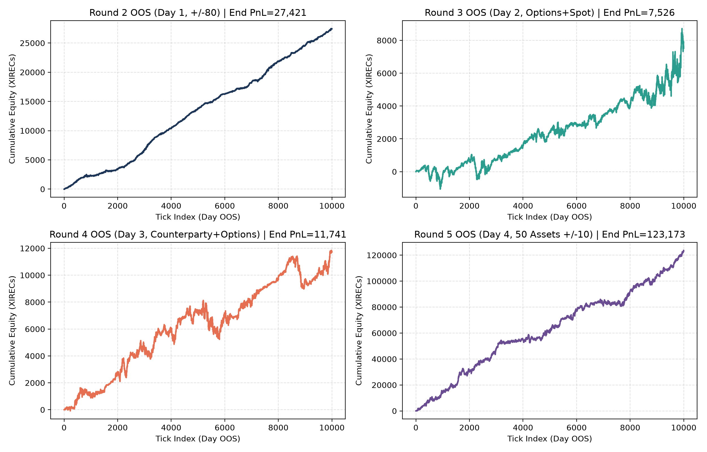
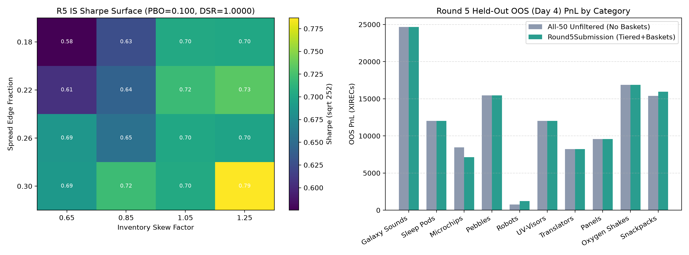
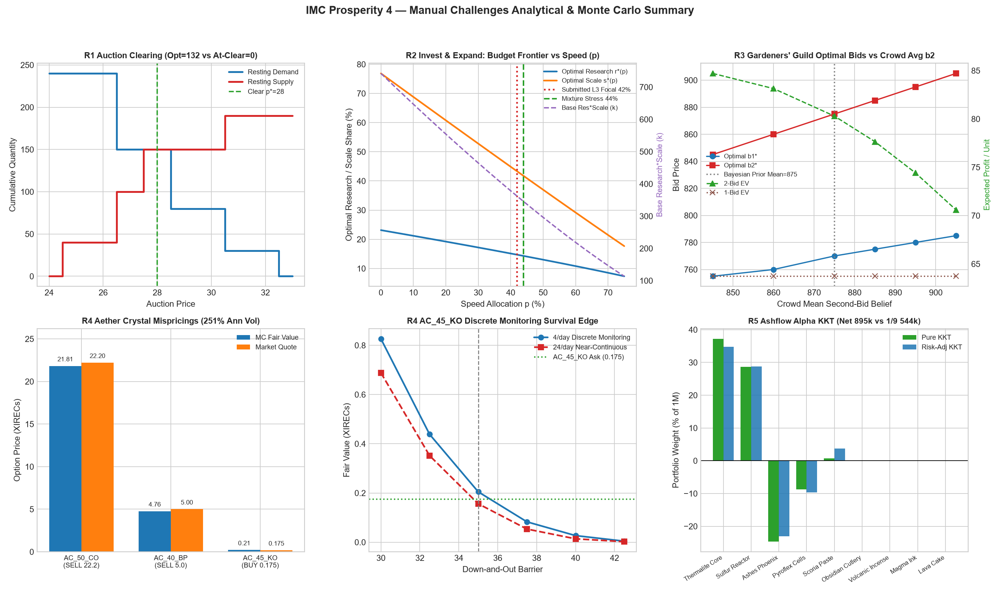

# IMC Prosperity 4 — Quantitative Trading Research & Multi-Round Strategy Portfolio

> **Core Deliverables**
> [Executive Monograph (`FINAL_WRITEUP.md`)](reports/FINAL_WRITEUP.md) ·
> [Compiled PDF Report (`2.5 MB`)](reports/IMC_Prosperity4_Research_Writeup.pdf) ·
> [Interactive HTML Tearsheet (`dashboard.html`)](reports/dashboard.html) ·
> [Manual Challenges Monograph (`MANUAL_CHALLENGES.md`)](docs/manual/MANUAL_CHALLENGES.md) ·
> [Architecture Overview](docs/architecture/system_overview.md) ·
> [GitHub CI Workflow](.github/workflows/ci.yml)

An end-to-end **Python 3.11** quantitative trading research codebase, queue-aware L1–L3 replay engine, vectorized Monte Carlo stress suite, combinatorial overfitting-control pipeline (`3x3` neighborhood plateaus, `CSCV PBO`, `DSR`, circular block bootstrap), and competition-compliant `Trader` archive spanning all five algorithmic and manual rounds of **IMC Prosperity 4**.

Every strategy in [`traders/`](traders/round5/README.md) is isolated from research tooling behind a strict AST- and runtime-verified boundary (`datamodel` + Python standard library only) and validated single-pass on chronological held-out **Out-of-Sample (`OOS`)** order books before reporting.

---

## 1. Out-of-Sample Performance Scorecard (`queue_aware`)

*Epistemic boundary: Every algorithmic metric below reports **simulated chronological out-of-sample replays** on archived historical exchange books under [`FillMode.QUEUE_AWARE`](src/prosperity_toolkit/execution/simulator.py) (`conservative` and `touch` sensitivity also logged), **not** live portal placements. Manual decisions were formulated strictly ex-ante from round specifications available prior to deadline.*

| Round | Strategy Architecture & Active Universe | `Q_max` | Held-Out OOS Day | OOS PnL (`queue_aware`) | OOS `Sharpe_252` (`95% Boot CI`) | Max Drawdown | `CSCV PBO` | `DSR` | Mean Tick Latency | Submission |
| :---: | :--- | :---: | :---: | ---: | :--- | ---: | :---: | :---: | ---: | :--- |
| **R1** | Bot-wall fair value, affine drift & penny-joining (`2` assets) | `20` *(config.)* | `Day 0` | **`+22,157.00`** | `1.1894` `[1.046, 1.329]` | `267.00` | `0.0860` | `1.0000` | `0.0340 ms` | [`round1`](traders/round1/README.md) |
| **R2** | Scaled skew + MAF auction flow pricing (`2` assets) | `80` | `Day 1` | **`+27,463.00`** | `1.3972` `[1.2314, 1.5823]` | `419.50` | `0.0000` | `1.0000` | `0.0406 ms` | [`round2`](traders/round2/README.md) |
| **R3** | Total-vol BS option surface, parity arb & delta band (`12` assets) | `200`/`300` | `Day 2` | **`+7,525.50`** | `0.2276` `[0.0097, 0.4392]` | `1,936.00` | `0.0000` | `0.9921` | `0.1872 ms` | [`round3`](traders/round3/README.md) |
| **R4** | `Mark 67` toxicity gating + plateau realignment (`12` assets) | `200`/`300` | `Day 3` | **`+11,741.00`** | `0.3613` `[0.0932, 0.6302]` | `2,901.00` | `0.0571` | `0.9975` | `0.1871 ms` | [`round4`](traders/round4/README.md) |
| **R5** | Lag-free `50`-asset MM, vol-guard & atomic `Pebbles` IOC (`50` assets) | `10` (`x50`) | `Day 4` | **`+123,173.00`** | `0.8109` `[0.5789, 1.0627]` | `6,205.50` | `0.1000` | `1.0000` | `0.6920 ms` | [`round5`](traders/round5/README.md) |
| **Total** | **Full Five-Round Production Stack** | — | — | **`+192,059.50`** | — | — | **`<= 0.1000`** | **`>= 0.9921`** | **`<= 0.6920 ms`** | [`FINAL_WRITEUP.md`](reports/FINAL_WRITEUP.md) |



---

## 2. Microstructure Edge & Research Progression (Rounds 1–5)

Across five competition stages, Naive textbook baselines break down sharply whenever market structure shifts (`SymmetricMM_80` loses `-20,294.50` in Round 2; fixed-horizon Black-Scholes loses `-7,604.00` in Round 3; EMA market making draws down `29,130.00` in Round 5). Each round's production strategy isolates the concrete microstructural cause before allocating risk:

1. **Bot-Wall Midpoint Denoising & Trend Extraction (`Rounds 1–2`)**:
   Two-sided exchange books feature deep institutional resting walls bracketed around `12–16` tick spreads with sporadic inside retail prints and `~7.5%` one-sided ticks (`~30` empty books/day). Extracting fair value from max-volume resting levels (`_popular_wall_mid`) rather than L1 top-of-book cuts step-to-step variance by `30.9%–40.0%`. Pairing stationary EMA filtering on `ASH_COATED_OSMIUM` with causal alpha-beta slope tracking on `INTARIAN_PEPPER_ROOT` (`+0.108`/tick drift) turns naive inventory blowout (`-20,294.50` OOS) into **`+22,157.00`** (`R1`) and **`+27,463.00`** (`R2`, `Sharpe_252 = 1.3972`). Calibrated Market Access Fee (MAF) stress suites show `+25%` arrival flow boosts 1,000-step EV by `+33.4%` (`5,065.52 -> 6,755.98`).
2. **Horizon-Invariant Volatility Surface & Delta Hedging (`Round 3`)**:
   Replacing the `R1–R2` pair with `HYDROGEL_PACK`, `VELVETFRUIT_EXTRACT`, and ten `VEV_4000..6500` call vouchers exposes fatal calendar-time error when plugging `TTE = 5` days into standard Black-Scholes (`OptionsVolatilityContract: -7,604.00` OOS), because option makers anchor closer to an `~8`-day implied schedule. Solving directly for **total implied volatility** $v_K = \sigma_K \sqrt{\tau}$ via bounded bisection removes expiry drift across unseen days, pairing `VEV_4000/4500` deep-ITM parity arbitrage and `HEDGE_BAND = 10` spot delta control with `15.7`-tick passive quoting on `HYDROGEL_PACK` (`+7,525.50` OOS).
3. **Counterparty Toxicity Filtering & Overfit Veto (`Round 4`)**:
   Revealing trade counterparty tags (`Mark 01..67`) inside `VELVETFRUIT_EXTRACT` uncovers asymmetric flow selection: pooled cross-asset mark-outs obscure signal, whereas single-symbol conditioning isolates informed buyer `Mark 67` (`+1.970`-tick permanent jump across `h = +1..50`) versus benign seller `Mark 49`. An aggressive spot-chasing candidate (`s_alpha = 0.85`) failed in-sample CSCV (`PBO = 0.9714`) and `DSR` (`0.9390 < 0.95`) and was **rejected**. Deploying plateau-aligned `Mark 67` skew (`M67_BUMP = 0.5, MM_EDGE = 5.5`) flipped `VELVETFRUIT_EXTRACT` OOS from `-328.50` (`R3`) to **`+1,027.00`**, trimmed drawdown **`-10.8%`** (`3,250.50 -> 2,901.00`), and raised `Sharpe_252` across every fill model (`0.3613` vs `0.3488` `Round3Ungated`).
4. **50-Asset Multi-Timescale Quoting & Atomic `Pebbles` Arbitrage (`Round 5`)**:
   Auditing `50` securities (`500,000` book rows/day, uniform `±10` caps) uncovers zero noise prints—all flow arrives in three synchronized category pulse clusters (`Group V` `40` symbols, `Pebbles` `5`, `Microchips` `5`)—plus two statistical arbitrage structures across radically different half-lives:
   - **Sub-tick Constant-Sum (`Pebbles`)**: $\sum_{i=1}^5 P_i = 50{,}000 \pm 2.82$ (`ADF t = -70.16`, `0.16`-tick OU half-life OOS). Decoupling **atomic 5-leg IOC crossing** from passive quotes earns **`+15,469.00`** OOS on `Pebbles` without adverse resting skew.
   - **Slow-Shifting Pair (`Snackpacks`) & Dynamic Vol-Guard (`Robots`/`Microchips`)**: Online causal tracking of `SNACKPACK_CHOCOLATE + VANILLA` daily equilibria $K_{\text{day}}$ ($r = -0.912$, `-98.2` tick cross-day shift) paired with spread-to-vol widening and full `QUOTE_CLIP = 10` sizing keeps **all 10 asset categories net profitable OOS** (`+123,173.00`, `88.3%` of single-day public-tape ceiling `139,448.5`, `MaxDD = 6,205.50`, `-78.7%` vs `EmaSymmetricMM_All50`).



---

## 3. Manual Challenges: Game Theory, Exotics & Final Portal Inputs (`R1–R5`)

Each one-shot manual challenge demands closed-form optimization over heterogeneous crowd beliefs, execution priority rules, and nonlinear cost curvature rather than brittle point guesses. Full derivations, Monte Carlo sensitivity grids, and exact vs. rounded inputs are documented in [`MANUAL_CHALLENGES.md`](docs/manual/MANUAL_CHALLENGES.md).

| Round | Challenge | Mathematical Mechanism & Ex-Ante Methodology | **Final Portal Inputs Submitted** | Primary Expected Outcome |
| :---: | :--- | :--- | :--- | :--- |
| **R1** | *An Intarian Welcome* | Sealed uniform clearing + back-of-queue arrival priority integrated over $\mathcal{N}(45, 22^2)$ human demand shocks | `DRYLAND_FLAX: Bid 30, Qty 65`<br>`EMBER_MUSHROOM: Bid 20, Qty 10` | `68.12` XIRECs (`96%` fill) / `9.81` (`73%` fill; guards `0.10` fee) |
| **R2** | *Invest & Expand* | Exact Research/Scale FOC $(100 - p - r^*)/(1+r^*) = \ln(1+r^*)$ + Level-`k` Poisson Cognitive Hierarchy (`tau = 1.5`: `L1 29.5% -> L2 37.5% -> L3 42.0%`) | `Research = 15%` (`14.71%`)<br>`Scale = 43%` (`43.29%`)<br>`Speed = 42%` (`42.0%`) | `246,036` L3 EV (`225,094` vs full blend; `44%` mixture stress check) |
| **R3** | *Celestial Gardeners' Guild* | Two-stage reserve screening (`{670..920}`) with cubic volume cliff integrated over $\bar{b}_2 \sim \mathcal{N}(875, 15^2)$ | `Bid 1 = 775, Bid 2 = 880` | `76.00` XIRECs/unit EV (`76.8%` fill vs `63.73` single bid) |
| **R4** | *Vanilla Just Isn't Exotic Enough* | `AETHER_CRYSTAL` (`S0=50, sigma_ann=251%, 15d`, `6h` discrete resets): BGK discrete continuity reveals `AC_45_KO` cheap (`0.2108` fair vs `0.175` ask) vs rich `AC_50_CO`/`AC_40_BP`; straddle min-var QP | `AC_50_CO: -15`, `AC_40_BP: -50`, `AC_45_KO: +198`, `AC_50_C15: +5`, `AC_50_P15: +21` | Cuts portfolio std **`-90.3%`** (`std = 297.48, CVaR95 = -575.5, SR = 0.0797`) |
| **R5** | *Extra! Extra!* | Ignith `9`-asset catalyst allocation under quadratic fee `(q/100)^2 * 1M` + story-uncertainty penalty ($\kappa = 3.0$) via exact $O(N \log N)$ KKT thresholding | `Thermalite +35%, Sulfur +29%, Ashes -23%, Pyroflex -10%, Scoria +3%`, others `0%` | **`893,544`** Net EV (`895,380` pure KKT vs `544,444` equal `1/9`) |



---

## 4. Simulator Fidelity, Anti-Overfitting Stack & Monte Carlo Risk

To prevent standard historical-replay blind spots ([`backtesting_methodology.md`](docs/methodology/backtesting_methodology.md), [`statistical_validation.md`](docs/methodology/statistical_validation.md)), our validation harness enforces:

- **Three Explicit Fill Regimes**: Every strategy evaluates under `conservative` (strictly through quote), `queue_aware` (deducting resting depth $V_{\text{ahead}}$ at touch), and `touch` (upper sensitivity bound), alongside carry-forward missing-book marking (`PM-001`) and starting-inventory batch limit cancellation ([`backtesting_engine.md`](docs/architecture/backtesting_engine.md)).
- **Five Overfitting Gates Before OOS Evaluation**:
  1. Strict chronological `IS / OOS` freeze (one unseen terminal day per round).
  2. Coarse 2D grid sweep selecting the **$3 \times 3$ neighborhood plateau** ($\mu_{\mathcal{N}} - \lambda\sigma_{\mathcal{N}}$) over brittle isolated peaks.
  3. **Combinatorially Symmetric Cross-Validation (`CSCV`, $S=8$, `70` splits)** requiring `PBO < 0.15`.
  4. **Deflated Sharpe Ratio (`DSR >= 0.95`)** adjusting for effective independent trials $N_{\text{eff}}$, skewness, and kurtosis.
  5. **Circular Block Bootstrap** (`block = 100, B = 1,000`) plus **Calibrated Monte Carlo Ensembles** (exact OU discretization, correlated option jumps, and synchronized pulse blocks):

| Round | Scenario / Strategy | Mean MC PnL | `VaR 95%` | `CVaR 95%` | Prob. of Loss | Mean `Sharpe_252` | Source Table |
| :---: | :--- | ---: | ---: | ---: | :---: | ---: | :--- |
| **R1** | `SymmetricMM` *(baseline, N=30, 500t)* | `359.52` | `-451.87` | `-774.25` | `20.0%` | `0.5393` | [`r1_mc_risk_summary.csv`](reports/tables/r1_mc_risk_summary.csv) |
| **R1** | `Round1Submission` *(N=30, 500t)* | **`900.48`** | `446.18` | `344.25` | **`0.0%`** | `1.7084` | [`r1_mc_risk_summary.csv`](reports/tables/r1_mc_risk_summary.csv) |
| **R2** | `Round2Submission` (`Baseline` / `+25% MAF`) | `5,065.52` / `6,755.98` | `3,578.20` / `5,578.00` | `3,463.25` / `5,487.25` | **`0.0%`** | `2.8362` / `3.6416` | [`r2_to_r5_mc_risk_summary.csv`](reports/tables/r2_to_r5_mc_risk_summary.csv) |
| **R3** | `Round3Submission` *(coupled options+spot)* | `2,448.56` | `1,137.00` | `1,121.25` | **`0.0%`** | `0.5189` | [`r2_to_r5_mc_risk_summary.csv`](reports/tables/r2_to_r5_mc_risk_summary.csv) |
| **R4** | `Round4Submission` *(flow + options)* | `2,345.10` | `1,692.40` | `1,116.75` | **`0.0%`** | `0.4966` | [`r2_to_r5_mc_risk_summary.csv`](reports/tables/r2_to_r5_mc_risk_summary.csv) |
| **R5** | `Round5Submission_JointMC` *(50-asset pulse)* | **`14,876.42`** | `6,495.55` | `2,649.00` | **`0.0%`** | `1.6066` | [`r2_to_r5_mc_risk_summary.csv`](reports/tables/r2_to_r5_mc_risk_summary.csv) |

---

## 5. Repository Structure & Reviewer Navigation

- **Quick Executive Overview**: [`reports/FINAL_WRITEUP.md`](reports/FINAL_WRITEUP.md) · [`reports/IMC_Prosperity4_Research_Writeup.pdf`](reports/IMC_Prosperity4_Research_Writeup.pdf) · [`reports/dashboard.html`](reports/dashboard.html)
- **Round-by-Round Research Analyses**: [`round_1.md`](docs/rounds/round_1.md) · [`round_2.md`](docs/rounds/round_2.md) · [`round_3.md`](docs/rounds/round_3.md) · [`round_4.md`](docs/rounds/round_4.md) · [`round_5.md`](docs/rounds/round_5.md) · [`final_round.md`](docs/rounds/final_round.md)
- **Quantitative Topic Monographs**: [`market_microstructure.md`](docs/research/market_microstructure.md) · [`fair_value_estimation.md`](docs/research/fair_value_estimation.md) · [`market_making.md`](docs/research/market_making.md) · [`inventory_management.md`](docs/research/inventory_management.md) · [`options_pricing.md`](docs/research/options_pricing.md) · [`arbitrage.md`](docs/research/arbitrage.md)
- **Engine, Validation & Failures**: [`system_overview.md`](docs/architecture/system_overview.md) · [`backtesting_engine.md`](docs/architecture/backtesting_engine.md) · [`data_pipeline.md`](docs/architecture/data_pipeline.md) · [`monte_carlo_simulator.md`](docs/architecture/monte_carlo_simulator.md) · [`statistical_validation.md`](docs/methodology/statistical_validation.md) · [`limitations.md`](docs/limitations.md) · [`postmortem.md`](docs/postmortem.md)
- **Experiment Logs (`EXP-R1`–`EXP-R5`)**: [`docs/experiments/README.md`](docs/experiments/README.md)
- **Executed Research Notebooks**: [`01_data_exploration.ipynb`](notebooks/01_data_exploration.ipynb) · [`02_market_microstructure.ipynb`](notebooks/02_market_microstructure.ipynb) · [`03_fair_value_analysis.ipynb`](notebooks/03_fair_value_analysis.ipynb) · [`04_strategy_comparison.ipynb`](notebooks/04_strategy_comparison.ipynb) · [`05_parameter_optimisation.ipynb`](notebooks/05_parameter_optimisation.ipynb)

```text
.
├── .github/workflows/      # GitHub Actions CI (ruff, mypy, 5x submission validation, pytest)
├── src/prosperity_toolkit/ # Modular research package (data, execution, backtesting, simulation, analysis, visualisation)
├── traders/round{1..5}/    # Standalone AST-verified Trader implementations + round strategy cards
├── scripts/                # Reproducible CLI pipelines (EDA, R1-R5 backtests, manual solvers, dashboard, PDF)
├── tests/                  # Unit and end-to-end integration tests (102 checks)
├── docs/                   # Architecture, methodology, microstructure research, rounds R1-R5, manual derivations
├── notebooks/              # Executed Jupyter notebooks (01-05) with inline tables & Matplotlib figures
├── data/                   # Immutable raw CSVs (round0-5) + SHA-256 manifest registry
└── reports/                # Generated figures, CSV summary tables, HTML tearsheet & standalone PDF monograph
```

---

## 6. Reproducible Setup & Verification

Using `uv` (Python `>=3.11,<3.13`):

```bash
uv sync --locked --group dev
```

### Run Quality, Typing & Submission Validation Gates

```bash
# Unit and integration tests (102 tests)
uv run pytest

# Lint, formatting & strict static type checks (104 files)
uv run ruff check .
uv run mypy .

# Validate every competition submission AST, datamodel API & stdlib boundary
uv run python scripts/validate_submission.py traders/round1/submission.py
uv run python scripts/validate_submission.py traders/round2/submission.py
uv run python scripts/validate_submission.py traders/round3/submission.py
uv run python scripts/validate_submission.py traders/round4/submission.py
uv run python scripts/validate_submission.py traders/round5/submission.py
```

### Reproduce Research Tables, Figures, Dashboard & PDF Monograph

```bash
# Audit all 34 raw CSV files against SHA-256 manifest
uv run python scripts/audit_all_datasets.py

# Round 1 IS/OOS ablations, CSCV, DSR, bootstrap & MC artifacts
uv run python scripts/generate_report.py

# Rounds 2-5 cross-round EDA, ablations, overfitting gates & MC stress suites
uv run python scripts/eda_rounds2_to_5.py
uv run python scripts/evaluate_rounds2_to_5.py

# Manual Challenges (R1-R5), interactive HTML tearsheet & standalone PDF monograph
uv run python scripts/evaluate_manual_challenges.py
uv run python scripts/build_dashboard.py
uv run python scripts/build_pdf_writeup.py
```

---

## 7. Data Integrity, Attribution & Epistemic Standards

- Historical market books reside unmodified under [`data/raw/prosperity4/`](data/README.md) with filenames, row/warning audits, and SHA-256 hashes verified in [`prosperity4_manifest.json`](data/manifests/prosperity4_manifest.json).
- All empirical figures strictly distinguish **observed exchange data**, **in-sample fitted parameters**, **queue-aware simulated replays**, **synthetic Monte Carlo distributions**, and **explicitly parameterized manual-challenge beliefs**.
- Full engineering caveats, configurable assumption disclosures (such as `Round 1` position limit `20` vs `Round 2` `±80`), and resolved historical bugs (`PM-001`–`PM-005`) are documented in [`limitations.md`](docs/limitations.md) and [`postmortem.md`](docs/postmortem.md).
