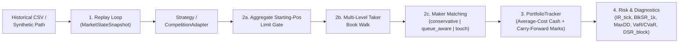

# Architecture: Backtesting & Execution Engine

## 1. Disentangling Simulation Components

Conflating data replay, order matching, inventory accounting, and stochastic stress-testing inside a monolithic loop obscures execution assumptions and silently leaks future information. This toolkit isolates four explicit responsibilities:

---

## 2. Order Matching, Causality & Queue Conservation (`execution/simulator.py`)

### A. Starting-Position Limit Verification
Before any fill executes on tick $t$, `validate_orders_against_limits` checks the aggregate worst-case buy and sell exposure against the tick's **starting inventory** $q_{\text{start}}$:
$$q_{\text{start}} + \sum_{o:\,Q_o > 0} Q_o \le Q_{\max}, \qquad q_{\text{start}} + \sum_{o:\,Q_o < 0} Q_o \ge -Q_{\max}$$
When `reject_on_limit_breach=True` (mirroring exchange behavior), any violation cancels the entire batch of orders for that product on that tick; when `False` (strict unit/integration tests), `PositionLimitExceededError` is raised immediately.

### B. Multi-Level Taker Matching (`match_taker_with_remainder`)
Crossing orders walk the sorted opposite book ladder (`sorted(asks)` for buys, `sorted(bids, reverse=True)` for sells), filling sequentially across L1, L2, and L3 levels up to available resting depth. Remaining resting liquidity is decremented inside the tick so multiple orders cannot double-consume the same level. Any unfilled remainder passes to passive maker matching.

### C. Maker Fill Regimes & Price-Time Queue Conservation (`match_maker_orders`)
Passive orders are evaluated against contemporaneous market trades under three explicit fill models using a shared mutable `remaining_trade_volumes` budget:
1. **`conservative`**: Fills a resting buy only if a trade prints *strictly through* the limit ($P_{\text{trade}} < P_{\text{limit}}$), and a resting sell only if $P_{\text{trade}} > P_{\text{limit}}$.
2. **`queue_aware`**: Sorts same-direction resting orders strictly by price-time priority (`(-price, idx)` for bids, `(price, idx)` for asks). When $P_{\text{trade}} == P_{\text{limit}}$, only trade volume *exceeding* the exchange's resting book depth $V_{\text{ahead}}$ at that level is allocated sequentially across orders sharing that level; quotes strictly inside the spread ($V_{\text{ahead}} = 0$) receive zero-queue fill priority without double-counting volume across same-tick orders.
3. **`touch`**: Fills against remaining available trade volume whenever $P_{\text{trade}}$ reaches or crosses $P_{\text{limit}}$ (used strictly as an upper sensitivity bound to check touch-fill sensitivity).

### D. Strict Event Causality (`backtesting/engine.py`, `competition/adapter.py`)
Strategies at tick $t$ never observe contemporaneous prints executed at timestamp $t$:
- `CompetitionStrategyAdapter` delivers `own_trades` from tick $t - 100$ (fills generated at tick $t - 100$) and `market_trades` executed strictly prior to $t$ (`prior_market_trades`).
- Contiguous equity updates prepending tick `0` (`np.diff(equity_curve, prepend=0.0)`) avoid off-by-one return shifts and preserve full `10,000`-tick sample alignment.

---

## 3. Portfolio Accounting & Missing-Book Mark Continuity (`backtesting/portfolio.py`)

`PortfolioTracker` separates realized PnL via average-cost inventory tracking (`avg_entry_price`) from unrealized mark-to-market equity $V_t = C_t + \sum_i q_{i,t} M_{i,t}$. Because historical rounds (notably Rounds 1 and 2) contain one-sided (`~7.5%`) and completely empty (`~0.14%–0.22%`) books where instantaneous `mid_price` is undefined (`None`), `BacktestEngine` maintains `last_marks[sym]`—carrying forward the last valid two-sided mid-price across empty/one-sided ticks rather than falsely marking inventory to `0.0` (see [PM-001](../postmortem.md)).
