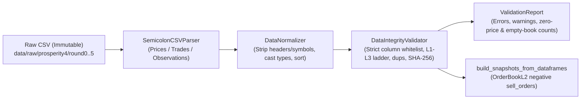

# Architecture: Data Pipeline & Integrity Verification

## 1. Raw Market Data Ingestion & Immutability

The IMC Prosperity 4 exchange exports two historical feeds per trading day across all `6` competition stages (Rounds 0–5, `34` CSV files total) as UTF-8, semicolon-delimited (`;`) CSVs:
1. **Prices & Level 1–3 Order Book Depths (`prices_round_<R>_day_<D>.csv`)**: `17` columns capturing `day`, `timestamp`, `product`, 3 levels of bid/ask prices and volumes, `mid_price`, and `profit_and_loss`.
2. **Public Executed Trades (`trades_round_<R>_day_<D>.csv`)**: `7` columns capturing `timestamp`, `buyer`, `seller`, `symbol`, `currency` (`XIRECS`), `price`, and `quantity`.
3. **Optional Conversion Observations (`observations_round_<R>_day_<D>.csv`)**: Supported explicitly via [`schemas.py`](../../src/prosperity_toolkit/data/schemas.py) (`OBSERVATION_CSV_COLUMNS` matching `ConversionObservation`), though absent in all Prosperity 4 Round 0–5 datasets.

Files under `data/raw/` remain strictly immutable read-only artifacts, hashed via `compute_sha256()` and indexed in [`prosperity4_manifest.json`](../../data/manifests/prosperity4_manifest.json).

---

## 2. Ingestion, Validation & Manifest Verification

- **Unified Ingestion**: `DataLoader.ingest_csv` and `validate_csv_file` share a single normalization and validation pipeline.
- **Immutable CI Gate**: `python scripts/audit_all_datasets.py --verify-only` checks all `34` raw CSVs against committed SHA-256 digests and schemas without regenerating files, enforced in [`.github/workflows/ci.yml`](../../.github/workflows/ci.yml).
- **Cross-Round Rolling Window Awareness**: `round3` (`Days 0, 1, 2`) and `round4` (`Days 1, 2, 3`) share **byte-identical price files on `Day 1` and `Day 2`** (`trades` differ only by populated Round 4 `buyer`/`seller` counterparty IDs), and `round2` (`Day -1, 0`) shares price/trade history with `round1`. All validation splits account explicitly for this rolling-window structure (see [`limitations.md`](../limitations.md)).

---

## 3. Empirical Schema Edge Cases Handled Across Rounds 0–5

Direct auditing of all **`34` raw datasets** uncovered five concrete edge cases handled deterministically by `DataIntegrityValidator`:

1. **Inverted Ask-Volume Sign Convention**: Raw CSVs store `ask_volume_{1,2,3}` as **positive** integers, whereas `OrderDepth.sell_orders` requires **negative** integers (`build_snapshots_from_dataframes` enforces `-abs(int(av))`).
2. **Empty Order Books (`mid_price == 0.0`)**: In Round 1 & Round 2 (`ASH_COATED_OSMIUM` and `INTARIAN_PEPPER_ROOT`), `28–38` rows/day have both bid and ask empty, logged with `mid_price == 0.0`. `DataIntegrityValidator` permits `mid_price == 0.0` strictly when both `bid_price_1` and `ask_price_1` are `NaN`, rejecting non-empty zero mid-prices.
3. **One-Sided Order Books (`~7.5%` of Round 1–2 ticks)**: Round 1 (`1,480–1,563`/day) and Round 2 (`1,475–1,500`/day) record the remaining single quote as `mid_price` when one side vanishes; Rounds 0, 3, 4, and 5 are `100.0%` two-sided (`0` empty/one-sided rows).
4. **Zero-Price Deep-OTM Voucher Quotes & Trades (Rounds 3–4)**: Deep out-of-the-money call vouchers `VEV_6000` and `VEV_6500` quote `bid_price_1 == 0, ask_price_1 == 1` across all `10,000` ticks/day and execute `182–253` zero-price trade prints/day when bots sell into the `0`-bid. `DataIntegrityValidator` strictly rejects **negative** quotes/trades (`< 0`) while logging `0.0` trades as structured audit warnings.
5. **Counterparty Population & Duplicate Prints**: `buyer`/`seller` columns (`Mark 01..67`) are populated solely in Round 4; Round 1 `Day -2` trades contain `2` exact duplicate rows flagged cleanly as warnings while duplicate `(timestamp, product)` rows in price tables trigger hard errors. Unexpected extra columns fail validation explicitly (`Unexpected columns in ... dataframe`).
