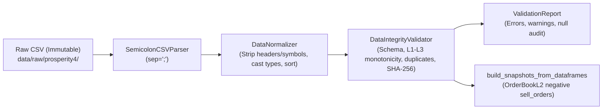

# Architecture: Data Pipeline & Integrity Verification

## 1. Raw Market Data Ingestion & Immutability

The IMC Prosperity 4 exchange exports two primary historical feeds per trading day as UTF-8, semicolon-delimited (`;`) CSV files:
1. **Prices & Level 1–3 Order Book Depths (`prices_round_<R>_day_<D>.csv`)**: 17 columns capturing `day`, `timestamp`, `product`, 3 levels of bid/ask prices and volumes, `mid_price`, and `profit_and_loss`.
2. **Public Executed Trades (`trades_round_<R>_day_<D>.csv`)**: 7 columns capturing `timestamp`, `buyer`, `seller`, `symbol`, `currency` (`XIRECS`), `price`, and `quantity`.

To guarantee strict data hygiene, files in `data/raw/` are treated as immutable read-only sources. Every ingested file is assigned a cryptographic **SHA-256 checksum** via `compute_sha256()` and logged in [data/README.md](../../data/README.md).

---

## 2. Ingestion & Validation Lifecycle

---

## 3. Empirical Schema Edge Cases Handled

Direct inspection of the ingested Round 0 (`4` files) and Round 1 (`6` files) raw datasets uncovered four critical edge cases that naive CSV parsers mishandle:

1. **Inverted Ask-Volume Sign Convention**:
   - Raw CSVs store `ask_volume_{1,2,3}` as **positive** integers, whereas the Prosperity `OrderDepth.sell_orders` contract requires **negative** integers. `build_snapshots_from_dataframes` enforces `asks[int(ap)] = -abs(int(av))` during snapshot reconstruction.
2. **Empty Order Books (`mid_price == 0.0`)**:
   - In Round 1 `ASH_COATED_OSMIUM`, `34–35` ticks per day have **both** bid and ask books completely empty, recorded by the exchange with `mid_price == 0.0`.
   - `DataIntegrityValidator` explicitly permits `mid_price == 0.0` *only* when `bid_price_1` and `ask_price_1` are both `NaN` (emitting an audit warning with the exact row count), while raising `DataValidationError` if `mid_price == 0.0` appears on a non-empty book or if `mid_price < 0`.
3. **One-Sided Order Books (`7.5%–8.0%` of Round 1 ticks)**:
   - When one side of the book vanishes, the exchange logs the remaining single side's price as `mid_price`, injecting $\pm 8$ tick jumps into raw `mid_price` series. Research and mark-to-market layers handle one-sided ticks explicitly via `extract_two_sided_mid()` and carry-forward valuation.
4. **Duplicate Trade Prints**:
   - `trades_round_1_day_-2.csv` contains `2` exact duplicate trade rows (identical timestamp, symbol, price, and quantity with empty `buyer`/`seller`). `DataIntegrityValidator.detect_trade_duplicates()` flags exact trade duplicates as warnings (since multiple identical bot prints can occur on the same tick), while rejecting duplicate `(timestamp, product)` rows in price tables as hard errors.

---

## 4. Microstructural Invariants Enforced

1. **Spread Positivity**: On every two-sided row, $P_{\text{ask}, 1}(t) - P_{\text{bid}, 1}(t) > 0$.
2. **Strict L1–L3 Ladder Monotonicity**:
   $$P_{\text{bid}, 1} > P_{\text{bid}, 2} > P_{\text{bid}, 3}, \qquad P_{\text{ask}, 1} < P_{\text{ask}, 2} < P_{\text{ask}, 3}$$
3. **Volume Positivity**: All non-null level volumes and trade quantities must be strictly positive.
4. **Discrete Timestamp Continuity**: `validate_timestamp_continuity()` verifies uniform `100`-unit steps ($t_k - t_{k-1} = 100$ across $t \in [0, 999{,}900]$).
