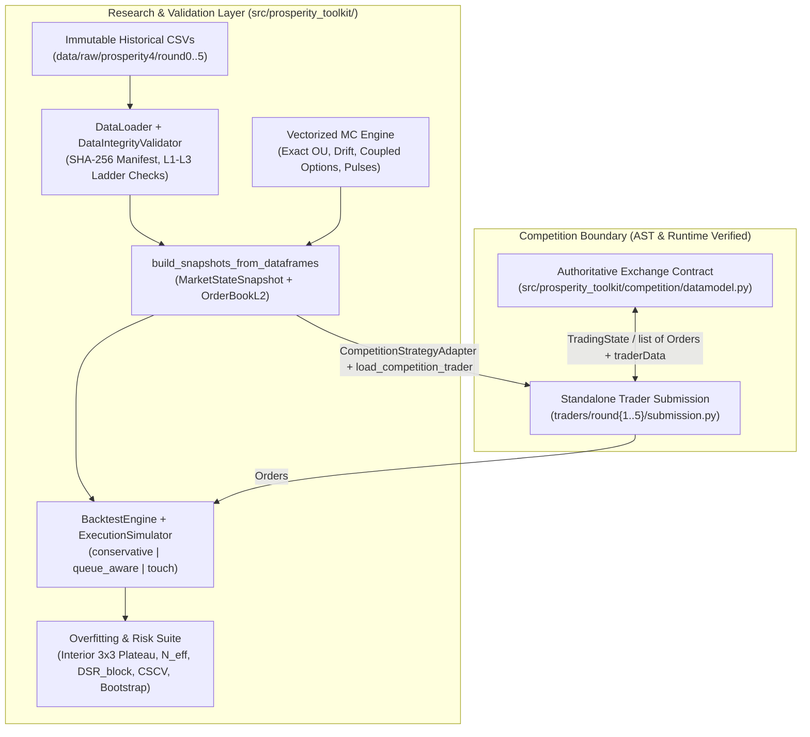

# Architecture: System Overview

## 1. Dual-Layer Architecture & Submission Boundary

The **IMC Prosperity 4 Research Toolkit** enforces a strict architectural separation between **research infrastructure** and **competition execution**:

1. **Research, Simulation & Validation Library ([`src/prosperity_toolkit/`](../../src/prosperity_toolkit/))**: A strictly typed Python 3.11 package (`numpy`, `pandas`, `scipy`, `matplotlib`) handling historical CSV auditing, L1–L3 order-book reconstruction, queue-aware execution matching, vectorized Monte Carlo stress paths, and overfitting diagnostics (`DSR_block`, `CSCV PBO`, `N_eff`, circular block bootstrap).
2. **Standalone Competition Submissions ([`traders/round1/`](../../traders/round1/submission.py)–[`traders/round5/`](../../traders/round5/submission.py))**: Self-contained single-file `Trader` implementations importing strictly from `datamodel` and Python's standard library (`json`, `math`, `statistics`, `typing`), enforced automatically by [`validate_submission.py`](../../scripts/validate_submission.py) via AST allowlist inspection.

---

## 2. Exchange Runtime Contract & Boundary Enforcements

Competition code cannot import research modules or external scientific libraries (`numpy`, `pandas`, `scipy`), nor retain hidden mutable module globals across live sandbox restarts. [`CompetitionStrategyAdapter`](../../src/prosperity_toolkit/competition/adapter.py) bridges the two layers during local backtests via `load_competition_trader(...)`, feeding authentic `TradingState` instances from each `MarketStateSnapshot` directly into the exact submission files:

- **State Isolation (`state.traderData`)**: Running online estimates (bot-wall EWMA midpoints, fixed `10,000` OU anchor, Black-Scholes total-volatility trackers $v_K$, causal prior-tick `Mark 14` / `Mark 55` counterparty flow signals, and `MICROCHIP_CIRCLE` 50/100/150/200-tick lag circular buffers) serialize defensively into compact JSON strings with safe fallbacks for empty or malformed payloads.
- **Per-Symbol Batch Limit Cancellation**: [`ExecutionSimulator.validate_orders_against_limits`](../../src/prosperity_toolkit/execution/simulator.py) verifies starting-inventory worst-case exposure (`start_pos + sum_buys <= limit` and `start_pos + sum_sells >= -limit`), cancelling the offending symbol batch cleanly if breached rather than accepting partial violations.
- **CLI & CI Integration**: [`scripts/run_backtest.py`](../../scripts/run_backtest.py) and `python -m prosperity_toolkit.cli replay` accept `--round`, `--submission`, and `--fill-mode`, while [`.github/workflows/ci.yml`](../../.github/workflows/ci.yml) runs `audit_all_datasets.py --verify-only`, `ruff`, `mypy`, AST checks on all 5 submissions, and `pytest`.

---

## 3. Subsystem Directory & Further Reading

| Package / Module | Core Responsibility | Deep-Dive Blueprint |
| :--- | :--- | :--- |
| [`data/`](../../src/prosperity_toolkit/data/) | Semicolon CSV parsing, schema whitelists, empty/zero-bid edge handling, SHA-256 manifests | [Data Pipeline Architecture](data_pipeline.md) |
| [`execution/`](../../src/prosperity_toolkit/execution/) & [`backtesting/`](../../src/prosperity_toolkit/backtesting/) | Strict price-time maker queue conservation, multi-level taker book walk, causal `t - 100` trade delivery, average-cost accounting | [Backtesting & Execution Engine](backtesting_engine.md) |
| [`simulation/`](../../src/prosperity_toolkit/simulation/) | Exact OU transition sampling, correlated multi-asset pulse blocks, `fill_mode` propagation, adverse-selection stress & `wilson_ci_upper` | [Monte Carlo Simulator](monte_carlo_simulator.md) |
| [`analysis/`](../../src/prosperity_toolkit/analysis/) | Bot-wall denoising, total implied vol inversion, mark-outs, PCA/ADF/OU tests, `N_eff`, `DSR_block`, CSCV, manual solvers | [Statistical Validation](../methodology/statistical_validation.md) |
| [`optimisation/`](../../src/prosperity_toolkit/optimisation/) | Coarse 2D grid sweeps and interior $3 \times 3$ neighborhood stability selection (`require_interior=True`) | [Backtesting Methodology](../methodology/backtesting_methodology.md) |
| [`visualisation/`](../../src/prosperity_toolkit/visualisation/) | High-DPI Matplotlib diagnostics, self-contained HTML tearsheet, and A4 PDF compiler | [`scripts/build_dashboard.py`](../../scripts/build_dashboard.py) & [`scripts/build_pdf_writeup.py`](../../scripts/build_pdf_writeup.py) |
