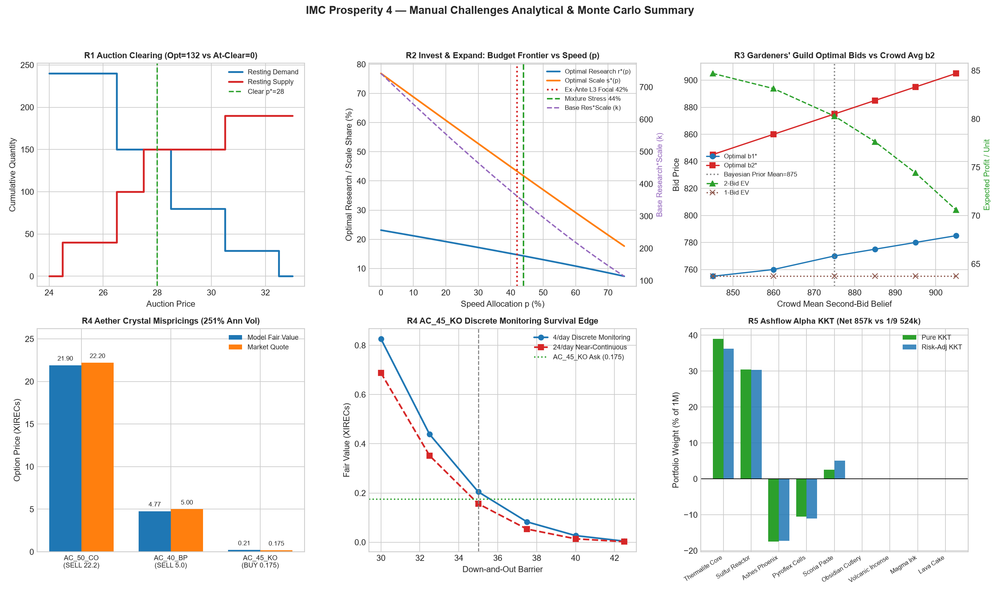

# Manual Challenges: Game Theory, Derivatives & Final Submissions (Rounds 1–5)

Unlike the algorithmic exchange rounds—where historical order-book ticks let us test strategies iteratively against resting bot depth—each manual challenge in IMC Prosperity 4 demands a single, irreversible allocation submitted directly in the round portal. Because outcomes depend on stochastic payoff dynamics and strategic interactions across thousands of competing teams, every decision below is built strictly ex-ante from first principles and concludes with the exact final portal inputs submitted for that round.

## Summary of Final Submitted Portal Inputs (Rounds 1–5)

| Round | Challenge Name | Final Inputs Submitted | Expected Metric / Model Rationale |
| :---: | :--- | :--- | :--- |
| **R1** | *An Intarian Welcome* | **`DRYLAND_FLAX`: `Bid 30, Qty 65`**; **`EMBER_MUSHROOM`: `Bid 20, Qty 10`** | Guards `96%` fill prob (`68.12` EV) under uncertain demand on Flax; caps Mushroom sizing (`9.81` EV) against `0.10`/unit clearing fee |
| **R2** | *Invest & Expand* | **`Research = 15%` (`14.71%`), `Scale = 43%` (`43.29%`), `Speed = 42%`** | Exact Level-3 Cognitive Hierarchy focal equilibrium (`246,036` L3 EV; `225,094` vs blended crowd) |
| **R3** | *Celestial Gardeners' Guild* | **`Bid 1 = 775, Bid 2 = 880`** | Bayesian optimization across $\bar{b}_2 \sim \mathcal{N}(875, 15^2)$ (`76.00` EV/unit vs `63.73` single bid; guards cubic penalty cliff) |
| **R4** | *Aether Crystal Exotics* | **`AC_50_CO: -15` (`SELL`), `AC_40_BP: -50` (`SELL`), `AC_45_KO: +198` (`BUY`), `AC_50_C15: +5`, `AC_50_P15: +21`** | Exploits `+20.5%` discrete `4/day` survival edge on `AC_45_KO` while cutting portfolio variance `-90.3%` via vanilla straddle (`Sharpe 0.0797` vs `0.0221`) |
| **R5** | *Extra! Extra! (Ignith)* | **`Thermalite +35%, Sulfur +29%, Ashes -23%, Pyroflex -10%, Scoria +3%`**; `Obsidian/Incense/Ink/Lava = 0%` | Variance-penalized KKT water-filling ($\kappa = 3.0$, exact `34.8 / 28.8 / -23.1 / -9.7 / 3.7%`, `893.5k` Net EV vs `544.4k` `1/9`) |

## 1. Round 1 — *An Intarian Welcome* (Walrasian Auction & Queue Depletion)

### Auction Rules and Queue Mechanics
Round 1 opens with a sealed uniform-price auction across two commodities backed by fixed merchant guild buybacks:
- **Dryland Flax**: guaranteed guild buyback at $V = 30$ with zero transaction fee ($c = 0$).
- **Ember Mushroom**: guild buyback at $V = 20$ with a $c = 0.10\text{/unit}$ clearing fee.

All orders clear simultaneously at the price $p^*$ maximizing traded volume:
$$p^* = \arg\max_p \min\bigl(D(p), S(p)\bigr), \qquad D(p) = \sum_{p_i \ge p,\; q_i > 0} q_i, \quad S(p) = \sum_{p_j \le p,\; q_j < 0} (-q_j)$$
with two rules that completely reshape optimal sizing:
1. If multiple prices tie on matched volume, the exchange selects the **strictly highest tied price**.
2. Orders match by **price priority first, then arrival order**—meaning any late human order sits at the **very back of the queue** at its submitted price level.

### Strategic Tension: Queue Jumping Without Price Tipping
Submitting a passive buy right at the resting clearing price $p_{\text{rest}}^*$ is frequently a trap. Because resting orders at $p_{\text{rest}}^*$ already fill the queue, late entrants placed at the back of $p_{\text{rest}}^*$ collect zero units whenever supply is exhausted by resting bids. Stepping up one tick to $p = p_{\text{rest}}^* + 1$ jumps the entire resting queue at $p_{\text{rest}}^*$. Yet that jump carries an immediate size constraint: if your bid quantity $q$ pushes cumulative demand at $p_{\text{rest}}^* + 1$ high enough to match or exceed cumulative matched volume at $p_{\text{rest}}^*$, the high-price tie-breaker pulls the uniform clearing price itself up to $p_{\text{rest}}^* + 1$, compressing profit per unit across your entire fill.

On our illustrative **Dryland Flax** book solved in [`clear_opening_auction`](file:///c:/Users/pierr/Desktop/imc-prosperity-4-toolkit-writeup/src/prosperity_toolkit/analysis/manual_challenges.py#L44):
- Without our order, clearing sits at $p_{\text{rest}}^* = 28$ on `150` units of matched flow. Bidding right at `28` yields **`0.00` XIRECs** (`0` filled behind resting bids).
- Bidding `(px=29, qty=66)` leaps ahead of the `70` resting units at `28` without tipping clearing above `28`, capturing `66` lots at `28` for **`132.00` XIRECs**. Increasing size past `69` trips the tie-breaker to `29` and cuts profit nearly in half.

Because a live auction also absorbs unpredictable competing human demand around the clearing boundary, [`solve_round1_uncertain_demand`](file:///c:/Users/pierr/Desktop/imc-prosperity-4-toolkit-writeup/src/prosperity_toolkit/analysis/manual_challenges.py#L583) integrates expected PnL over `250` random human demand draws ($\mathcal{N}(45, 22^2)$ on Flax, $\mathcal{N}(30, 15^2)$ on Mushroom):
- **Dryland Flax Final Submission (`px = 30, qty = 65`)**: Raising the limit to `30` (equal to buyback $V$, never above) defends fill probability (`96%` fill rate) when other human bids nudge clearing up to `29` without exposing the fill to winner's-curse overpaying (`68.12` XIRECs EV; bidding `31` loses money whenever clearing prints `31`).
- **Ember Mushroom Final Submission (`px = 20, qty = 10`)**: The `0.10`/unit fee reduces net ceiling to `19.90`; sizing small (`qty = 10`) captures positive expected surplus (`9.81` XIRECs EV, `73%` fill rate) across uncertain human depth without taking uncapped fee losses if crowding pins clearing at `20`.

## 2. Round 2 — *Invest & Expand* (Cognitive Hierarchy Equilibrium & Speed Allocation)

Round 2 shifts from clearing auctions to strategic budget allocation. Given a `50,000`-XIREC budget normalized across percentages $(r, s, p) \ge 0$ ($r + s + p \le 100$), teams split capital between **Research** ($r$), **Scale** ($s$), and **Speed** ($p$):

$$\text{Research}(r) = 200{,}000 \cdot \frac{\ln(1 + r)}{\ln(101)}, \qquad \text{Scale}(s) = 0.07 \cdot s, \qquad \text{Speed}(p) \in [0.1, 0.9]$$

$$\Pi_{\text{net}}(r, s, p) = \text{Research}(r) \cdot \text{Scale}(s) \cdot \text{Speed}(p) - 500(r + s + p)$$

where $\text{Speed}(p)$ is an increasing function solely of a team's **percentile rank** across all cohort Speed submissions ($0.1$ at the 0th percentile, $0.9$ at the 100th).

### Exact Internal Decomposition Between Research and Scale
Because Speed enters purely multiplicatively, Research $\times$ Scale separates cleanly for any remaining budget $R := 100 - p$. Once `Speed(p)` clears roughly `0.15`, leaving budget unspent is strictly suboptimal. Conditioning on any Speed share $p$, choosing $r$ to maximize $\ln(1 + r)(R - r)$ gives the closed-form first-order condition:

$$\frac{R - r^*}{1 + r^*} = \ln(1 + r^*)$$

Solved via bounded bisection in [`optimal_research_given_speed`](file:///c:/Users/pierr/Desktop/imc-prosperity-4-toolkit-writeup/src/prosperity_toolkit/analysis/manual_challenges.py#L645), every Speed share maps uniquely to an optimal `(Research, Scale)` pair:

| Speed Share $p$ | Remaining Budget $R = 100 - p$ | Optimal Research $r^*(p)$ | Optimal Scale $s^*(p)$ | Intrinsic Base $\text{Research}\cdot\text{Scale}$ | Net PnL at `Speed = 0.50` / `0.80` |
| :---: | :---: | :---: | :---: | :---: | :---: |
| **`20%`** | `80%` | `19.21%` | `60.79%` | `555,442` | `227.7k` / `394.4k` |
| **`29.5%`** | `70.5%` | `17.30%` | `53.20%` | `469,050` | `184.5k` / `325.2k` |
| **`37.5%`** | `62.5%` | `15.65%` | `46.85%` | `399,671` | `149.8k` / `269.7k` |
| **`42.0%`** *(L3 Focal)* | `58.0%` | **`14.71%`** | **`43.29%`** | **`361,696`** | `130.8k` / `239.4k` |
| **`44.0%`** | `56.0%` | `14.29%` | `41.71%` | `345,049` | `122.5k` / `226.0k` |
| **`50.0%`** | `50.0%` | `13.00%` | `37.00%` | `296,090` | `98.0k` / `186.9k` |

Scale captures nearly three times as much remaining budget as Research because $\ln(1+r)$ sees sharp diminishing marginal returns past $r \approx 15\%$, whereas Scale (`0.07 s`) yields linear leverage across the budget.

### Modeling Competitive Speed via Cognitive Hierarchy (`L1 -> L3`)
Unlike $(r^*(p), s^*(p))$, optimal Speed $p^*$ depends directly on the strategic sophistication of rival teams. Optimizing blindly against a naive field (`midpoint = 10%`) places only `20%` in Speed and risks falling into the bottom quartile against hundreds of quantitative teams solving the same equation.

Using Camerer–Ho–Chong **Cognitive Hierarchy** reasoning (`solve_round2_cognitive_hierarchy`), we trace iterative best-response escalation step-by-step prior to submission:
- **Level-0 (Anchor Crowd)**: Unmodeled entrants anchoring near low Speed (`2%–22%`) or naive `33%` equal thirds.
- **Level-1 (Best response to L0)**: Clears the Level-0 cluster cleanly at **`p = 29.5%`** (`r = 17.30%, s = 53.20%`, Net EV `305,185`).
- **Level-2 (Best response to L0 + L1 mix)**: Anticipating first-order optimizers near ~`30%`, Level-2 bids ahead to **`p = 37.5%`** (`r = 15.65%, s = 46.85%`, Net EV `277,760`).
- **Level-3 (Best response to L0 + L1 + L2 tournament blend)**: Escalates directly to **`p = 42.0%`** (`r = 14.71%, s = 43.29%`, Net EV `246,036` vs blend; `225,094` under full CH stress mixture).
- **Mixture Stress Edge (`44.0%`)**: Continuous L0–L3 optimization peaks only `2%` higher (`p = 44.0%`, `r = 14.29%, s = 41.71%`, Net EV `226,943`). Past `44%–46%`, sacrificing linear Scale ($s \le 37\%$) destroys intrinsic base faster than additional percentile rank inside `[0.1, 0.9]` can recover.

**Final Portal Submission (`Invest & Expand`)**: We lock onto the exact **Level-3 equilibrium stopping point**: **`Speed = 42.0%`, `Scale = 43.29%`, `Research = 14.71%`** *(or integer platform inputs **`Research = 15%, Scale = 43%, Speed = 42%`**)*—capturing top-tier Speed percentile rank right at the knee before marginal Scale erosion turns net-negative.

## 3. Round 3 — *The Celestial Gardeners' Guild* (Bayesian Reserve Screening)

In Round 3, sellers draw private reserve prices uniformly from the `51`-point discrete grid $\mathcal{R} = \{670, 675, \dots, 920\}$, and acquired inventory resells immediately at `920`. Each team submits an ordered pair of bids $(b_1, b_2)$ with $b_1 \le b_2 < 920$:
- Reserves $R \le b_1$ fill cleanly at $b_1$ (profit $920 - b_1$).
- Intermediate reserves $b_1 < R \le b_2$ attempt the second bid and suffer a steep cubic acceptance penalty whenever $b_2$ trails the cohort average second bid $\bar{b}_2$:

$$\phi(b_2; \bar{b}_2) = \min\!\left(1, \;\left(\frac{920 - \bar{b}_2}{920 - b_2}\right)^3\right)$$

### Why Splitting Beats Single-Bid Quoting—and Protecting Against the Cubic Cliff
Maximizing single-bid expected profit ($b_1 = b_2$) peaks around `b = 795` at **`63.73` XIRECs/unit**, forcing an unattractive trade-off between losing cheap fills and margin compression on mid-range sellers. Two bids segment the reserve schedule cleanly: $b_1^*$ anchors near `760–775` to capture `+145` to `+160`/unit on lower-reserve sellers, while $b_2^*$ collects high-probability volume higher up the curve.

Inside [`evaluate_gardeners_pair`](file:///c:/Users/pierr/Desktop/imc-prosperity-4-toolkit-writeup/src/prosperity_toolkit/analysis/manual_challenges.py#L289), differentiating second-bid profit $(920 - b_2)\phi(b_2; \bar{b}_2) \propto (920 - b_2)^{-2}$ for $b_2 < \bar{b}_2$ proves why underwriting error is **asymmetric**: bidding just `15` ticks below $\bar{b}_2$ slashes volume cubically faster than unit profit expands. For any known point belief $\bar{b}_2$, exact best response locks strictly onto $b_2^* = \bar{b}_2$.

Because human cohorts carry estimation noise around where $\bar{b}_2$ settles, [`solve_round3_bayesian_belief`](file:///c:/Users/pierr/Desktop/imc-prosperity-4-toolkit-writeup/src/prosperity_toolkit/analysis/manual_challenges.py#L731) evaluates expected EV across quadratic belief integration $\bar{b}_2 \sim \mathcal{N}(875, 15^2)$ alongside sensitivity checks at conservative (`avg_b2 = 860`) and aggressive (`avg_b2 = 890`) priors:
- **Final Portal Submission**: **`Bid 1 = 775, Bid 2 = 880`** (`76.00` XIRECs/unit expected surplus, `76.8%` expected acceptance—intentionally hedging `+5` ticks above the `875` prior mean to shield against the steep cubic drop-off on the downside, while beating naive single-bid quoting by `+19.3%`).
- **Sensitivity Bound**: Under a softer cohort (`avg_b2 = 860`), theoretical point-optimal `(760, 860)` projects `83.14` EV/unit; even if actual competition lands slightly tighter around `860`, submitting `(775, 880)` sacrifices only `~6–7`/unit of spread while avoiding catastrophic zero-fill risk if the cohort bids `885–895`.

## 4. Round 4 — *Vanilla Just Isn't Exotic Enough* (Aether Crystal Exotics & Discrete Monitoring)

Round 4 presents an exotic option valuation and hedging book on **`AETHER_CRYSTAL`**, initialized at $S_0 = 50$ with zero drift ($\mu = 0$) and **`251%` annualized volatility** sampled at `4` discrete 6-hour steps per day across `252` trading days/year ($\sigma_{\text{step}} = 2.51 / \sqrt{1008} \approx 0.07906$). Two-week contracts settle at `10` trading days and three-week contracts at `15` trading days.

### Fixing Continuous-Barrier Blindness via Antithetic Discrete Monte Carlo
Using `60,000` paired antithetic paths under exact martingale log-increments ($\Delta \ln S = -\frac{1}{2}\sigma_{\text{step}}^2 + \sigma_{\text{step}} Z$, `annualized_to_step_sigma(2.51, 4, 252)`), [`price_aether_crystal_contract`](file:///c:/Users/pierr/Desktop/imc-prosperity-4-toolkit-writeup/src/prosperity_toolkit/analysis/manual_challenges.py#L407) evaluates every three-week (`15d`) market quote and `15d` vanilla hedging instrument:

| Contract | Payoff Specification (`15d`, `4/day`) | Portal Quote | Discrete `4/d` Fair Value ($\pm$ SE) | Edge vs Quote | Knock-Out Prob | Action |
| :--- | :--- | :---: | :---: | :---: | :---: | :---: |
| **`AC_50_CO`** | Chooser at `10d` ($K=50$, expiry `15d`) | `22.200` | **`21.8134`** ($\pm 0.0673$) | **`-0.3866`** | `0.00%` | **SELL** |
| **`AC_40_BP`** | Binary Put ($K=40$, pays **`10`** if $S_T < 40$) | `5.000` | **`4.7610`** ($\pm 0.0204$) | **`-0.2390`** | `0.00%` | **SELL** |
| **`AC_45_KO`** | Knock-Out Put ($K=45$, down-and-out $B=35$) | `0.175` | **`0.2108`** ($\pm 0.0045$) | **`+0.0358`** | `61.78%` | **BUY** |
| **`AC_45_KO` (24/day)** | Near-continuous monitoring counterfactual | `0.175` | `0.1570` ($\pm 0.0038$) | `-0.0180` | `63.85%` | *(Continuous trap)* |
| **`AC_50_C15` / `P15`** | ATM `15d` Vanilla Call / Put | `11.92 / 12.00` | `11.8235 / 11.9865` | `-0.097 / -0.014` | `0.00%` | Straddle hedge |

Two structural nuances dictate trade sizing here:
1. **Why `AC_45_KO` at `0.175` flips sign under continuous monitoring**: Plugging $K=45, B=35, \sigma=2.51$ into continuous Black-Scholes (or dense `24/day` steps, `0.1570`) makes the knock-out put appear overpriced (`-0.0180` vs ask `0.175`). Modeling the exact `4/day` 6-hour reset schedule shifts the effective Broadie–Glasserman–Kou barrier lower, cutting knock-out rate from `63.85% -> 61.78%` and raising fair value to **`0.2108` (`+20.5%` cheap at ask)**.
2. **Positive barrier-put delta**: Notice `AC_45_KO` carries finite-difference delta $\Delta_{\text{FD}} = +0.0026$ at $S_0 = 50$ despite being a put—at `251%` volatility, nudging spot slightly higher lowers knock-out hazard more than it trims terminal intrinsic value inside `[35, 45]`.

### Variance-Minimization & Final Portal Submission (`solve_round4_exotic_portfolio`)
Unhedged directional sizing (`-50` `AC_50_CO`, `-50` `AC_40_BP`, `+500` `AC_45_KO`) leaves high directional & vega tail volatility (`Sharpe = 0.0221`). Optimizing over all `40,000` common-random-number terminal P&L vectors (`risk_aversion = 0.00015`) with vanilla straddle hedges (`AC_50_C15`, `AC_50_P15`) yields our **Final Portal Submission**:
- **Submitted Contracts / Lots**: **`AC_50_CO: -15`** (`-15.04` exact), **`AC_40_BP: -50`** (`-50.00`), **`AC_45_KO: +198`** (`+198.18`), **`AC_50_C15: +5`** (`+5.19`), **`AC_50_P15: +21`** (`+20.54`).
- **Portfolio Risk Impact**: Slashes P&L standard deviation by **`-90.3%`** (`std = 297.48`, `CVaR95 = -575.5`, `EV = +23.70` vs asks) and lifts risk-adjusted **Sharpe ratio `3.6x`** (`0.0221 -> 0.0797`).

## 5. Round 5 — *Extra! Extra!* (Ashflow Alpha KKT Shrinkage & Variance Control)

In Round 5 on the **Ignith** exchange, teams translate nine **Ashflow Alpha** news items into signed allocations $q_i$ (expressed as `%` of a $B = 1{,}000{,}000$ capital limit, gross exposure $\sum_i |q_i| \le 100\%$) subject to a quadratic trading fee:

$$F_i(q_i) = \left(\frac{|q_i|}{100}\right)^2 \cdot 1{,}000{,}000$$

Writing $w_i = q_i / 100$ and catalyst edge estimate $\mu_i$, pure expected PnL maximization $\sum_i (\mu_i w_i - w_i^2) B$ under $\sum_i |w_i| \le 1$ yields closed-form KKT soft-thresholding (`solve_round5_extra_extra`):

$$w_i^*(\lambda^*) = \operatorname{sgn}(\mu_i)\,\max\!\left(0, \;\frac{|\mu_i| - \lambda^*}{2}\right)$$

Incorporating story-interpretation uncertainty $\sigma_i^2$ alongside quadratic fees (`solve_round5_risk_adjusted`, minimizing $-\mu^\top w + \sum_i w_i^2 + \frac{\kappa}{2}\sum_i \sigma_i^2 w_i^2$ at $\kappa = 3.0$) scales each denominator cleanly from $1 \to c_i = 1 + \frac{\kappa}{2}\sigma_i^2$, trimming noisy weights without losing exact $O(N \log N)$ simplex solvability.

### Final Portal Allocations Across All Nine Ignith Goods

| Ignith Good | Ashflow Alpha Catalyst | Edge $\mu_i$ | Vol $\sigma_i$ | Pure KKT Weight | Risk-Adj KKT ($\kappa=3.0$) | **Final Submitted %** |
| :--- | :--- | :---: | :---: | :---: | :---: | :---: |
| **`Thermalite Core`** | Surging smart-home active user growth | `+1.35` | `0.35` | `+37.2%` | `+34.76%` | **`+35%`** |
| **`Sulfur Reactor`** | Mandatory Elemental Index 118 inclusion | `+1.18` | `0.30` | `+28.7%` | `+28.76%` | **`+29%`** |
| **`Ashes of the Phoenix`** | Resurfaced ethical/sourcing video | `-1.10` | `0.40` | `-24.7%` | `-23.10%` | **`-23%`** |
| **`Pyroflex Cells`** | Tax-cut repeal eroding unit margins | `-0.78` | `0.45` | `-8.7%` | `-9.70%` | **`-10%`** |
| **`Scoria Paste`** | Maintenance stockpiling demand | `+0.62` | `0.42` | `+0.7%` | `+3.67%` | **`+3%`** |
| **`Obsidian Cutlery`** | Assembly outage vs recovery ambiguity | `-0.42` | `0.60` | `0.0%` | `0.00%` | **`0%`** |
| **`Volcanic Incense`** | *Whiff Nostralico* social-media hype | `+0.24` | `0.90` | `0.0%` | `0.00%` | **`0%`** |
| **`Magma Ink`** | Mixed supply-chain chatter | `-0.15` | `0.70` | `0.0%` | `0.00%` | **`0%`** |
| **`Lava Cake`** | Confectionery side chatter | `+0.06` | `0.65` | `0.0%` | `0.00%` | **`0%`** |

Because fees grow quadratically, naive equal-weight spreading (`1/9` across all nine goods) burns `111k`+ in extra fee friction on weak stories (`544,444` net EV). Exact KKT thresholding (`lambda* = 0.6060`) eliminates `4/9` ambiguous items cleanly for `895,380` Net EV (`+64.5%` above equal-weight), while submitting the **variance-adjusted allocation** (`+35%, +29%, -23%, -10%, +3%, 0%, 0%, 0%, 0%`, summing strictly to `100%` gross exposure) preserves **`893,544` Net EV** while trimming concentration in noisier stories (`Fees = 267,688`).
