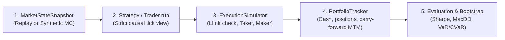

# Backtesting & Execution Simulation Methodology

## 1. Disentangling Simulation Components

Conflating market data replay, exchange matching, portfolio accounting, and synthetic simulation hides execution bugs. Our framework enforces strict separation across four stages:

---

## 2. Information Causality & Anti-Leakage Guarantees

1. **Tick-by-Tick State Isolation**: `HistoricalReplayLoop.step()` delivers a single `MarketStateSnapshot(timestamp=t)` to `BaseStrategy.generate_orders()` (or `CompetitionStrategyAdapter` $\to$ `Trader.run()`). Future snapshots and underlying DataFrames are inaccessible.
2. **Causal Online Estimators**: All fair-value trackers (`EMA`, alpha-beta drift filters) initialize at $t=0$ and update strictly sequentially, persisting internal state solely through JSON `traderData`.
3. **Calibration Split Isolation**: Empirical regressions (ADF tests, OLS drift, AR(1) OU fits) and 2D plateau selections run exclusively on `Day -2` and `Day -1`; `Day 0` is reserved as a single-pass out-of-sample test.

---

## 3. Exchange Matching Rules & Fill Regimes

### A. Simultaneous Starting-Position Limit Check
Before any order executes on tick $t$, `ExecutionSimulator.validate_orders_against_limits` verifies worst-case exposure against the tick's **starting inventory** $q_{\text{start}}$:
$$q_{\text{start}} + \sum_{Q_o > 0} Q_o \le Q_{\max}, \qquad q_{\text{start}} + \sum_{Q_o < 0} Q_o \ge -Q_{\max}$$
Violating either inequality cancels the entire order batch for that symbol on tick $t$ (when `reject_on_limit_breach=True`) or raises `PositionLimitExceededError` in strict test mode.

### B. Multi-Level Taker Execution
Crossing orders walk the sorted opposite book sequentially (`sorted(asks)` for buys, `sorted(bids, reverse=True)` for sells), decrementing remaining level liquidity within the tick so multiple orders cannot double-consume the same depth. Unfilled remainders rest as passive maker orders.

### C. Three-Regime Passive Maker Matching
Because historical CSVs do not react to our passive quotes, we bracket passive execution across three transparent regimes:
1. **`conservative`**: Fills a resting buy at $P_{\text{limit}}$ only when a public trade executes strictly through ($P_{\text{trade}} < P_{\text{limit}}$), and a resting sell only when $P_{\text{trade}} > P_{\text{limit}}$.
2. **`queue_aware`**: Respects resting L1–L3 queue ahead when $P_{\text{trade}} = P_{\text{limit}}$. If our quote matches the prevailing touch, only public trade volume *strictly exceeding* existing depth at that price fills our order; if our quote price-improves inside the spread (`best_bid + 1` / `best_ask - 1`), queue ahead is zero.
3. **`touch`**: Fills whenever $P_{\text{trade}} \le P_{\text{limit}}$ (buy) or $P_{\text{trade}} \ge P_{\text{limit}}$ (sell). Tracked purely as an upper-bound diagnostic for touch-optimism bias.

---

## 4. Portfolio Accounting & Missing-Book Valuation

For every `FillEvent` at price $P_f$, signed quantity $Q_f$, and friction fee $\phi_f$:
$$C_t = C_{t-1} - \sum_f (P_f Q_f + \phi_f), \qquad q_{i, t} = q_{i, t-1} + \sum_{f \in \mathcal{F}_i} Q_f$$
Equity is marked to carry-forward two-sided mid-prices $M_{i, t}$:
$$V_t = C_t + \sum_{i=1}^M q_{i, t} M_{i, t}$$
*(On one-sided or empty ticks—observed on `~8%` of Round 1 ticks—$M_{i, t}$ carries forward the last valid two-sided mid-price rather than falling back to `0.0`, preventing artificial mark-to-market crash spikes.)*

Conservative liquidation valuation marks long inventory to prevailing `best_bid` and short inventory to `best_ask`:
$$V_t^{\text{liq}} = C_t + \sum_{i=1}^M \begin{cases} q_{i, t} P_{\text{bid}, i}(t), & q_{i, t} > 0 \\ q_{i, t} P_{\text{ask}, i}(t), & q_{i, t} < 0 \\ 0, & q_{i, t} = 0 \end{cases}$$
