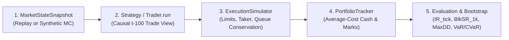

# Backtesting & Execution Simulation Methodology

Conflating market data replay, exchange matching, portfolio accounting, and synthetic simulation hides execution bugs and leakage. Our framework enforces strict separation across five explicit stages:

## 1. Information Causality & Anti-Leakage Guarantees

1. **Tick-by-Tick State Isolation**: `HistoricalReplayLoop.step()` delivers a single `MarketStateSnapshot(timestamp=t)` to `BaseStrategy.generate_orders()` (or `CompetitionStrategyAdapter` $\to$ `Trader.run()`). Future snapshots and underlying DataFrames are inaccessible.
2. **Strict `t - 100` Execution & Public Trade Lag**: `CompetitionStrategyAdapter` delays both `own_trades` and `market_trades` so strategies deciding at tick `t` observe only prints executed strictly prior to `t` (`<= t - 100`). Contemporaneous tick-`t` trades are never leaked into signal generation.
3. **Causal Online Estimators**: Fair-value trackers (fixed anchors, wall midpoints, BS total-vol EWMAs, prior-tick `Mark 14` / `Mark 55` signals, and `MICROCHIP_CIRCLE` circular lag buffers) initialize at $t=0$ and persist state solely via JSON `traderData`.
4. **Chronological Split Isolation**: Empirical regressions (ADF, OLS drift, OU fits, IS `VELVETFRUIT_EXTRACT` mark-outs, IS Microchip cross-correlograms) and 2D plateau selections run exclusively on early calibration days (`IS`), holding back the final chronological day (`Day 0` R1, `Day 1` R2, `Day 2` R3, `Day 3` R4, `Day 4` R5) strictly for single-pass out-of-sample evaluation.

## 2. Exchange Matching Rules & Fill Regimes

### Simultaneous Starting-Position Limit Check
Before any order executes on tick $t$, `ExecutionSimulator.validate_orders_against_limits` verifies worst-case exposure against the tick's **starting inventory** $q_{\text{start}}$:
$$q_{\text{start}} + \sum_{Q_o > 0} Q_o \le Q_{\max}, \qquad q_{\text{start}} + \sum_{Q_o < 0} Q_o \ge -Q_{\max}$$
Violating either inequality cancels the entire order batch for that symbol on tick $t$ (when `reject_on_limit_breach=True`) or raises `PositionLimitExceededError` in strict test mode.

### Multi-Level Taker Execution & Level Depletion
Crossing orders walk the sorted opposite book sequentially (`sorted(asks)` for buys, `sorted(bids, reverse=True)` for sells), decrementing remaining level liquidity within the tick so multiple orders cannot double-consume the same depth. Unfilled remainders rest as passive maker orders unless uncrossed.

### Price-Time Queue Conservation & Three Maker Regimes
Passive orders share a mutable `remaining_trade_volumes` map per price/side so overlapping orders at the same level never double-count market trade volume:
1. **`conservative`**: Fills a resting buy at $P_{\text{limit}}$ only when a public trade executes strictly through ($P_{\text{trade}} < P_{\text{limit}}$), and a resting sell only when $P_{\text{trade}} > P_{\text{limit}}$.
2. **`queue_aware`**: Sorts same-direction resting orders strictly by price-time priority (`(-price, idx)` for bids, `(price, idx)` for asks) and deducts exchange resting depth $V_{\text{ahead}}$ at touch when $P_{\text{trade}} == P_{\text{limit}}$ before allocating remaining volume sequentially. Inside-spread quotes ($V_{\text{ahead}} = 0$) receive zero-queue fill priority. Zero-price `VEV_6000/6500` prints never fill passive buys at `0`.
3. **`touch`**: Fills against remaining available volume whenever $P_{\text{trade}} \le P_{\text{limit}}$ (buy) or $P_{\text{trade}} \ge P_{\text{limit}}$ (sell). Tracked purely as an upper sensitivity bound.

## 3. Portfolio Accounting & Missing-Book Valuation

`PortfolioTracker` separates realized average-cost PnL (`avg_entry_price`) from unrealized mark-to-market equity $V_t = C_t + \sum_i q_{i,t} M_{i,t}$, matching zero-tick initial baseline (`prepend=0.0` in return series). On one-sided or empty ticks (`~7.5%–8.0%` of Round 1–2 ticks), $M_{i,t}$ carries forward the last valid two-sided mid-price rather than dropping falsely to `0.0`.
