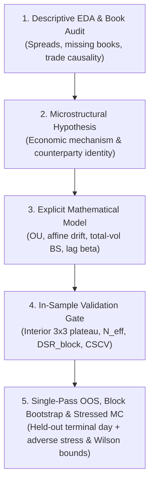

# Quantitative Research Methodology

Every strategy in this repository follows a disciplined five-step scientific workflow designed to separate durable structural alpha from finite-sample noise, look-ahead bias, and post-hoc rationalization:

## 1. Core Methodological Principles

### Data Integrity Before Alpha
No return series, correlation, or backtest is trusted until raw book completeness, duplicate structure, and sign conventions are verified. Auditing all `34` raw CSVs exposed `~7.5%` one-sided books and `13–22` empty ticks/asset/day in Rounds 1–2 (`mid_price == 0.0`), zero-price `VEV_6000/6500` prints in Rounds 3–4, and byte-identical Round 3 / Round 4 price archives on `Day 1–2`.

### Distinguishing Correlation from Causation (and Rejecting False Positives)
A large $t$-statistic or tight structural invariant does not automatically yield tradeable alpha:
- **Quote-Jitter OBI (`EMERALDS` & `ASH_COATED_OSMIUM`)**: Raw $\text{OBI}_t$ correlates at $r \approx 0.52\text{–}0.59$ with short-horizon mid moves because thin inside-spread quotes briefly pull L1 mid away from deep resting bot walls (`_popular_wall_mid`) before snapping back.
- **1-Tick Bounce vs. Causal Counterparty Flow (`Round 4`)**: Pooled `t=0 -> t+50` mark-outs falsely elevated `Mark 67` BUY (`+1.924` at `t -> t+1`, only `+0.113` at `t+1 -> t+200`, `OU-adj t = 1.56`), whereas causal post-execution tests isolated `Mark 14` SELL (`+3.788`, `t = 4.58`) and `Mark 55` BUY (`+2.460`, `t = 4.07`).
- **Sub-Spread Constant-Sum (`Round 5 Pebbles`)**: $\sum_{i=1}^5 P_i = 50{,}000 \pm 2.82$ (`ADF t = -70.16`) is a verified statistical invariant, yet its `2.82`-tick standard deviation sits strictly inside the `12–14` tick 5-leg touch spread—meaning IOC crossing is unprofitable and was pruned.

### Strict Distinction of Knowledge Layers
Every document and table distinguishes:
1. **Observed Data**: Immutable raw CSVs verified against [`prosperity4_manifest.json`](../../data/manifests/prosperity4_manifest.json).
2. **Estimated Parameters**: Statistics fitted strictly on calibration splits (`Day -2..-1` R1, `Day -1..0` R2, `Day 0..1` R3, `Day 1..2` R4, `Day 2..3` R5).
3. **Model Assumptions**: Verified official position limits (`±80` R1–R2, `±200/300` R3–R4, `±10` R5), causal queue-aware matching approximations, and Gaussian/adverse MC parameters.
4. **Simulated Results**: Held-out OOS historical replays and stressed Monte Carlo ensembles (`N = 40`).
5. **Ex-Ante Offline Manual Models**: Closed-form/Bayesian models built prior to outcomes (`MANUAL_CHALLENGES.md`); never represented as live portal telemetry.

### Baseline Benchmarking & Ablation Discipline
Every production refinement earns its complexity against simple baselines (`NoOpBaseline`, `SymmetricMM`, `SymmetricMM_80`, `OptionsVolatilityContract`, `Round3NoFlow`, `EmaSymmetricMM_All50`, `Round5NoLeadLag`) under all three fill modes (`conservative`, `queue_aware`, `touch`).
