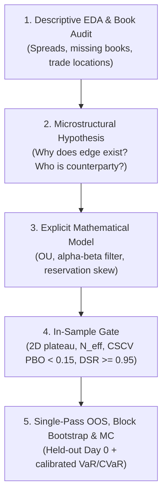

# Quantitative Research Methodology

## 1. Hypothesis-First Research Cycle

Every strategy in this repository follows a disciplined five-step scientific workflow designed to eliminate curve-fitting and post-hoc rationalization:

---

## 2. Core Methodological Principles

### A. Data Integrity Before Alpha
No return series, correlation, or backtest is trusted until raw book completeness and sign conventions are verified. For example, inspecting raw Round 1 CSVs revealed `7.5%–8.0%` one-sided books and `14–21` empty books per day (`mid_price == 0.0`). Ignoring those missing-book regimes originally produced spurious $\Delta \text{mid}$ lag-1 jumps and a phantom `818,356` XIRECS drawdown in early testing ([PM-001](../postmortem.md)).

### B. Distinguishing Correlation from Causation
A statistically significant correlation ($p < 10^{-100}$) does not automatically constitute directional predictive alpha:
- **Empirical Case (`EMERALDS` & `ASH_COATED_OSMIUM`)**: Order Book Imbalance ($\text{OBI}_t$) correlates strongly with future mid-price changes ($r \approx 0.52\text{–}0.64$ across horizons $h \in \{1, 5, 10\}$).
- **Root Mechanism**: Rather than signaling permanent fair-value discovery, thin inside-spread bot quotes temporarily displace `mid_price` away from $FV_t$ while shrinking L1 volume on that side; once those thin quotes fill or cancel, `mid_price` snaps back to the resting bot walls. Modeling structural wall midpoints (`_popular_wall_mid`) directly captures that insight instead of chasing L1 noise.

### C. Strict Distinction of Knowledge Layers
To maintain intellectual honesty across research notes and candidate evaluations, every report separates:
1. **Observed Data**: Direct measurements from immutable CSVs (e.g., `4,199` two-sided trade prints in Round 0–1, `99.98%` executed at L1 touch).
2. **Estimated Parameters**: Statistics fitted strictly on calibration splits (`Day -2` & `Day -1`), such as `ASH_COATED_OSMIUM` OU $\hat{\theta} \in [0.085, 0.135]$ and `INTARIAN_PEPPER_ROOT` drift $+0.10$/step.
3. **Model Assumptions**: Configurable limits ($Q_{\max} = 20$ where official limits remain unverified), fill-mode approximations, and Gaussian innovations.
4. **Simulated Results**: Historical replay and Monte Carlo PnL, drawdown, Sharpe, and $\text{CVaR}_{95}$ distributions.
5. **Actual Competition Results**: None claimed unless directly evidenced by official portal submission records.

### D. Baseline Benchmarking & Ablation Discipline
Every proposed refinement must earn its complexity through controlled ablation on held-out data (`EXP-R1-001`, `EXP-R1-002`):
- **Null Baseline (`NoOpBaseline`)**: Verifies zero leakage and zero phantom accounting PnL.
- **Naive Symmetric Quoter (`SymmetricMM`)**: Exposes unhedged directional inventory risk (`Day -2` drawdown `1,723`, Monte Carlo `ProbLoss = 0.20`).
- **Prior Candidate (`InventorySkewedMM`) $\to$ Refined (`Round1Submission`)**: Demonstrates how bot-wall filtering and penny-improving lifted OOS `Day 0` `queue_aware` PnL from `9,067` to `22,157` while cutting drawdown from `837.50` to `267.00`.
