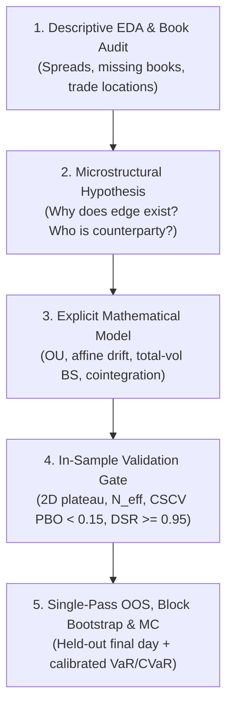

# Quantitative Research Methodology

Every strategy in this repository follows a disciplined five-step scientific workflow designed to separate durable structural alpha from finite-sample noise and post-hoc rationalization:

## 1. Core Methodological Principles

### Data Integrity Before Alpha
No return series, correlation, or backtest is trusted until raw book completeness and sign conventions are verified. Inspecting raw Round 1–2 CSVs revealed `7.5%–8.0%` one-sided books and `14–38` empty books per day (`mid_price == 0.0`). Ignoring those missing-book regimes originally produced spurious $\Delta \text{mid}$ lag-1 jumps and a phantom `818,356` XIRECS drawdown in early testing ([`postmortem.md`](file:///c:/Users/pierr/Desktop/imc-prosperity-4-toolkit-writeup/docs/postmortem.md), `PM-001`). Similarly, deep-OTM Round 3–4 call vouchers (`VEV_6000`, `VEV_6500`) generate `182–253` zero-price prints/day when takers hit `0`-tick bids, requiring explicit non-zero/two-sided filtering prior to volatility calibration.

### Distinguishing Correlation from Causation
A statistically significant correlation ($p < 10^{-100}$) does not automatically constitute directional predictive alpha:
- **Empirical Case (`EMERALDS` & `ASH_COATED_OSMIUM`)**: Order Book Imbalance ($\text{OBI}_t$) correlates strongly with future mid-price changes ($r \approx 0.52\text{–}0.64$ across horizons $h \in \{1, 5, 10\}$).
- **Root Mechanism**: Rather than signaling permanent fair-value discovery, thin inside-spread bot quotes temporarily displace `mid_price` away from $FV_t$ while shrinking L1 volume on that side; once those thin quotes fill or cancel, `mid_price` snaps back to the resting bot walls. Modeling structural wall midpoints (`_popular_wall_mid`) directly captures that insight instead of chasing L1 noise.
- **Cross-Asset Correlation vs. Cointegration (`Round 5`)**: `SNACKPACK_PISTACHIO`, `STRAWBERRY`, and `RASPBERRY` co-move at `0.927` difference correlation yet rotate level eigenvector weights sharply between `Day 2` and `Day 4`, disqualifying static 3-leg hedge ratios relative to exact `PEBBLES` constant-sum parity (`50,000 ± 2.82`, condition ratio $> 1.66 \times 10^6$).

### Strict Distinction of Knowledge Layers
To maintain intellectual honesty across research notes and candidate evaluations, every report separates:
1. **Observed Data**: Direct measurements from immutable CSVs (e.g., `4,199` two-sided trade prints in Round 0–1, `165` informed `Mark 67` prints in Round 4 IS, three synchronized Poisson pulse clusters in Round 5).
2. **Estimated Parameters**: Statistics fitted strictly on calibration splits (`Day -2` & `-1` R1, `Day -1` & `0` R2, `Day 0` & `1` R3, `Day 1` & `2` R4, `Day 2` & `3` R5), such as `ASH_COATED_OSMIUM` OU $\hat{\theta} \in [0.085, 0.135]$ and `INTARIAN_PEPPER_ROOT` drift $+0.10$/step.
3. **Model Assumptions**: Position limits (`±80` R2, `±200/300` R3–R4, `±10` R5 verified across multiple public Prosperity 4 backtester archives; `±20` stressed explicitly on Round 1), queue-matching rules, and Gaussian/Poisson scenario generators.
4. **Simulated Results**: Single-pass held-out chronological replay (`Day 0`–`Day 4`) and Monte Carlo PnL, drawdown, Sharpe, and $\text{CVaR}_{95}$ distributions.
5. **Actual Competition Results**: None claimed unless directly evidenced by official exchange submission logs; public competition placements referenced as external context are always flagged explicitly.

### Baseline Benchmarking & Ablation Discipline
Every proposed refinement must earn its complexity through controlled ablation on held-out data (`EXP-R1-001` through `EXP-R5-001`):
- **Null Baseline (`NoOpBaseline`)**: Verifies zero leakage and zero phantom accounting PnL.
- **Unhedged / Uncalibrated Baselines**: Expose inventory drift bleed (`SymmetricMM_80` `-20,294.50` OOS R2), fixed-TTE options mispricing (`OptionsVolatilityContract` `-7,604.00` OOS R3), and EMA lag toxicity (`EmaSymmetricMM_All50` `29,130.00` DD in R5).
- **Refined Submissions**: Evaluated only once against held-out final days after clearing `3x3` plateau checks, `CSCV PBO < 0.15`, and `DSR >= 0.95`.
