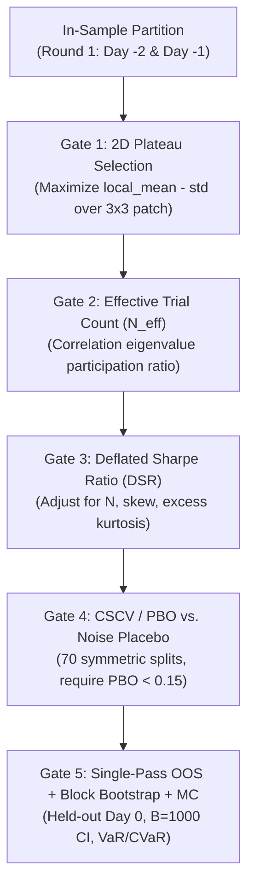

# Statistical Validation & Multiple-Testing Discipline

## 1. Why Backtests Lie on Short Competition Horizons

In algorithmic trading competitions such as IMC Prosperity, each round provides only **2 to 3 historical trading days** (`20,000–30,000` ticks) prior to live evaluation. That sample structure creates a dangerous statistical illusion: a strategy records tens of thousands of discrete timestamps—enough to inflate naive $t$-statistics—yet spans only a handful of independent drift episodes, volatility regimes, or inventory mean-reversion cycles.

When a researcher runs $N$ parameter combinations over the same historical window and promotes $\arg\max_n \widehat{\text{SR}}_n$, three distinct sources of error contaminate the result:
1. **Extreme-Value Selection Bias**: Even if every candidate configuration has zero true skill ($H_0: \text{SR}_n = 0$), the expected maximum Sharpe ratio across $N$ draws grows roughly with $\sqrt{2 \ln N}$. Searching 100 configurations almost guarantees an eye-catching sample Sharpe by chance.
2. **Parameter-Cliff Fragility**: Discrete integer ticks and resting bot offsets create discontinuous payoff boundaries. A brittle rule like `min_edge = 1.5` can score artificially well solely because a small cluster of historical trades crossed that exact tick level, collapsing if market spreads shift by 1 tick out-of-sample.
3. **Serial & Distributional Dependence**: Market-making equity curves exhibit negative lag-1 return autocorrelation (from bid-ask bounce), negative skewness (steady spread collection punctuated by mark-to-market inventory drawdowns), and volatility clustering. Standard i.i.d. Gaussian confidence intervals systematically understate uncertainty.

To separate genuine structural alpha from data snooping, every strategy refinement in this repository passes through a **five-gate validation pipeline** prior to out-of-sample verification:

---

## 2. Mathematical Foundations

### A. Non-Normal Sharpe Variance & Deflated Sharpe Ratio (DSR)
Following Lo (2002) and Bailey & López de Prado (2014), the asymptotic variance of an estimated non-annualized Sharpe ratio $\widehat{\text{SR}}$ scales with skewness $\hat{\gamma}_3$ and Fisher excess kurtosis $\hat{\gamma}_4$:
$$\widehat{\sigma}_{\text{SR}}^2 \approx \frac{1 - \hat{\gamma}_3 \widehat{\text{SR}} + \frac{\hat{\gamma}_4 + 2}{4} \widehat{\text{SR}}^2}{T - 1}$$
*(Notice the $\frac{\hat{\gamma}_4 + 2}{4}$ coefficient when $\hat{\gamma}_4$ denotes excess kurtosis, identically equal to $\frac{K - 1}{4}$ for raw kurtosis $K = \hat{\gamma}_4 + 3$. Under Gaussian returns $\hat{\gamma}_3 = \hat{\gamma}_4 = 0$, this reduces cleanly to $\frac{1 + \frac{1}{2}\widehat{\text{SR}}^2}{T - 1}$.)*

When $N$ trials are tested with trial Sharpe variance $V[\{\widehat{\text{SR}}_n\}]$, extreme-value theory yields the zero-skill false-discovery hurdle $\text{SR}^*$:
$$\text{SR}^* = \sqrt{V[\{\widehat{\text{SR}}_n\}]} \left[ (1 - \gamma_{\text{EM}}) \Phi^{-1}\!\left(1 - \frac{1}{N}\right) + \gamma_{\text{EM}} \Phi^{-1}\!\left(1 - \frac{1}{N e}\right) \right]$$
where $\gamma_{\text{EM}} \approx 0.57721566$ is the Euler-Mascheroni constant. The **Deflated Sharpe Ratio** evaluates the probability that true skill exceeds $\text{SR}^*$:
$$\text{DSR} = \Phi\!\left( \frac{(\widehat{\text{SR}} - \text{SR}^*) \sqrt{T - 1}}{\sqrt{1 - \hat{\gamma}_3 \widehat{\text{SR}} + \frac{\hat{\gamma}_4 + 2}{4} \widehat{\text{SR}}^2}} \right)$$

#### Worked Example: How Multiple Testing Erodes a Marginal Edge
Suppose a weak strategy achieves per-tick $\widehat{\text{SR}} = 0.018$ over $T = 19,999$ ticks ($\hat{\gamma}_3 = -0.5$, $\hat{\gamma}_4 = 3.0$, trial std $\sqrt{V} = 0.01$). Tested in isolation ($N=1$), a naive $z$-test looks persuasive; once search breadth $N$ is accounted for, statistical significance collapses:

| Trials Searched ($N$) | Hurdle $\text{SR}^*$ | $\text{DSR}$ | Interpretation |
| :--- | :--- | :--- | :--- |
| $N = 1$ (Single hypothesis) | `0.0000` | `0.9944` | Appears significant at 99% |
| $N = 10$ | `0.0157` | `0.6245` | Fails 95% gate |
| $N = 25$ | `0.0200` | `0.3907` | Hurdle already exceeds observed SR |
| $N = 100$ | `0.0253` | `0.1519` | Likely pure noise |
| $N = 500$ | `0.0305` | `0.0390` | Severe data snooping |

### B. Minimum Backtest Length ($\text{MinBTL}$) & Effective Trial Count ($N_{\text{eff}}$)
To keep $\mathbb{E}[\max_N \widehat{\text{SR}}]$ below a target Sharpe $\widehat{\text{SR}}$, sample length must satisfy $\text{MinBTL} \approx \frac{2 \ln N}{\widehat{\text{SR}}^2}$. However, neighboring grid points on a continuous parameter surface are **not** orthogonal hypotheses. We quantify the **effective number of independent trials** $N_{\text{eff}} \in [1, N]$ from the eigenvalues $\{\lambda_k\}_{k=1}^N$ of the $(N \times N)$ trial return correlation matrix:
$$N_{\text{eff}} = \frac{\left(\sum_{k=1}^N \lambda_k\right)^2}{\sum_{k=1}^N \lambda_k^2} = \frac{N^2}{\sum_{k=1}^N \lambda_k^2}$$
- If all $N$ trials are identical, $\lambda_1 = N \implies N_{\text{eff}} = 1.0$.
- If all $N$ trials are uncorrelated, $\lambda_k = 1\ \forall k \implies N_{\text{eff}} = N$.

### C. Combinatorial Symmetric Cross-Validation (CSCV & PBO)
CSCV (Bailey et al., 2017) directly audits the *parameter-selection rule*:
1. Assemble the $(T \times N)$ return matrix $M$ across all $N$ candidate trials.
2. Partition $T$ into an even number $S$ of disjoint contiguous blocks (we use $S = 8$, giving $\binom{8}{4} = 70$ symmetric IS/OOS splits).
3. For each split $c = (J_c, \bar{J}_c)$, pick the in-sample winner $n^* = \arg\max_n \text{SR}_n(J_c)$, measure its out-of-sample relative rank $\omega_c = \frac{\text{rank}_{\bar{J}_c}(n^*)}{N + 1} \in (0, 1)$, and compute its rank logit $\lambda_c = \ln\left(\frac{\omega_c}{1 - \omega_c}\right)$.
4. The **Probability of Backtest Overfitting** is $\text{PBO} = \mathbb{P}(\lambda_c \le 0)$. We require $\text{PBO} < 0.15$.

### D. 2D Plateau Stability Selection & Circular Block Bootstrap
1. **Plateau Selection**: Rather than promoting $\arg\max_{(x, y)} S(x, y)$, `SensitivityAnalyzer.select_stable_plateau_2d` maximizes $\mu_{\mathcal{N}}(x, y) - \lambda \sigma_{\mathcal{N}}(x, y)$ over each point's $3 \times 3$ neighborhood $\mathcal{N}(x, y)$ ($\lambda = 1.0$), rejecting brittle cliffs.
2. **Circular Block Bootstrap**: To place honest confidence bounds on out-of-sample Sharpe and PnL without breaking short-range serial correlation or volatility clustering, `OverfittingDiagnostics.block_bootstrap_ci` resamples contiguous blocks of length $L = 100$ ticks with wrap-around across $B = 1,000$ draws.

---

## 3. Empirical Validation on Round 1 (`Day -2` & `Day -1`) & Negative Control

We evaluate our 25-configuration 2D grid (`min_edge` $\in \{1.0, 1.5, 2.0, 2.5, 3.0\}$ $\times$ `inventory_skew` $\in \{0.10, 0.25, 0.40, 0.60, 0.80\}$ on `Day -2` + `Day -1`, $T = 19,999$ step returns under `queue_aware` matching) alongside an identical-dimension **Gaussian White-Noise Placebo** (`seed = 42`):

| Diagnostic Metric | Pure Noise Placebo ($N=25$) | Round 1 Refined Grid ($N=25$) | Acceptance Rule |
| :--- | :--- | :--- | :--- |
| **Effective Trial Count ($N_{\text{eff}}$)** | `~24.9` (orthogonal noise) | **`1.11`** (highly coherent grid) | — |
| **Mean IS Best Per-Step SR** | `+0.0161` | `+0.0921` | — |
| **Mean OOS Selected Per-Step SR** | `-0.0025` *(collapses)* | `+0.0898` *(retains 97.5%)* | Minimal decay |
| **CSCV PBO ($S=8$, 70 splits)** | **`0.643`** *(Reject)* | **`0.086`** *(Pass)* | `< 0.15` |
| **$\mathbb{P}(\text{OOS SR} \le 0)$** | `0.700` | `0.000` | Near zero |
| **Deflated Sharpe Ratio** | — | **`1.0000`** ($\text{SR}^* = 0.0043$) | `>= 0.95` |
| **Plateau Selected** | Random | `edge=1.5, skew=0.80` ($\mu_{\mathcal{N}}=1.419, \sigma_{\mathcal{N}}=0.020$) | Smooth basin |

### Interpreting the PnL vs. Sharpe Trade-Off (`reports/tables/r1_sensitivity_grid.csv`)
Inspecting both raw IS PnL and IS Sharpe reveals an instructive economic trade-off:
- At light skew (`inventory_skew = 0.10`), IS PnL reaches `55,009–55,225` (`Sharpe = 1.33–1.36`).
- At strong skew (`inventory_skew = 0.80`), IS PnL moderates to `44,461–46,763`, while **IS Sharpe rises to `1.415–1.450`**.
Why? Light skew allows inventory to linger longer on `INTARIAN_PEPPER_ROOT`, capturing extra directional drift exposure when favorable at the cost of significantly higher equity volatility. Selecting via Sharpe plateau stability (`edge=1.5, skew=0.80`) deliberately sacrifices uncompensated drift variance in favor of consistent spread capture.

### Out-of-Sample `Day 0` Circular Block-Bootstrap Uncertainty
Running 1,000 circular block-bootstrap resamples ($L = 100$ ticks) on held-out `Day 0` returns (`Round1Submission`, `queue_aware`):
- **OOS Annualized Sharpe**: **`1.190`**, 95% CI **`[1.046, 1.329]`**
- **OOS Total PnL**: **`22,140.8`** bootstrap mean (observed `22,157.0`), 95% CI **`[19,772.5, 24,425.5]`**
- Even at the 2.5th percentile of the block-bootstrap distribution, OOS Sharpe remains solidly above `1.0` and PnL remains near `20,000`.

---

## 4. Cross-Round Gate Scorecard & Empirical Overfitting Rejection (Rounds 1–5)

Applying the same five-gate funnel uniformly across all five competition rounds yields high-confidence acceptance for the deployed models—and actively blocked overfit feature engineering before it reached held-out testing:

| Round | Selected Plateau (`IS`) | Local Mean ± Std ($3 \times 3$) | $N_{\text{eff}}$ | `CSCV PBO` | `DSR` | Held-Out OOS PnL | OOS `Sharpe_252` (95% Boot CI) | Gate Status |
| :---: | :--- | :---: | :---: | :---: | :---: | ---: | :--- | :---: |
| **R1** | `min_edge=1.5, skew=0.80` | `1.419 ± 0.020` | `1.11` | `0.0860` | `1.0000` | `+22,157.00` | `1.1894` `[1.046, 1.329]` | **Pass** |
| **R2** | `min_edge=3.5, skew=0.75` | `1.360 ± 0.018` | `1.22` | `0.0000` | `1.0000` | `+27,463.00` | `1.3972` `[1.2314, 1.5823]` | **Pass** |
| **R3** | `mm_edge=4.5, mm_skew=0.10` | `0.368 ± 0.054` | `1.12` | `0.0000` | `0.9921` | `+7,525.50` | `0.2276` `[0.0097, 0.4392]` | **Pass** |
| **R4** | `m67_bump=0.5, mm_edge=5.5` | `0.350 ± 0.019` | `1.08` | `0.0571` | `0.9975` | `+11,741.00` | `0.3613` `[0.0932, 0.6302]` | **Pass** |
| **R4 (Rejected)** | `s_alpha=0.85` aggressive spot chasing | — | — | **`0.9714`** | **`0.9390`** | — *(vetoed)* | — | **Reject** (`PBO >= 0.15`, `DSR < 0.95`) |
| **R5** | `ef=0.18, sk=1.25` | `0.714 ± 0.015` | `1.30` | `0.1000` | `1.0000` | `+123,173.00` | `0.8109` `[0.5789, 1.0627]` | **Pass** |

### Why Blocking the Aggressive Round 4 Candidate Mattered
During Round 4 development, an aggressive counterparty spot-chasing variant (`s_alpha = 0.85` plus unconstrained option crossing around `VEV_5000/5100`) improved headline in-sample PnL but drove `CSCV PBO = 0.9714` and dragged `DSR = 0.9390 < 0.95`—nearly every time-slice winner ranked below the OOS median on the complementary partition. Vetoing that variant strictly inside the IS gate kept `traders/round4/submission.py` pinned cleanly onto its `(m67_bump = 0.5, mm_edge = 5.5)` plateau, preserving `PBO = 0.0571` (`DSR = 0.9975`) and beating `Round3Ungated` cleanly on held-out `Day 3`.

## 5. Methodological Limitations
1. **Correlated Trials Narrow DSR Hurdle**: Because $N_{\text{eff}} \in [1.08, 1.30]$ along continuous grid sweeps, all parameter cells inside a family express variations of the same core edge, keeping $V[\{\widehat{\text{SR}}_n\}]$ small ($\text{SR}^* = 0.0043$ in R1). DSR is far stricter when screening structurally unrelated signal families; here, **CSCV**, **circular block-bootstrap CIs**, and **multi-session Monte Carlo testing** carry the main validation burden.
2. **Short Chronological Partitions ($2$ Days IS)**: With 20,000 IS ticks split into $S=8$ blocks of 2,500 steps (`1/4` day each), CSCV detects intra-day instability and overfitted spikes well, while genuine multi-day regime shifts (such as `ROBOT_DISHES` volatility exploding `2.8x` on R5 `Day 4`) remain safeguarded by volatility-adaptive quoting rules rather than curve-fit thresholds.
2. **Contiguous Blocks Under Non-Stationary Drift**: Partitioning contiguous blocks assumes roughly comparable return moments across slices. On drifting instruments, we cross-check CSCV against parametric Monte Carlo simulations (`ProbLoss = 0.00`, $\text{CVaR}_{95} = +344.25$).
