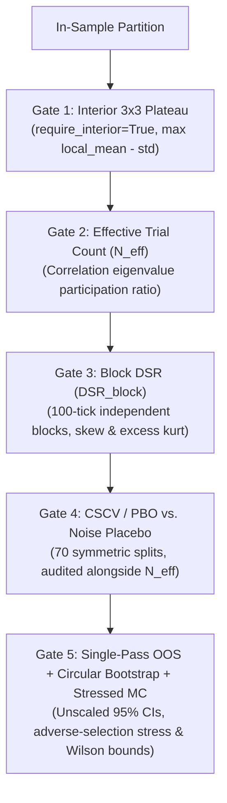
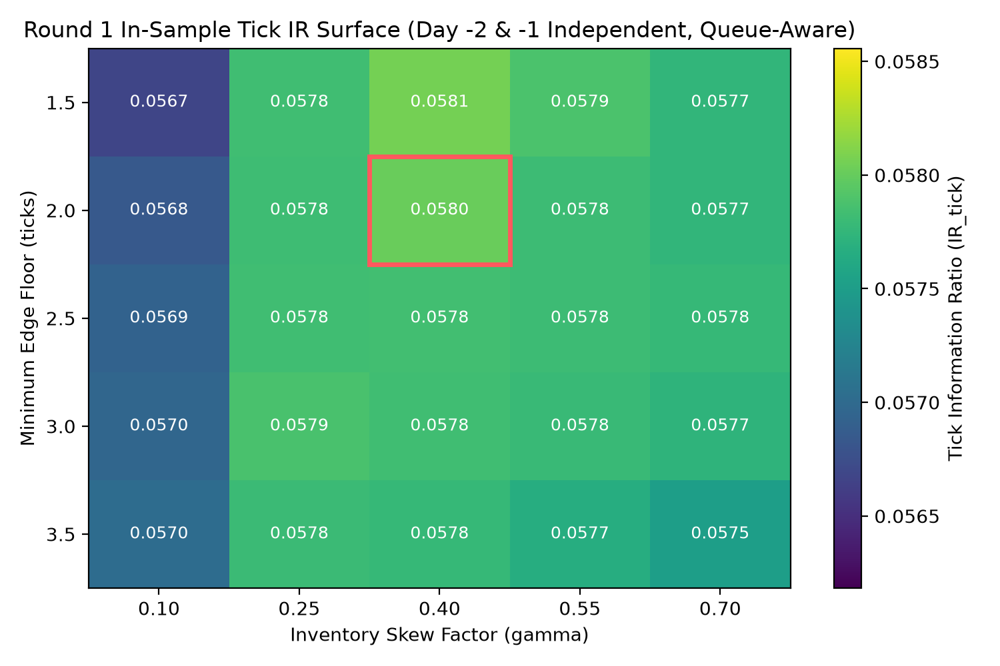
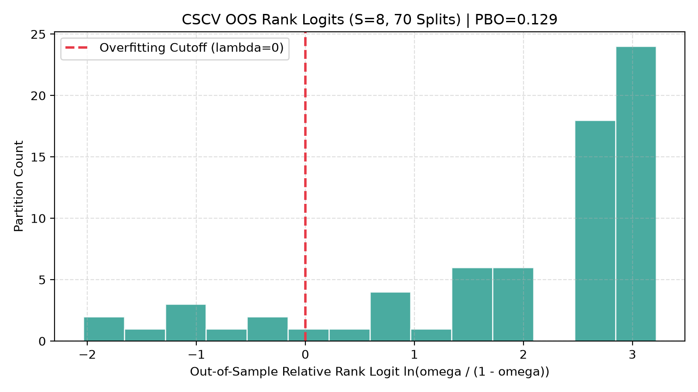

# Statistical Validation & Multiple-Testing Discipline

## 1. Why Backtests Lie on Short Competition Horizons

In algorithmic trading competitions such as IMC Prosperity 4, each round provides only **2 to 3 historical trading days** (`20,000–30,000` ticks) prior to held-out evaluation—and Round 3 and Round 4 share identical `Day 1–2` price series. That sample structure creates a dangerous illusion: tens of thousands of timestamps inflate naive $t$-statistics while spanning only a few independent drift or volatility episodes.

When optimizing $N$ candidate parameterizations on a short sample, three hazards dominate:
1. **Extreme-Value Selection Bias**: Expected max Sharpe under the null grows roughly with $\sqrt{2 \ln N}$, making raw grid peaks unreliable.
2. **Boundary & Parameter Cliffs**: Edge cells on a discrete parameter sweep often win by catching thin tick artifacts rather than durable spread capture.
3. **Serial Dependence & Tick Inflation**: Treating `20,000` correlated 100-unit ticks as independent daily observations (or scaling tick IR by $\sqrt{252 \times 10000}$) distorts risk-adjusted statistics. We therefore report **unannualized per-tick Information Ratio (`IR_tick`, `annualization_factor=1.0`)**, **1,000-tick block Sharpe (`BlkSR_1k`)**, and **`PnL/MaxDD`**, never `Sharpe_252`.

Every strategy passes through a **five-gate validation pipeline** prior to single-pass OOS testing:

---

## 2. Mathematical Foundations

### A. Block Non-Normal Sharpe Variance & `DSR_block`
Following Lo (2002) and Bailey & López de Prado (2014), evaluated across disjoint 100-tick return blocks (`evaluate_block_matrix_dsr(mat, sel_idx, block_size=100)` in [`diagnostics.py`](../../src/prosperity_toolkit/analysis/diagnostics.py)) to avoid inflated tick sample size:
$$\widehat{\sigma}_{\text{SR}}^2 \approx \frac{1 - \hat{\gamma}_3 \widehat{\text{SR}} + \frac{\hat{\gamma}_4 + 2}{4} \widehat{\text{SR}}^2}{B - 1}, \qquad \text{SR}^* = \sqrt{V[\{\widehat{\text{SR}}_n\}]} \left[ (1 - \gamma_{\text{EM}}) \Phi^{-1}\!\left(1 - \frac{1}{N_{\text{eff}}}\right) + \gamma_{\text{EM}} \Phi^{-1}\!\left(1 - \frac{1}{N_{\text{eff}} e}\right) \right]$$
$$\text{DSR}_{\text{block}} = \Phi\!\left( \frac{(\widehat{\text{SR}}_{\text{block}} - \text{SR}^*) \sqrt{B - 1}}{\sqrt{1 - \hat{\gamma}_3 \widehat{\text{SR}}_{\text{block}} + \frac{\hat{\gamma}_4 + 2}{4} \widehat{\text{SR}}_{\text{block}}^2}} \right)$$

#### Worked Sensitivity Example (`B = 200` Blocks, Marginal $\widehat{\text{SR}} = 0.018$, $\sqrt{V} = 0.01$)
Even before reaching extreme $N$, multiplicity across $N$ trials quickly pushes hurdle $\text{SR}^*$ above marginal noise:

| Trials Searched ($N$) | Hurdle $\text{SR}^*$ | `DSR` ($B = 200$) | Interpretation |
| :--- | :---: | :---: | :--- |
| $N = 1$ (Single hypothesis) | `0.0000` | `0.5998` | Indistinguishable from marginal noise over 200 blocks |
| $N = 10$ | `0.0157` | `0.5126` | Hurdle consumes nearly all edge |
| $N = 25$ | `0.0200` | `0.4890` | Hurdle exceeds observed $\widehat{\text{SR}}$ |
| $N = 100$ | `0.0253` | `0.4591` | Sub-50% confidence |
| $N = 500$ | `0.0305` | `0.4302` | Clear data-snooping rejection |

### B. Effective Trial Count ($N_{\text{eff}}$) & Interior $3 \times 3$ Plateaus
We compute $N_{\text{eff}} = N^2 / \sum_{k=1}^N \lambda_k^2$ from eigenvalues $\{\lambda_k\}$ of the $(N \times N)$ trial return correlation matrix, and force `SensitivityAnalyzer.select_stable_plateau_2d(..., require_interior=True)` to choose among interior grid cells maximizing $\mu_{\mathcal{N}} - \lambda \sigma_{\mathcal{N}}$ over their $3 \times 3$ patch rather than unstable boundary cells.

### C. CSCV PBO & Flat-Surface Ties
Under $S = 8$ contiguous partitions (`70` splits), CSCV computes $\text{PBO} = \mathbb{P}(\omega_c \le 0.5)$. When neighboring interior candidates on a flat plateau share ultra-low dispersion (`R2 local_std = 0.000107`, `R5 local_std = 0.000551`) and $N_{\text{eff}} \approx 1.04\text{--}1.14$, slice-winner rank swaps occur almost purely from rounding/noise ties (`PBO = 0.300` in R2, `0.543` in R5) even while `DSR_block = 1.0000` and OOS stays robust. Accordingly, CSCV must be interpreted jointly with $N_{\text{eff}}$, `local_std`, and `DSR_block`.

### D. Circular Block Bootstrap (`scale_factor = 1.0`) & Wilson Upper Bounds
`OverfittingDiagnostics.block_bootstrap_ci(..., block_size=100, n_bootstraps=1000, scale_factor=1.0)` resamples unscaled 100-tick blocks at the **portfolio scope**, keeping `Asset`/`Category` rows cleanly separated with `NaN` bootstrap bounds. Synthetic MC (`N = 40`) reports `wilson_ci_upper` (`0.0876` = `8.76%` for `0/40` losses) alongside explicit `AdverseStress` scenarios.

---

## 3. Empirical Validation Summary Across Rounds 1–5 (`overfitting_gates.csv`)

On Round 1 IS (`Day -2 & -1`, `min_edge` $\in \{1.5..3.5\}$, `inventory_skew` $\in \{0.10..0.70\}$), `r1_sensitivity_grid.csv` forms a smooth interior basin at `(edge = 2.0, skew = 0.40)` (`local_mean = 0.05788, local_std = 0.00009, N_eff = 1.0216, PBO = 0.1286, DSR_block = 1.0000`), sharply beating a Gaussian white-noise placebo (`PBO = 0.671, OOS_IR = -0.0025`).

| Round | Selected Interior Plateau (`IS`) | `IS IR_tick` (`local_std`) | $N_{\text{eff}}$ | `CSCV PBO` | `DSR_block` | OOS PnL (`QA`) | OOS `IR_tick` (95% Boot CI) | OOS `BlkSR_1k` |
| :---: | :--- | :--- | :---: | :---: | :---: | ---: | :--- | :---: |
| **R1** | `edge=2.0, skew=0.4` | `0.05802` (`0.00009`) | `1.02` | `0.1286` | `1.0000` | **`+91,098.00`** | `0.05445` `[0.05052, 0.05875]` | `9.327` |
| **R2** | `edge=2.5, skew=0.4` | `0.06052` (`0.00011`) | `1.04` | `0.3000` *(flat ties)* | `1.0000` | **`+94,209.00`** | `0.05466` `[0.05089, 0.05841]` | `8.237` |
| **R3** | `spot_scale=30.0, enter_band=10.0` | `0.01593` (`0.00061`) | `1.01` | `0.0000` | `0.9966` | **`+95,093.00`** | `0.00584` `[-0.01118, 0.02133]` | `0.573` |
| **R4** | `spot_scale=30.0, flow_weight=1.5` | `0.01137` (`0.00045`) | `1.02` | `0.0143` | `0.9783` | **`+260,540.00`** | `0.01680` `[0.00099, 0.03354]` | `0.646` |
| **R5** | `vsm=0.18, ef=0.14, mc=0.16` | `0.03531` *(0.03398 @ mc=0)* | `1.14` | `0.5429` *(flat ties)* | `1.0000` | **`+97,628.00`** | `0.02624` `[0.01051, 0.04124]` | `1.108` |

Notice two critical scientific takeaways:
1. Unannualized OOS CIs remain genuinely honest about finite-sample variance: Round 3's single-day OOS `IR_tick` CI spans `[-0.01118, 0.02133]` (`BootPnL [-184,416.62, +355,675.89]`), warning against overclaiming statistical precision from one volatile options session.
2. Pruning false edges (`Mark 67` 1-tick bounce in R4, `Pebbles` spread-trapped deviations in R5, spot delta hedging in R3) occurred strictly during IS diagnosis rather than OOS peeking.
