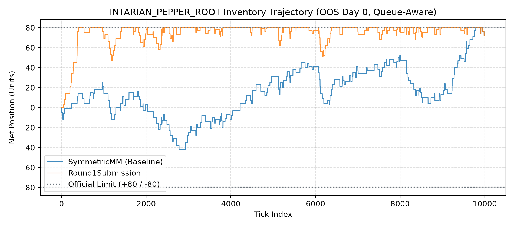

# Quantitative Research: Inventory Risk & Position Limit Management

## 1. Why Unhedged Market Making Is Secretly Directional

A symmetric market maker quoting equal offsets around mid-price absorbs toxic **one-sided fill pressure** whenever underlying fair value drifts:
- In Round 2 (`±80` official cap), `SymmetricMM_80` lost **`-20,294.50` XIRECs OOS** (`MaxDD = 21,729.50`) because passive asks absorbed persistent buy flow along `INTARIAN_PEPPER_ROOT`'s `+0.10000/tick` climb, leaving full short saturation (`-80`) into rising prices.
- Even in stationary Round 1 Monte Carlo (`N = 40`), unskewed `SymmetricMM` lost money on **`37.5%`** of synthetic sessions (`CVaR95 = -5,711.00`), whereas `Round1Submission` recorded `0/40` losses (`wilson_ci_upper = 0.0876`, `CVaR95 = +2,845.75`).

## 2. Reservation Price Skewing & Volatility Scaling

Following Avellaneda–Stoikov indifference pricing around estimated fair value $FV_t$:
$$r_t = FV_t - \tilde{\gamma} \cdot q_{\text{start}}$$
our strategies scale risk aversion $\tilde{\gamma}$ directly to position capacity and step variance:
- **Rounds 1–2 (`Q_max = ±80`)**: Interior plateau `inventory_skew = 0.40` (`min_edge = 2.0` R1, `2.5` R2) pairs `ASH_COATED_OSMIUM` `10,000` anchoring with controlled `INTARIAN_PEPPER_ROOT` carry (`R1 MaxDD = 1,405.00`, `R2 MaxDD = 1,401.00`, `PnL/MaxDD = 64.8–67.2`).
- **Rounds 3–4 (`Q_max = ±200` Spot / `±300` Options)**: Rather than churning wide-spread spot (`VELVETFRUIT_EXTRACT`, `5`-tick spread) with frequent mechanical delta-hedges, leaving options delta-unhedged inside `±300` voucher limits while biasing passive quotes preserves spread capture and cuts round-trip slippage (`+95,093` R3, `+260,540` R4 OOS).
- **Round 5 (`Q_max = ±10` across `50` Assets)**: Replacing fixed skew with proportional **volatility-scaled skew** ($\tilde{\gamma}_{i,t} = \text{vol\_skew\_mult} \cdot \hat{\sigma}_{i,t}$, `vol_skew_mult = 0.18`) widens reservation offset automatically during `Robots` / `Microchips` volatility bursts without hard-halting passive liquidity (`OOS MaxDD = 14,961.50`, `PnL/MaxDD = 6.53`).

## 3. Prosperity's Starting-Position Limit Constraint

IMC Prosperity checks worst-case buy and sell quantities across **all** submitted orders for a symbol on tick $t$ against the tick's **starting position** $q_{\text{start}}$—not sequentially after taker legs fill:
$$q_{\text{start}} + \sum_{Q_o > 0} Q_o \le Q_{\max}, \qquad q_{\text{start}} + \sum_{Q_o < 0} Q_o \ge -Q_{\max}$$
Exceeding either boundary cancels that symbol's entire order batch for the tick. Every submission ([`traders/round1`](../../traders/round1/submission.py)–[`traders/round5`](../../traders/round5/submission.py)) tracks cumulative `take_buy` and `take_sell` lots explicitly:
$$q_{\text{rem, buy}} = \max(0, Q_{\max} - q_{\text{start}} - q_{\text{take, buy}}), \qquad q_{\text{rem, sell}} = \max(0, Q_{\max} + q_{\text{start}} - q_{\text{take, sell}})$$
ensuring zero silent batch cancellations, enforced strictly by [`ExecutionSimulator.validate_orders_against_limits`](../../src/prosperity_toolkit/execution/simulator.py).
