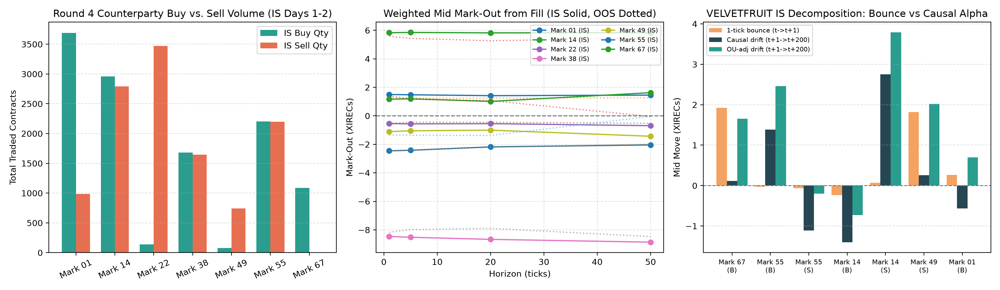

# Market Microstructure Across IMC Prosperity 4 (Rounds 1–5)

Quantitative edge in IMC Prosperity 4 originates in classifying order-book depth structure, return autocorrelation, strictly causal counterparty flow, and multi-asset pulse/lead-lag geometry before writing quoting rules. Every empirical measurement below was calibrated In-Sample (`IS`) strictly before single-pass Out-of-Sample (`OOS`) verification.

## 1. Cross-Round Microstructure Taxonomy

| Round | Instruments | Book Structure & Spread | Return Dynamics | Verified Edge vs. Pruned Trap |
| :--- | :--- | :--- | :--- | :--- |
| **R1–R2** | `ASH_COATED_OSMIUM` | `~92.4%` two-sided (`16`-tick spread, `13–22` empty/day) | Stationary OU (`ACF_1 ~ -0.44`, `ADF t < -10.5`, half-life `5.4–10.5`t) | Bot-wall fair value cuts step std `-31%` to `-40%`; fixed `10,000` OU anchor |
| **R1–R2** | `INTARIAN_PEPPER_ROOT` | `~92.4%` two-sided (`13 -> 14 -> 15` widening spread) | Exact deterministic slope **`+0.10000/tick`** (`R^2 = 1.0000`, `ACF_1 ~ -0.45`) | Asymmetric carry & wall tracking avoids naive `-20,294.50` short bleed |
| **R3–R4** | `HYDROGEL_PACK`, `VELVETFRUIT_EXTRACT`, `VEV_4000..6500` | `100%` two-sided (`HYDRO ~16`, `VELVET ~5`); `6000/6500` `0/1` noise | Weak stationary OU (`VELVET ~5,250`); R4 `Mark 01..67` prints | Total-vol BS without spot delta hedging; causal **`Mark 14` SELL** / **`Mark 55` BUY** (`Mark 67` is 1-tick bounce) |
| **R5** | `50` Spot Goods (`10` cat. $\times$ `5`) | Dense L1–L3 (`±10`), no trader IDs | Three synchronized Poisson pulse clusters (`Group V`, `Pebbles`, `Microchips`) | Discrete `MICROCHIP_CIRCLE` 50/100/150/200 lag (`+2,215.5` OOS); **`Pebbles`** sum `50k ± 2.82` trapped inside `12–14`t spreads |

## 2. Strictly Causal Counterparty Decomposition (Round 4 IS `Days 1–2`)

Conditioning strictly on In-Sample `VELVETFRUIT_EXTRACT` prints ([`r4_counterparty_velvet_midmoves.csv`](../../reports/tables/r4_counterparty_velvet_midmoves.csv)) and splitting immediate execution bounce (`t -> t+1`, hidden under causal `t - 100` delivery) from subsequent appreciation (`t+1 -> t+200`) separates genuine informed flow from microstructure illusion:

| Counterparty (`VELVETFRUIT`) | IS Trades | `t-1 -> t` | 1-Tick Bounce (`t -> t+1`) | Causal (`t+1 -> t+200`) | `OU-adj (h=200)` | `t-stat` | Verdict |
| :--- | :---: | :---: | :---: | :---: | :---: | :---: | :--- |
| **`Mark 67` (`buyer`)** | `119` | `-1.765` | **`+1.924`** *(bounce)* | `+0.113` | `+1.653` | `1.56` | **False Positive** (mean-reverting 1-tick spread bounce) |
| **`Mark 49` (`seller`)** | `71` | `-1.718` | `+1.817` | `+0.254` | `+2.021` | `1.45` | **Passive liquidity seller** (absorbed bounce) |
| **`Mark 14` (`seller`)** | `215` | `-0.091` | `+0.070` | **`+2.754`** | **`+3.788`** | **`+4.58`** | **True Causal Signal** (persistent appreciation) |
| **`Mark 55` (`buyer`)** | `404` | `+0.006` | `-0.024` | **`+1.385`** | **`+2.460`** | **`+4.07`** | **True Causal Signal** (persistent appreciation) |

Deploying strictly causal prior-tick signals from `Mark 14` SELL and `Mark 55` BUY (ignoring `Mark 67`) adds **`+11,153.50` XIRECs OOS** (`+260,540.00` vs `+249,386.50` for `Round3NoFlow`) and lowers MaxDD by **`2,581.00`** (`71,177.00` vs `73,758.00`).

## 3. Synchronized Pulse Clusters & Discrete Lead-Lag (Round 5)

Synchronized arrival analysis (`detect_trade_pulses`, [`r5_category_pca_and_pulses.csv`](../../reports/tables/r5_category_pca_and_pulses.csv)) shows public prints fire inside three category-wide synchronized pulse clusters (`100.0%` uniform side & quantity per cluster): `Group V` (`484` IS / `249` OOS pulses, $\lambda \approx 0.0242\text{–}0.0249$), `Pebbles` (`442` / `202`), and `Microchips` (`368` / `201`). Within `Microchips`, `MICROCHIP_CIRCLE` leads `OVAL` (`50`t), `SQUARE` (`100`t), `RECTANGLE` (`150`t), and `TRIANGLE` (`200`t) cleanly on both IS Days `2–3` (`is_pooled_beta = 0.0781..0.1296`), while exact `Pebbles` constant-sum stability (`std = 2.82`) sits strictly inside `12–14`-tick quoted spreads.
