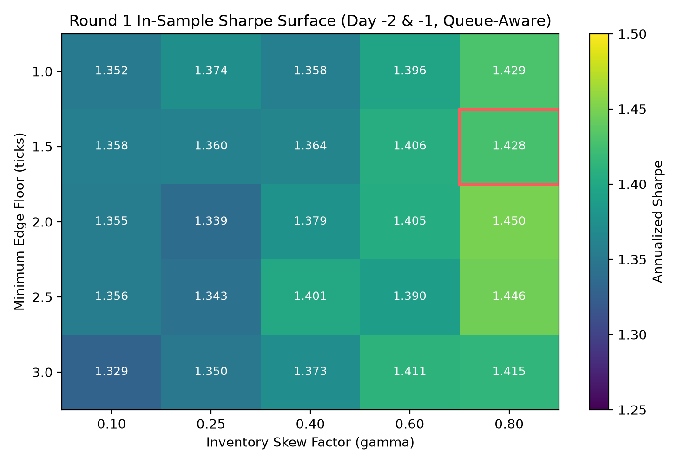
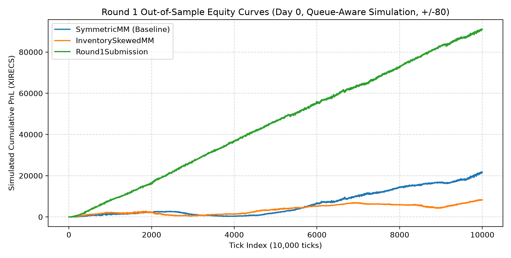

# Round 1: Market Fundamentals, Bot Structure & Strategy Refinement

## 1. Tradable Instruments (Observed)

Verified from `data/raw/prosperity4/round1/prices_round_1_day_{-2,-1,0}.csv` (10,000 ticks per instrument per day, `timestamp` step = `100`):

- **`ASH_COATED_OSMIUM`**: Stationary mean-reverting instrument centered near `10,000` XIRECS.
- **`INTARIAN_PEPPER_ROOT`**: Linearly drifting instrument increasing by `+1,000` XIRECS per day (`+0.10` per 100-tick step: `10,000 -> 11,000 -> 12,000 -> 13,000`).

---

## 2. Empirical Microstructure Summary (Calibration vs. Out-of-Sample)

We treat **Day -2** and **Day -1** as the exploratory/calibration split and reserve **Day 0** strictly for single-pass out-of-sample verification.

### A. Book Structure & Missing-Side Regimes (Observed)
Unlike Round 0 (`EMERALDS`, `TOMATOES`) where 100% of ticks are two-sided, Round 1 exhibits frequent liquidity gaps:
- **One-sided books**: `7.5%–8.0%` of ticks (`754–795` per day for `ASH_COATED_OSMIUM`; `726–768` per day for `INTARIAN_PEPPER_ROOT`).
- **Empty books**: `14–21` ticks per day where both `bid_price_1` and `ask_price_1` are missing (recorded as `mid_price == 0.0` in the raw CSV).
- **Methodological Implication**: Computing returns on raw CSV `mid_price` injects artificial $\pm 8$ tick jumps whenever one side vanishes. All empirical estimates below filter strictly to **two-sided ticks** (`bid_price_1` and `ask_price_1` both present).

### B. `ASH_COATED_OSMIUM` (Stationary Mean-Reverting Regime)
| Split | Day | Two-Sided Ticks | Mid Mean | Mid Std | Mean Spread | ADF $t$-stat (lags=2) | Est. OU $\hat{\theta}$ | Est. Half-Life |
| :--- | :--- | :--- | :--- | :--- | :--- | :--- | :--- | :--- |
| Calibration | Day -2 | 9,187 | 9,998.16 | 4.73 | 16.15 | $-8.429$ (reject $H_0$) | 0.0853 | 8.13 ticks |
| Calibration | Day -1 | 9,225 | 10,000.83 | 3.83 | 16.19 | $-10.990$ (reject $H_0$) | 0.1352 | 5.13 ticks |
| **OOS Check** | **Day 0** | **9,232** | **10,001.62** | **5.22** | **16.18** | **$-7.898$ (reject $H_0$)** | **0.0732** | **9.47 ticks** |

- **Public Trade Flow**: 411–429 prints/day (~`4.1%–4.3%` arrival probability per tick), balanced ~50/50 between `ask_price_1` and `bid_price_1` touches, mean print size `5.15–5.25`.

### C. `INTARIAN_PEPPER_ROOT` (Deterministic Linear Drift + Proportional Noise)
| Split | Day | Two-Sided Ticks | Mid Mean | Mean Spread | Spread / Mid | OLS Drift Slope (`/step`) | OLS $R^2$ | Detrended Residual Std |
| :--- | :--- | :--- | :--- | :--- | :--- | :--- | :--- | :--- |
| Calibration | Day -2 | 9,216 | 10,500.57 | 11.99 | 11.42 bps | `+0.10000` | 1.0000 | 1.1237 |
| Calibration | Day -1 | 9,219 | 11,501.41 | 13.01 | 11.31 bps | `+0.10001` | 1.0000 | 1.2596 |
| **OOS Check** | **Day 0** | **9,253** | **12,500.96** | **14.13** | **11.30 bps** | **`+0.10000`** | **1.0000** | **1.3352** |

- **Detrended Residuals**: Once detrended by $\hat{P}_t = \hat{\alpha} + 0.001 \cdot t$, residuals are stationary across all 3 days (ADF $t = -55.50, -56.23, -55.92$) with near-zero AR(1) persistence ($\hat{b} \approx 0.006\text{–}0.015$).
- **Public Trade Flow**: 332–344 prints/day (~`3.3%–3.4%` arrival probability per tick), mean print size `5.07–5.24`.

---

## 3. Bot-Tier Microstructure & Stage 6 Strategy Refinement

Inspecting L1–L3 depth on `Day -2` and `Day -1` reveals **why** our initial Stage 5 market maker left substantial edge on the table:
1. **Two-Tier Bot Quoting**: Approximately `68%` of two-sided books contain a second resting tier `2–3` ticks behind L1, while the primary structural bot walls sit wide (`median spread = 16` on `ASH_COATED_OSMIUM`, `12–13` on `INTARIAN_PEPPER_ROOT`).
2. **Filtering Transient Inside Noise**: When thin inside-spread quotes appear momentarily at L1, L1 microprice gets pulled away from true fair value. Selecting the **maximum-volume resting price level** on each side (`_popular_wall_mid`) anchors fair value directly to the structural market-maker bot walls.
3. **Penny-Improving Inside Wide Spreads**: Quoting fixed `reservation ± 2.0` inside a 16-tick spread sacrifices `5–6` ticks of spread capture per fill. Instead, we quote:
   $$P_{\text{bid}} = \min\big(\lfloor r - \delta_{\min} \rfloor,\ P_{\text{bid}, 1} + 1\big), \quad P_{\text{ask}} = \max\big(\lceil r + \delta_{\min} \rceil,\ P_{\text{ask}, 1} - 1\big)$$
   where $r = FV_t - \gamma \cdot q_{\text{start}}$. When the book is wide, we capture `6–7` ticks per leg with **zero queue ahead**; when the book tightens, $\delta_{\min}$ prevents quoting past fair value.

### Sensitivity & Overfitting Validation (IS `Day -2` & `Day -1`)
Using `scripts/run_optimisation.py` across a 25-point grid (`min_edge` $\in [1.0, 3.0]$ $\times$ `inventory_skew` $\in [0.10, 0.80]$):
- **Selected Plateau**: `min_edge = 1.5`, `inventory_skew = 0.80` (neighborhood mean Sharpe `1.419`, std `0.020`, max neighbor drop `0.022`).
- **CSCV / PBO ($S = 8$, 70 splits)**: `PBO = 0.086` (`< 0.15`), `prob_oos_neg = 0.000`.
- **Deflated Sharpe Ratio**: `DSR = 1.0000` (`>= 0.95`).

---

## 4. Simulated Ablation & Out-of-Sample Verification

All figures below are **Simulated Results** generated via `scripts/evaluate_round0_round1.py` under the explicit configurable assumption $Q_{\max} = 20$ (exact official Round 1 limits remain **UNVERIFIED**).

### A. Historical Replay Ablation (`Day -2`/`-1` IS vs. `Day 0` OOS)
| Strategy | Day -2 (IS, `queue_aware`) | Day -1 (IS, `queue_aware`) | **Day 0 (OOS, `conservative`)** | **Day 0 (OOS, `queue_aware`)** | **Day 0 (OOS, `touch`)** |
| :--- | :--- | :--- | :--- | :--- | :--- |
| `NoOpBaseline` | 0.00 (MaxDD 0) | 0.00 (MaxDD 0) | 0.00 (MaxDD 0) | 0.00 (MaxDD 0) | 0.00 (MaxDD 0) |
| `SymmetricMM` (Baseline) | 2,544.00 (MaxDD 1,723.0) | 14,461.00 (MaxDD 945.0) | 10,825.00 (MaxDD 886.0) | 10,825.00 (MaxDD 886.0) | 11,895.00 (MaxDD 913.5) |
| `InventorySkewedMM` (Stage 5) | 13,767.00 (MaxDD 443.5) | 11,825.00 (MaxDD 754.0) | 9,067.00 (MaxDD 837.5) | 9,067.00 (MaxDD 837.5) | 9,087.00 (MaxDD 855.5) |
| **`Round1Submission` (Stage 6)** | **23,084.50 (MaxDD 304.0)** | **23,057.00 (MaxDD 262.0)** | **22,151.00 (MaxDD 267.0)** | **22,157.00 (MaxDD 267.0)** | **22,667.00 (MaxDD 274.5)** |

- **Per-Tick Latency**: `Round1Submission` executes at `0.038–0.045 ms/tick` over 10,000 ticks (more than 20x under a `1.0 ms` budget).

### B. Calibrated Monte Carlo Distribution (30 Sessions $\times$ 500 Ticks, Conservative Fills)
| Strategy | Mean PnL | Std Dev | $\text{VaR}_{95}$ | $\text{CVaR}_{95}$ | $\mathbb{P}(\text{Loss})$ |
| :--- | :--- | :--- | :--- | :--- | :--- |
| `SymmetricMM` (Baseline) | 359.52 | 496.20 | $-451.87$ | $-774.25$ | 0.20 |
| **`Round1Submission` (Stage 6)** | **900.48** | **319.06** | **+446.18** | **+344.25** | **0.00** |

