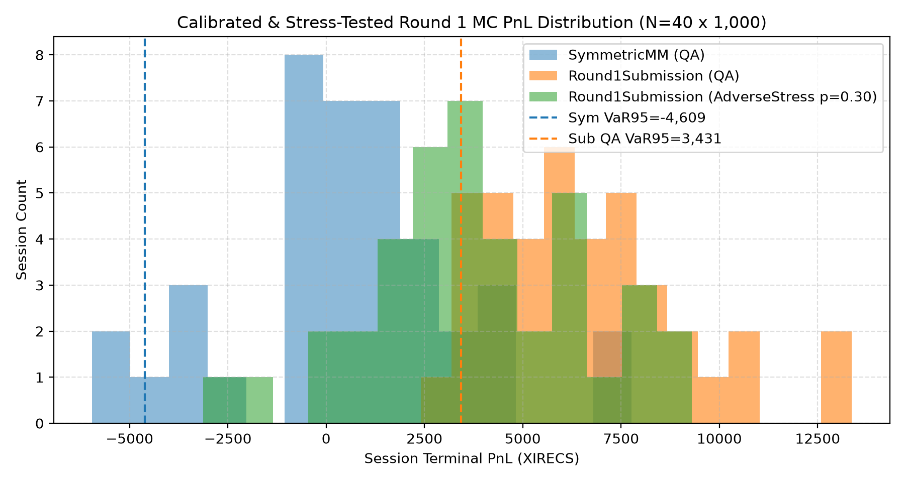

# Round 1: Market Fundamentals, Bot Structure & Live-to-OOS Reconciliation

> **Official Live Competition Result (`Team 63-bit integers`)**: Algo **`+116,927`** · Manual `+87,995` · Round Total **`+204,922` XIRECs**.

## 1. Tradable Instruments (Observed)

Verified from `data/raw/prosperity4/round1/prices_round_1_day_{-2,-1,0}.csv` (`10,000` ticks per instrument per day, `timestamp` step = `100`, verified official `±80` position limit per symbol):

- **`ASH_COATED_OSMIUM`**: Stationary Ornstein-Uhlenbeck instrument centered near `10,000` XIRECs (`16`-tick median spread).
- **`INTARIAN_PEPPER_ROOT`**: Deterministic linearly drifting instrument advancing at **`+0.10000` XIRECs per tick** (`+1,000`/day across `Day -2 -> -1 -> 0`).

---

## 2. Empirical Microstructure Summary (Calibration vs. Held-Out OOS)

We keep **`Day -2` and `Day -1`** strictly as the In-Sample calibration split and hold back **`Day 0`** strictly for single-pass Out-of-Sample verification.

### A. Missing-Side & Empty-Book Regimes
- **One-sided books**: `7.5%–8.0%` of ticks (`754–795`/day `ASH_COATED_OSMIUM`; `726–768`/day `INTARIAN_PEPPER_ROOT`).
- **Empty books**: `14–21` ticks/day (`mid_price == 0.0`). Naive returns computed on raw CSV `mid_price` inject artificial jumps; our diagnostics restrict return fits to two-sided ticks and carry forward last valid two-sided marks during valuation.

### B. Stationary Anchor vs. Trend Carry
- `ASH_COATED_OSMIUM` rejects a unit root on all days (`ADF t < -7.8`, half-life `~5–10` ticks) around `10,000`.
- `INTARIAN_PEPPER_ROOT` exhibits `OLS R^2 = 1.0000` deterministic linear drift (`+0.10000/tick`, stationary detrended residuals with `ADF t < -55.0`).

---

## 3. Strategy Architecture, Interior Plateau & Validation Gates

[`traders/round1/submission.py`](../../traders/round1/submission.py) enforces `±80` limits and pairs:
1. **`ASH_COATED_OSMIUM`**: Fixed `10,000.0` fair-value anchor with inventory skew (`inventory_skew = 0.40`) and edge floor (`min_edge = 2.0`), crossing mispriced resting depth inside `[FV - 1.0, FV + 1.0]` before quoting passive brackets.
2. **`INTARIAN_PEPPER_ROOT`**: Max-volume bot-wall fair-value extraction (`_popular_wall_mid`) with asymmetric trend-aligned carry up to `+80`.

### Sensitivity & Multiple-Testing Control (`Day -2` & `Day -1` IS)
Sweeping `min_edge in {1.5, 2.0, 2.5, 3.0, 3.5}` $\times$ `inventory_skew in {0.10, 0.25, 0.40, 0.55, 0.70}` via [`scripts/run_optimisation.py`](../../scripts/run_optimisation.py):
- **Selected Interior Plateau**: `min_edge = 2.0, inventory_skew = 0.40` (`IS IR_tick = 0.05802`, `3x3` local mean `0.05788`, std `0.00009`).
- **Multiple-Testing Gates**: `N_eff = 1.0216`, **`CSCV PBO = 0.1286`**, **`DSR_block = 1.0000`**.

---

## 4. Held-Out OOS Verification (`Day 0`) & Monte Carlo Risk

All results below reflect deterministic **simulated replays** under official `±80` limits (`scripts/evaluate_round0_round1.py`, `scripts/generate_report.py`):

### A. Historical Replay Ablation (`Day -2/-1` IS vs. `Day 0` OOS)
| Strategy | `Day -2` (IS `QA`) | `Day -1` (IS `QA`) | **`Day 0` (OOS `cons`)** | **`Day 0` (OOS `QA`)** | **`Day 0` (OOS `touch`)** |
| :--- | ---: | ---: | ---: | ---: | ---: |
| `NoOpBaseline` | `0.00` | `0.00` | `0.00` | `0.00` | `0.00` |
| `SymmetricMM` | `-12,460.00` | `52,710.00` | `21,731.00` *(DD `2,455`)* | `21,731.00` *(DD `2,455`)* | `30,670.00` *(DD `2,986`)* |
| `InventorySkewedMM` | `11,220.50` | `12,152.00` | `8,072.00` *(DD `2,959`)* | `8,251.00` *(DD `2,743`)* | `8,133.00` *(DD `3,230`)* |
| **`Round1Submission`** | **`89,507.00`** *(DD `1,066`)* | **`93,968.00`** *(DD `1,072`)* | **`91,098.00`** *(DD `1,405`)* | **`91,098.00`** *(DD `1,405`)* | **`91,743.00`** *(DD `1,391`)* |

- **OOS `Day 0` Metrics (`queue_aware`)**: **`+91,098.00` XIRECs** (`ASH_COATED_OSMIUM +11,371.00`, `INTARIAN_PEPPER_ROOT +79,727.00`), `IR_tick = 0.05445` (`95% Boot CI [0.05052, 0.05875]`, `BootPnL [85,711.14, 96,434.06]`), `BlkSR_1k = 9.327`, `PnL/MaxDD = 64.84`, `712` fills, **`0.0204 ms/tick`** latency.

### B. Calibrated & Stressed Monte Carlo (`N = 40` Sessions $\times$ `1,000` Ticks)
| Scenario / Strategy | Mean MC PnL | Std Dev | `VaR 95%` | `CVaR 95%` | `Prob(Loss)` | `Wilson 95% Upper` | Mean `IR_tick` |
| :--- | ---: | ---: | ---: | ---: | :---: | :---: | ---: |
| `SymmetricMM` (`QA`) | `562.46` | `2,970.34` | `-4,609.05` | `-5,711.00` | `37.5%` | `53.0%` | `0.01035` |
| **`Round1Submission_QA`** | **`6,675.06`** | `2,619.24` | `3,431.15` | `2,845.75` | `0.0%` | `8.76%` | `0.05715` |
| **`Round1Submission_AdverseStress`** | `3,783.54` | `2,769.09` | `-253.65` | `-2,503.00` | `7.5%` | `19.86%` | `0.02242` |

