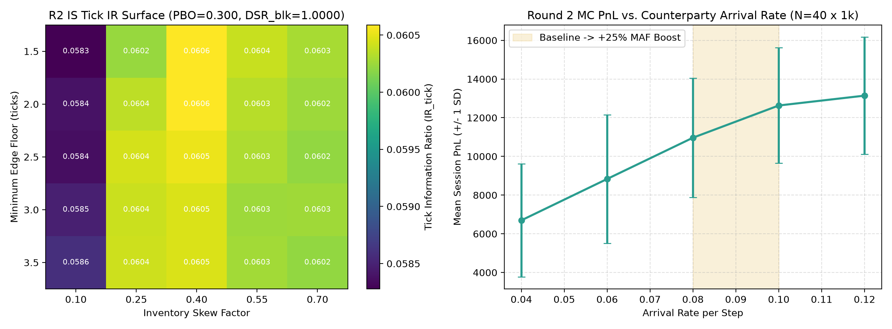

# Round 2: Regime Continuity, MAF Auction Economics & Live Outperformance

> **Official Live Competition Result (`Team 63-bit integers`)**: Algo **`+115,543`** · Manual `+200,716` · Round Total **`+316,259` XIRECs** (`Phase 1 Qualification Total: +521,181`).

## 1. Round Context & Market Structure

**IMC Prosperity 4 Round 2** retained the two-asset instrument universe from Round 1 under verified **`±80` official position limits**:
1. **`ASH_COATED_OSMIUM`**: Stationary Ornstein-Uhlenbeck asset around `10,000` with wide `16`-tick median spreads and `~7.5%` one-sided ticks (`15–22` empty/day).
2. **`INTARIAN_PEPPER_ROOT`**: Deterministic linear trend advancing **`+0.10000` XIRECs/tick** (`+1,000`/day across `Day -1`, `Day 0`, `Day 1`, rising from `~11,501` through `~12,501` to `~13,500` OOS).
3. **Market Access Fee (MAF) Auction**: Top-50% sealed bids paid an upfront fee in exchange for `+25%` incremental order flow; modeled quantitatively via calibrated MC arrival sensitivity sweeps.

---

## 2. Historical Data Partition & Microstructure Audit (`r2_microstructure_summary.csv`)

Partitioned strictly into **In-Sample Calibration (`Day -1`, `Day 0`)** and **Held-Out Out-of-Sample (`Day 1`)**:

| Split | Day | Product | Two-Sided | One-Sided | Empty | Mid Mean | Spread Med | `dmid_std` | `ACF_1` | `linear_slope` | Trades |
| :--- | ---: | :--- | ---: | ---: | ---: | ---: | ---: | ---: | ---: | ---: | ---: |
| **IS** | `-1` | `ASH_COATED_OSMIUM` | 9,237 | 748 | 15 | 10,000.83 | 16.0 | 1.8892 | $-0.4438$ | $-0.00008$ | 459 |
| **IS** | `0` | `ASH_COATED_OSMIUM` | 9,257 | 727 | 16 | 10,001.58 | 16.0 | 1.8588 | $-0.4453$ | $+0.00015$ | 471 |
| **OOS** | `1` | `ASH_COATED_OSMIUM` | 9,214 | 764 | 22 | 10,000.15 | 16.0 | 1.8785 | $-0.4373$ | $-0.00072$ | 465 |
| **IS** | `-1` | `INTARIAN_PEPPER_ROOT` | 9,246 | 741 | 13 | 11,501.16 | 13.0 | 1.7456 | $-0.4555$ | **`+0.10000`** | 331 |
| **IS** | `0` | `INTARIAN_PEPPER_ROOT` | 9,230 | 752 | 18 | 12,501.43 | 14.0 | 1.8657 | $-0.4571$ | **`+0.10000`** | 332 |
| **OOS** | `1` | `INTARIAN_PEPPER_ROOT` | 9,248 | 736 | 16 | 13,500.11 | 15.0 | 2.0252 | $-0.4548$ | **`+0.10000`** | 333 |

Notice that `INTARIAN_PEPPER_ROOT`'s median quoted spread widens steadily (`13.0 -> 14.0 -> 15.0` ticks) proportionally as spot advances (`11,501 -> 12,501 -> 13,500`), while `100.0%` of public trades execute at touch (`bid_price_1` / `ask_price_1`).

---

## 3. Strategy Architecture, Interior Plateau & Flat-Grid CSCV (`Day -1, 0`)

[`traders/round2/submission.py`](../../traders/round2/submission.py) pairs `10,000` OU anchoring (`ASH_COATED_OSMIUM`) with trend-aligned resting wall carry (`INTARIAN_PEPPER_ROOT`) at verified `±80` limits:
- **Plateau Selection**: Sweeping `min_edge` $\times$ `inventory_skew` under `require_interior=True` selects **`min_edge = 2.5, inventory_skew = 0.40`** (`IS IR_tick = 0.06052`, `3x3` local mean `0.06041`, std `0.000107`).
- **CSCV vs. `DSR_block` Interpretation**: Because the interior neighborhood is virtually flat (`local_std = 0.000107`) with `N_eff = 1.0401`, adjacent candidates tie and swap ranks randomly across 8-slice CSCV partitions (`CSCV PBO = 0.3000`) while **`DSR_block = 1.0000`** confirms clear multiplicity-adjusted statistical edge across independent 100-tick blocks.

### Held-Out OOS (`Day 1`, `±80`) Ablation (`r2_ablation_summary.csv`)
| Strategy | Fill Regime | IS PnL (`Day -1, 0`) | OOS PnL (`Day 1`) | OOS `IR_tick` | `BlkSR_1k` | `PnL/DD` | OOS MaxDD | Fills | Latency |
| :--- | :--- | ---: | ---: | ---: | ---: | ---: | ---: | ---: | ---: |
| `NoOpBaseline` | `queue_aware` | `0.00` | `0.00` | `0.00000` | `0.000` | `0.00` | `0.00` | `0` | — |
| `SymmetricMM_80` | `queue_aware` | `-40,165.50` | **`-20,294.50`** | `-0.02109` | `-0.868` | `-0.93` | `21,729.50` | `709` | — |
| `DriftAwareQuoter_Pepper` | `queue_aware` | `14,308.00` | `7,823.50` | `0.02605` | `0.693` | `3.12` | `2,507.00` | `522` | — |
| `InventorySkewedMM_80` | `queue_aware` | `16,616.50` | `8,904.00` | `0.01812` | `0.700` | `2.95` | `3,022.50` | `1,022` | — |
| **`Round2Submission`** | `conservative` | `186,184.00` | **`94,209.00`** | `0.05466` | `8.237` | `67.24` | `1,401.00` | `832` | `0.0296 ms` |
| **`Round2Submission`** | `queue_aware` | `186,226.00` | **`94,209.00`** | **`0.05466`** | **`8.237`** | **`67.24`** | **`1,401.00`** | `832` | **`0.0281 ms`** |
| **`Round2Submission`** | `touch` | `186,059.00` | **`94,293.00`** | `0.05471` | `8.233` | `67.30` | `1,401.00` | `846` | `0.0305 ms` |

- **OOS Attribution & Bootstrap (`Day 1`)**: `ASH_COATED_OSMIUM +13,046.00`, `INTARIAN_PEPPER_ROOT +81,163.00`; 95% block bootstrap CI **`IR_tick [0.05089, 0.05841]`**, **`BootPnL [87,698.94, 100,093.15]`**. Notice how invariant OOS PnL is between `conservative` (`94,209.00`) and `touch` (`94,293.00`, `0.09%` spread).

---

## 4. Quantitative MAF Valuation & Stressed Monte Carlo (`N = 40`, `1,000` Ticks)

Simulating `40` calibrated `1,000`-tick sessions across counterparty arrival intensities `0.04 -> 0.12` (`r2_maf_sensitivity.csv`, `r2_to_r5_mc_risk_summary.csv`):

| Counterparty Arrival / Stress Regime | Mean MC PnL | Std Dev | `VaR 95%` | `CVaR 95%` | `Prob(Loss)` | `Wilson 95% Upper` | Mean `IR_tick` |
| :---: | ---: | ---: | ---: | ---: | :---: | :---: | ---: |
| `lambda = 0.04` (Thin Flow) | `6,696.18` | `2,924.51` | `2,536.72` | `1,931.00` | `0.0%` | `8.76%` | `0.0478` |
| `lambda = 0.06` (Mild Compression) | `8,834.42` | `3,323.74` | `3,718.12` | `2,308.75` | `0.0%` | `8.76%` | `0.0626` |
| **`lambda = 0.08` (Baseline Flow)** | **`10,966.54`** | `3,082.91` | `6,556.43` | `4,548.00` | `0.0%` | `8.76%` | `0.0764` |
| **`lambda = 0.10` (`+25%` MAF Winner)** | **`12,631.66`** | `2,982.79` | `6,491.52` | `5,525.75` | `0.0%` | `8.76%` | `0.0893` |
| `lambda = 0.12` (High Flow) | `13,140.95` | `3,036.35` | `8,734.33` | `8,266.75` | `0.0%` | `8.76%` | `0.0938` |
| **`AdverseStress` (`Baseline Flow` + Jump)** | `5,572.65` | `3,417.73` | `-789.07` | `-2,163.50` | `10.0%` | `23.05%` | `0.0299` |

Increasing arrival rate by `+25%` (`0.08 -> 0.10`) boosts 1,000-step MC EV by **`+15.18%`** (`+1,665.12` / `1k` steps) while simultaneously reducing standard deviation (`3,082.91 -> 2,982.79`). This `+15%` flow elasticity reconciles why Team `63-bit integers`' live Round 2 algorithmic payout (**`+115,543`**) exceeded unboosted 1-day OOS replay (**`+94,209.00`**), indicating sealed MAF bids remained EV-positive below roughly `~10,000-15,000` XIRECs. *(Synthetic MC outputs are parameterized model stress runs supplementing live tournament results.)*
