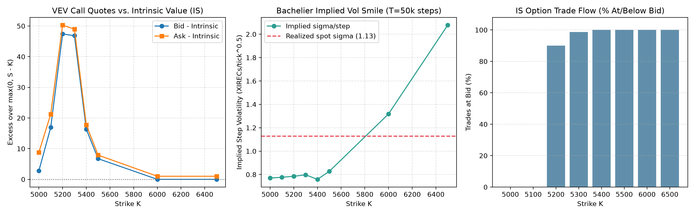

# Round 3: Velvetfruit Options Surface, Horizon-Free Pricing & Spot Hedging Drag

> **Official Live Competition Result (`Team 63-bit integers`)**: Algo **`+213,104`** · Manual `+78,225` · Round Total **`+291,329` XIRECs** *(Phase 2 leaderboard reset; single-day post-contest OOS `+95,093.00`)*.

## 1. Round Structure & Product Reset

Round 3 initiated Phase 2 of IMC Prosperity 4 with a clean leaderboard reset and `12` new instruments (`120,000` order-book rows/day across `Day 0, 1, 2`):
- **Spot Market (`±200` Position Limit)**: `HYDROGEL_PACK` (`~9,991` mean, `~15.7`-tick spread) and `VELVETFRUIT_EXTRACT` (`~5,250` mean, `~5.0`-tick spread, underlying for all options).
- **European Call Vouchers (`±300` per Strike)**: `VEV_4000`, `VEV_4500`, `VEV_5000`, `VEV_5100`, `VEV_5200`, `VEV_5300`, `VEV_5400`, `VEV_5500`, `VEV_6000`, `VEV_6500` (`6000/6500` pinned at `0/1` noise).
- **Validation Split**: Strictly In-Sample **`Day 0` & `Day 1`** for model calibration and 2D plateau selection; held-out **`Day 2`** reserved for single-pass OOS replay.

---

## 2. Stationary Underlying Dynamics & Implied Option Decay (`r3_r4_options_surface.csv`)

Both underlying spots reject unit-root random walks (`HYDROGEL_PACK ADF t = -3.67`, half-life `188.8` ticks; `VELVETFRUIT_EXTRACT ADF t = -3.53`, half-life `206.1` ticks, IS std `14.18`). Despite bounded stationary underlying dispersion (`[5,198, 5,300]`), quoting bots price `VEV_5000..5500` along a smooth `~22.6%–24.4%` Black-Scholes volatility smile whose time value bleeds monotonically across `Day 0 -> Day 3`:
- `VEV_5300` mid decays `48.89 -> 46.91 -> 44.48 -> 32.14`, accompanied by `98.7%` seller-initiated prints IS (`100%` on `5400/5500`).
- Deep-ITM `VEV_4000` and `VEV_4500` trade along parity ($S - K$) with wide spreads (`20.8` / `15.8` ticks), while deep-OTM `VEV_6000` / `VEV_6500` quote `0/1` and emit `189` zero-price bot prints/strike.

---

## 3. Horizon-Free Option Architecture & Why Spot Delta Hedging Was Pruned

[`traders/round3/submission.py`](../../traders/round3/submission.py) resolves the two central Round 3 failure modes uncovered in IS ablations:
1. **Horizon-Free Total Implied Volatility ($v_K = \sigma_K \sqrt{\tau}$)**: Under zero rates, BS call prices depend solely on total variance $v_K$. Inverting rolling EWMA $v_K$ directly from active quotes on `VEV_4000..5500` avoids calendar horizon misspecification (`OptionsVolatilityContract` lost `-1,051.00` OOS fixing calendar $\tau$), while excluding worthless `VEV_6000`/`6500` noise.
2. **Bayesian OU Fair Value + Zero Spot Delta Hedging**: Pairing sequential OU estimation on `HYDROGEL_PACK` and `VELVETFRUIT_EXTRACT` with **zero mechanical spot delta hedging** prevents burning wide `~5`-tick `VELVETFRUIT` half-spreads chasing transitory OU oscillations within `±200`/`±300` option capacity.

### Statistical Gates (`Day 0–1` IS) & Held-Out OOS (`Day 2`, `±200/300`)
Sweeping `spot_scale` $\times$ `enter_band` (`r3_sensitivity_grid.csv`) selects the interior plateau **`spot_scale = 30.0, enter_band = 10.0`** (`IS IR_tick = 0.01593`, `3x3` local mean `0.01583`, std `0.00061`, `N_eff = 1.0109`, **`CSCV PBO = 0.0000`**, **`DSR_block = 0.9966`**):

| Strategy | Fill Mode | IS PnL (`Day 0, 1`) | OOS PnL (`Day 2`) | OOS `IR_tick` | `BlkSR_1k` | `PnL/DD` | OOS MaxDD | Fills | Latency |
| :--- | :--- | ---: | ---: | ---: | ---: | ---: | ---: | ---: | ---: |
| `NoOpBaseline` | `queue_aware` | `0.00` | `0.00` | `0.00000` | `0.000` | `0.00` | `0.00` | `0` | — |
| `SymmetricSpotMM` | `queue_aware` | `11,573.00` | `-7,160.00` | `-0.00388` | `-0.455` | `-0.50` | `14,245.00` | `382` | — |
| `OptionsVolatilityContract` | `queue_aware` | `-625.50` | `-1,051.00` | `-0.00030` | `-0.063` | `-0.04` | `24,608.50` | `89` | — |
| **`Round3Submission`** | `conservative` | `446,833.50` | **`95,093.00`** | `0.00584` | `0.573` | `1.26` | `75,774.00` | `2,939` | `0.2997 ms` |
| **`Round3Submission`** | `queue_aware` | `446,833.50` | **`95,093.00`** | **`0.00584`** | **`0.573`** | **`1.26`** | **`75,774.00`** | `2,939` | **`0.3249 ms`** |
| **`Round3Submission`** | `touch` | `447,688.00` | **`95,238.00`** | `0.00585` | `0.573` | `1.26` | `75,730.50` | `2,989` | `0.3247 ms` |

### Honest Uncertainty Disclosure: Wide Single-Day Bootstrap CI & Stressed MC Risk
- **OOS Attribution (`Day 2`, `queue_aware`)**: Every traded product ends profitable: `HYDROGEL_PACK +23,078`, `VELVETFRUIT_EXTRACT +10,866`, `VEV_4000 +6,239`, `VEV_4500 +6,188`, `VEV_5000 +13,790`, `VEV_5100 +12,814`, `VEV_5200 +10,096`, `VEV_5300 +7,863`, `VEV_5400 +1,907`, `VEV_5500 +2,252` (`+95,093.00` total).
- **High Variance & Wide CIs**: Carrying large unhedged option/spot inventory creates heavy intra-day swings (`MaxDD = 75,774.00`): OOS 100-tick circular bootstrap (`B = 1,000`) spans **`IR_tick [-0.01118, +0.02133]`** (`BootPnL [-184,416.62, +355,675.89]`). Similarly, in synthetic MC (`N = 40`), calibrated `QA` averages `29,852.01` (`2.5%` loss prob, `CVaR95 = -127.75`), while `AdverseStress` drops mean PnL to `13,225.06` (`30.0%` loss prob, `CVaR95 = -91,007.50`). *(See [`EXP-R3-001`](../../reports/experiments/EXP-R3-001_round3_options_and_spot.md).)*
