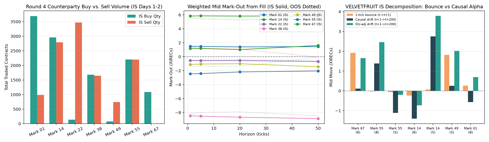
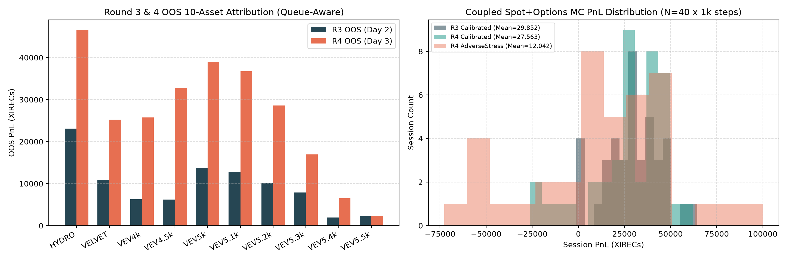

# Round 4: Counterparty Flow Decomposition & Stratified Mark-Outs

> **Official Live Competition Result (`Team 63-bit integers`)**: Algo **`+220,783`** · Manual `+36,969` · Round Total **`+257,752` XIRECs** *(post-contest Day 3 OOS `+260,540.00`)*.

## 1. Round Context & Telemetry Evolution

Round 4 carried over the exact **12-product universe** from Round 3 (`HYDROGEL_PACK` `±200`, `VELVETFRUIT_EXTRACT` `±200`, `VEV_4000..6500` `±300` each) across `Day 1`, `Day 2`, and `Day 3`, while exposing **counterparty identifiers (`buyer` and `seller`) in `trades_round_4_day_{1,2,3}.csv`**:

- **Historical File Structure Audit**: `prices_round_4_day_1.csv` and `day_2.csv` share exact SHA-256 parity with `prices_round_3_day_1.csv` and `day_2.csv`, whereas `trades_round_4_day_{1,2}.csv` populate seven counterparty tags (`Mark 01`, `Mark 14`, `Mark 22`, `Mark 38`, `Mark 49`, `Mark 55`, `Mark 67`).
- **Held-Out Split**: `Day 1–2` = strictly In-Sample (`IS`); **`Day 3`** (`120,000` book rows, `1,541` trades) = single-pass Out-of-Sample (`OOS`).

---

## 2. Counterparty Causal vs. 1-Tick Bounce Decomposition (`IS Days 1–2`)

Conditioning strictly on In-Sample `VELVETFRUIT_EXTRACT` prints ([`r4_counterparty_velvet_midmoves.csv`](../../reports/tables/r4_counterparty_velvet_midmoves.csv)) and separating the **mechanical 1-tick bounce (`t -> t+1`)**—which is never observable at decision time under causal `t - 100` trade delivery—from **true causal appreciation (`t+1 -> t+200`)** prevents a critical look-ahead pitfall:

| Counterparty (`VELVETFRUIT`, IS) | Side | `n` | `t-1 -> t` | Bounce (`t -> t+1`) | Causal (`t+1 -> t+200`) | `OU-adj h200` | `t-stat` | Research Conclusion |
| :--- | :--- | ---: | ---: | ---: | ---: | ---: | ---: | :--- |
| **`Mark 67`** | Buyer | `119` | `-1.765` | **`+1.924`** *(unobservable)* | `+0.113` | `+1.653` | `1.56` | **Pruned**: 1-tick spread bounce, zero causal edge |
| **`Mark 49`** | Seller | `71` | `-1.718` | `+1.817` | `+0.254` | `+2.021` | `1.45` | Passive liquidity seller |
| **`Mark 14`** | Seller | `215` | `-0.091` | `+0.070` | **`+2.754`** | **`+3.788`** | **`+4.58`** | **Promoted**: strong causal upward drift |
| **`Mark 55`** | Buyer | `404` | `+0.006` | `-0.024` | **`+1.385`** | **`+2.460`** | **`+4.07`** | **Promoted**: persistent causal appreciation |

---

## 3. Strictly Causal Architecture, Interior Plateau & OOS Evaluation (`Day 3`)

[`traders/round4/submission.py`](../../traders/round4/submission.py) pairs Round 3's unhedged Bayesian OU + Black-Scholes total-volatility options core (`spot_scale = 30.0`) with strictly prior-tick `state.market_trades` filtering on `VELVETFRUIT_EXTRACT` (`t - 100` lag enforced):
- Whenever prior-tick `Mark 14` **sells** or `Mark 55` **buys**, `Round4Submission` adds a decaying causal positive fair-value signal (`flow_weight = 1.5`) without chasing `Mark 67` bounces.
- **IS Plateau & Overfitting Gates (`Day 1–2`)**: Sweeping `spot_scale in {10, 20, 30, 40}` $\times$ `flow_weight in {0.5, 1.0, 1.5, 2.0, 2.5}` selects interior plateau **`spot_scale = 30.0, flow_weight = 1.5`** (`IS IR_tick = 0.01137`, `3x3` local mean `0.01135`, std `0.00045`, `N_eff = 1.0157`, **`CSCV PBO = 0.0143`**, **`DSR_block = 0.9783`**).

| Strategy | Fill Mode | IS PnL (`Day 1, 2`) | OOS PnL (`Day 3`) | OOS `IR_tick` | OOS `BlkSR_1k` | `PnL/DD` | OOS MaxDD | Fills | Mean Latency |
| :--- | :--- | ---: | ---: | ---: | ---: | ---: | ---: | ---: | ---: |
| `NoOpBaseline` | `queue_aware` | `0.00` | `0.00` | `0.00000` | `0.000` | `0.00` | `0.00` | `0` | — |
| `Round3NoFlow` | `queue_aware` | `313,275.50` | `249,386.50` | `0.01617` | `0.597` | `3.38` | `73,758.00` | `3,469` | `0.2768 ms` |
| **`Round4Submission`** | `conservative` | `341,631.00` | **`260,537.00`** | `0.01680` | `0.646` | `3.66` | `71,177.00` | `3,667` | `0.2914 ms` |
| **`Round4Submission`** | `queue_aware` | `341,648.00` | **`260,540.00`** | **`0.01680`** | **`0.646`** | **`3.66`** | **`71,177.00`** | `3,669` | **`0.2925 ms`** |
| **`Round4Submission`** | `touch` | `342,518.00` | **`260,392.00`** | `0.01678` | `0.644` | `3.65` | `71,390.00` | `3,802` | `0.2974 ms` |

### OOS Attribution, Bootstrap Uncertainty & Stressed MC
- **Controlled Improvement Over `Round3NoFlow`**: Adding `Mark 14`/`Mark 55` causal flow improves OOS PnL by **`+11,153.50`** (`+260,540.00` vs `+249,386.50`), trims MaxDD by **`-2,581.00`** (`71,177.00` vs `73,758.00`), and lifts `BlkSR_1k` from `0.597` to `0.646`. Every traded symbol closes net positive (`HYDROGEL +46,672`, `VELVET +25,237`, `VEV_4000 +25,774`, `VEV_4500 +32,686`, `VEV_5000 +39,019`, `VEV_5100 +36,756`, `VEV_5200 +28,599`, `VEV_5300 +16,931`, `VEV_5400 +6,554`, `VEV_5500 +2,312`).
- **Bootstrap (`Day 3`, `block=100, B=1,000`) & MC (`N = 40`)**: OOS `IR_tick` 95% CI **`[0.00099, 0.03354]`**, PnL CI **`[14,650.65, 525,360.43]`**. Under synthetic MC (`N = 40`), calibrated `QA` averages `27,562.95` (`12.5%` loss prob, `wilson_ci_upper = 26.1%`, `CVaR95 = -24,536.25`), while `AdverseStress` lowers mean PnL to `12,042.42` (`27.5%` loss prob, `CVaR95 = -66,346.50`)—honestly reflecting large options/spot inventory variance. *(See [`EXP-R4-001`](../../reports/experiments/EXP-R4-001_round4_counterparty_flow.md).)*
