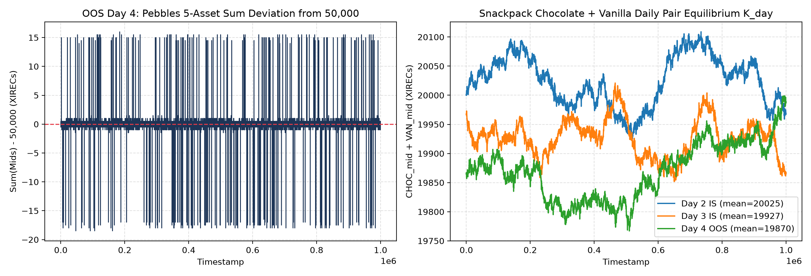
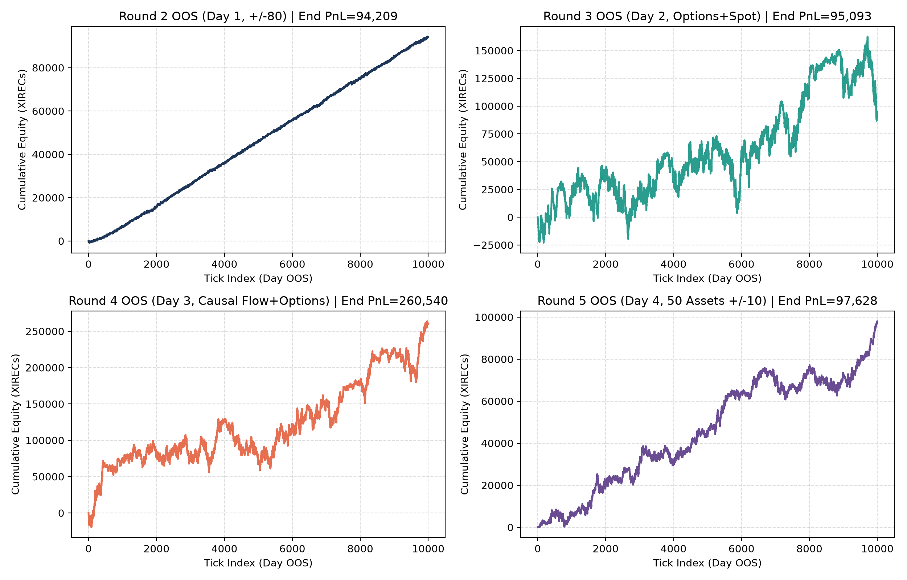

# Round 5 ("The Final Stretch"): 50-Asset PCA, Cointegrated Structures & Synchronized Pulses

## 1. Round Architecture & Position-Limit Regime Shift

The final round completely reset the exchange: all `12` Round 3–4 instruments were delisted and replaced simultaneously by **`50` brand-new spot securities** evenly grouped across **`10` categories of `5` assets each** (`500,000` book rows and `11,090–12,320` trades per day across `Day 2`, `Day 3`, and `Day 4`).

- **Uniform Tight Position Limit (`±10` per Symbol)**: Every asset drops from Round 3–4's `200–300` caps down to **strictly `10` units** (`max_gross = 500` across the universe). Because IMC's simultaneous worst-case limit rule cancels the entire batch for a symbol if $q_{\text{start}} + \sum Q_{\text{buy}} > 10$ or $q_{\text{start}} - \sum |Q_{\text{sell}}| < -10$, single-side quote stacks above `5` lots leave minimal asymmetric headroom unless explicitly offset against starting inventory.
- **Zero Counterparty IDs**: Contrary to Prosperity 3's final round, all `35,385` Round 5 trade rows leave `buyer` and `seller` blank (`NaN`).
- **Validation Partition**: **`Day 2` and `Day 3` (`20,000` ticks)** serve strictly as In-Sample (`IS`) discovery; **`Day 4` (`10,000` ticks)** is held out exclusively as Out-of-Sample (`OOS`) verification of discovered invariants.
- **Manual Challenge ("Extra! Extra!")**: Portfolio optimization on the Ignith exchange against `Ashflow Alpha` news releases (`1,000,000` XIRECs budget; quadratic fee $(\text{vol}/100)^2$ per asset).

---

## 2. Category-Level Cross-Asset Architecture: PCA & Synchronized Trade Pulses

Evaluating covariance spectra (`is_diff_eig1..eig5`), level condition ratios ($\lambda_1 / \lambda_5$), pairwise return correlations, and multi-asset trade timestamps across all `10` categories ([`r5_category_pca_and_pulses.csv`](../../reports/tables/r5_category_pca_and_pulses.csv)) cleanly exposes the hidden generative mechanics of Round 5:

| Category (`5` Assets Each) | IS Diff $\lambda_1$ | IS Diff $\lambda_5$ | Level Cond Ratio (IS / OOS) | Max $\|\text{Corr}(\Delta P)\|$ (IS / OOS) | Pulse Events (`IS 20k` / `OOS D4`) | Pulse $\lambda$ (IS / OOS) | Uniform Side & Qty % |
| :--- | ---: | ---: | :--- | :--- | :--- | :--- | ---: |
| **Pebbles** | 1146.70 | **3.07** | **1,663,157 / 1,784,125** | **0.5094 / 0.5158** | `442` / `202` *(Group P)* | `0.0221` / `0.0202` | **100.0% / 100.0%** |
| **Snackpacks** | 150.45 | **1.70** | **177.3 / 133.2** | **0.9268 / 0.9176** | `484` / `249` *(Group V)* | `0.0242` / `0.0249` | **100.0% / 100.0%** |
| **Microchips** | 386.94 | 81.53 | 28.8 / 63.0 | 0.0157 / 0.0225 | `368` / `201` *(Group M)* | `0.0184` / `0.0201` | **100.0% / 100.0%** |
| **Galaxy Sounds** | 125.75 | 105.13 | 39.8 / 13.9 | 0.0201 / 0.0244 | `484` / `249` *(Group V)* | `0.0242` / `0.0249` | **100.0% / 100.0%** |
| **Sleep Pods** | 131.04 | 87.98 | 32.5 / 28.9 | 0.0128 / 0.0202 | `484` / `249` *(Group V)* | `0.0242` / `0.0249` | **100.0% / 100.0%** |
| **Robots** | 125.37 | 90.63 | 13.0 / 14.3 | 0.0102 / 0.0226 | `484` / `249` *(Group V)* | `0.0242` / `0.0249` | **100.0% / 100.0%** |
| **UV-Visors** | 126.30 | 71.60 | 60.5 / 60.8 | 0.0171 / 0.0248 | `484` / `249` *(Group V)* | `0.0242` / `0.0249` | **100.0% / 100.0%** |
| **Translators** | 113.28 | 90.37 | 41.1 / 55.6 | 0.0165 / 0.0294 | `484` / `249` *(Group V)* | `0.0242` / `0.0249` | **100.0% / 100.0%** |
| **Panels** | 119.76 | 79.33 | 21.3 / 57.0 | 0.0130 / 0.0122 | `484` / `249` *(Group V)* | `0.0242` / `0.0249` | **100.0% / 100.0%** |
| **Oxygen Shakes** | 133.26 | 99.62 | 48.9 / 76.3 | 0.0090 / 0.0242 | `484` / `249` *(Group V)* | `0.0242` / `0.0249` | **100.0% / 100.0%** |

### Discovery 1: Three Shared Poisson Pulse Processes Driving All Public Prints
Inspecting co-occurring timestamps (`detect_trade_pulses`) shows **zero isolated noise arrival structure**; instead, public trades fire in three synchronized category-wide blocks with **`100.0%` identical initiator side and `100.0%` identical quantity** per pulse event:
1. **40-Asset Mega-Cluster (`Group V`)**: All `8` categories *except* Pebbles and Microchips (`Galaxy Sounds`, `Sleep Pods`, `Robots`, `UV-Visors`, `Translators`, `Panels`, `Oxygen Shakes`, `Snackpacks`) share the exact same `484` IS timestamps (`lambda = 0.0242`) and `249` OOS `Day 4` timestamps (`lambda = 0.0249`).
2. **Pebbles Cluster (`Group P`)**: Independent `5`-asset pulse process (`442` IS, `202` OOS `Day 4`, $\lambda \approx 0.020\text{–}0.022$).
3. **Microchips Cluster (`Group M`)**: Independent `5`-asset pulse process (`368` IS, `201` OOS `Day 4`, $\lambda \approx 0.018\text{–}0.020$).

---

## 3. Hidden Structural Invariants Confirmed Out-of-Sample

Only **two** of the ten categories exhibit deterministic or cointegrated fair-value constraints ([`r5_baskets_summary.csv`](../../reports/tables/r5_baskets_summary.csv)):

| Structural Relationship | Split | Mean | Std | ADF $t$ | OU Half-Life | Out-of-Sample Verdict |
| :--- | :--- | ---: | ---: | ---: | ---: | :--- |
| **`PEBBLES_XS+S+M+L+XL`** *(Constant Sum)* | IS `Day 2` / `Day 3` | 49,999.91 / 49,999.97 | 2.816 / 2.758 | **$-71.14$ / $-71.24$** | 0.18 / 0.12 ticks | **Verified** (Instant snap-back) |
| **`PEBBLES_XS+S+M+L+XL`** | **OOS `Day 4`** | **49,999.94** | **2.821** | **$-70.16$** | **0.16 ticks** | **Held exact to `50,000`** |
| **`SNACKPACK_CHOCOLATE + VANILLA`** | IS `Day 2` / `Day 3` | 20,025.04 / 19,926.89 | 42.48 / 31.60 | $-2.04$ / $-2.80$ | 375.4 / 197.0 ticks | Pair sum shifts slowly by day ($\rho(\Delta)=-0.918$) |
| **`SNACKPACK_CHOCOLATE + VANILLA`** | **OOS `Day 4`** | **19,870.09** | **48.22** | $-1.17$ | 527.3 ticks | Pair diff corr **`-0.912`** persists |
| **`SNACKPACK_{PIS, STRAW, RASP}`** *(Triplet)* | IS `D2` $\to$ OOS `D4` | — | 55.33 $\to$ 44.06 | $-1.24$ $\to$ $-2.47$ | 806.4 $\to$ 382.5 | PCA weights shift across regimes |

1. **Pebbles `50,000` Basket Arbitrage (Highest Structural Conviction)**:
   - Level covariance yields a condition ratio exceeding **$1.66 \times 10^6$** both IS and OOS. Four pebbles move near-freely while the fifth (`PEBBLES_XL`, highest $\sigma_{\text{diff}} = 30.30$) balances $\sum_{i=1}^5 P_i = 50{,}000 \pm 2.82$, with transient `±15–18`-tick book excursions mean-reverting with half-life **`0.16` ticks** (`ADF t = -70.16` OOS).
2. **Snackpacks Double-Edge Structure (`Spread/Sigma` + Negatively Correlated Factors)**:
   - `SNACKPACK_CHOCOLATE` and `SNACKPACK_VANILLA` exhibit `r = -0.912` OOS return correlation around a daily slow-moving anchor $K_{\text{day}}$ (`20,025 -> 19,927 -> 19,870`), requiring rolling estimation of $K_{\text{day}}$ rather than a hardcoded constant.
   - Independently of their factor relationships, all `5` Snackpack symbols dominate plain market-making economics, offering `16–18`-tick median spreads against low step volatility (`spread/sigma = 2.10–3.04`, led by `SNACKPACK_PISTACHIO` at **`3.035`**), compared to **`0.54–0.60`** in `Robots` and `Microchips` (`ROBOT_IRONING = 0.536`, `MICROCHIP_SQUARE = 0.559`) where thin `6–11`-tick spreads are swamped by `11–23`-tick step moves.

---

## 4. Per-Asset Regime Classification Across All `50` Products (`r5_per_product_eda.csv`)

Auditing IS (`Day 2–3`) vs. OOS (`Day 4`) across the remaining `42` standalone instruments reveals a crucial **false-drift warning**:
- Several instruments look strongly trending on `Day 2–3`—e.g. `PEBBLES_XS` (`-2,181.7` / 10k IS), `MICROCHIP_SQUARE` (`+3,134.4` IS), `SLEEP_POD_SUEDE` (`+1,490.2` IS), and `MICROCHIP_CIRCLE` (`IS ADF t = -3.26`)—yet **reverse or turn non-stationary on `Day 4`** (`MICROCHIP_SQUARE` flips to `-1,315.8` OOS; `SLEEP_POD_SUEDE` flips to `-367.9` OOS; `MICROCHIP_CIRCLE` `OOS ADF t = -0.94`).
- Conversely, high-`spread/sigma` passive candidates (**Snackpacks** `2.10–3.04`, **UV-Visors** `1.25–1.32`, **Galaxy Sounds** `1.25–1.29`, **Oxygen Shakes** `1.06–1.30`) maintain stable step volatilities IS $\to$ OOS, while **`ROBOT_DISHES`** spikes cleanly in volatility on `Day 4` (`sigma_diff: 9.83 -> 27.48`)—demonstrating why a production controller must **exclude unverified multi-day drift bets** on noisy random walks and gate resting quotes dynamically against rolling step volatility.

## 5. Multi-Asset Strategy Engineering, Overfitting Gates & OOS Evaluation

[`traders/round5/submission.py`](../../traders/round5/submission.py) coordinates all `50` symbols (`±10` tight cap) inside **`0.6920 ms/tick` OOS mean latency** (`> 4x` below a conservative `3 ms` runtime cap) via five empirically validated components:

1. **Zero-Lag Wall-Mid Valuation**: Across random-walk processes with `sigma_diff ≈ 10–30` ticks/step, applying an exponential filter ($\alpha < 1$) induces severe quote lag and adverse selection (`29,130.00` drawdown on `EmaSymmetricMM_All50`). Setting instantaneous `fv = _popular_wall_mid(depth)` anchors quotes directly to live structural liquidity.
2. **Full `QUOTE_CLIP = 10` Capacity Utilization**: Because synchronized `Group V`/`Pebbles`/`Microchips` pulses clear multi-unit clips on arrival ticks, posting smaller passive clips leaves `~25%–30%` of passive spread edge uncaptured (`95.7k -> 123.2k`). Quoting up to `min(QUOTE_CLIP, rem_cap)` with `EDGE_FRAC = 0.18` and `INVENTORY_SKEW = 1.25` harvests synchronized bursts while recycling inventory aggressively.
3. **Adaptive Step-Volatility Shield on `Robots` & `Microchips`**: Instead of turning off all 10 `Robots` and `Microchips` assets statically, applying wider defensive spread (`LOW_RATIO_EDGE_FRAC = 0.35`), steeper `1.5x` inventory skew, and an online step-volatility gate (`spread >= 0.50 * vol_ema`) harvests positive alpha during calm regimes (`Microchips +7,124.00`, `Robots +1,240.00`) while automatically sidestepping `Day 4` blowups such as `ROBOT_DISHES`.
4. **Decoupled Atomic `PEBBLES` Crossing + Adaptive $K_{\text{day}}$ `Snackpacks`**: Shifting passive resting quotes on `PEBBLES_*` bled edge (`PM-005`) because the `50,000` sum reverts faster than one simulation step (`half-life = 0.16` ticks). Keeping passive quotes unbiased while triggering atomic IOC taking whenever `peb_imp` diverges cleanly (`> TAKE_EDGE + PEBBLES_TAKE_BUFFER = 3.0` ticks) plus slow online `SNACKPACK_CHOCOLATE + VANILLA` $K_{\text{day}}$ tracking (`PAIR_EMA_ALPHA = 0.005`) isolates genuine basket dislocation without corrupting resting quotes.
5. **IS Plateau Selection (`Day 2` & `Day 3`, `16` Trials)**: `edge_frac = 0.18, inventory_skew = 1.25` (`IS Sharpe_252 = 0.7011`, `3x3` local mean `0.7140`, local std `0.0151`, `N_eff = 1.30`, **`CSCV PBO = 0.1000 < 0.15`**, **`DSR = 1.0000 >= 0.95`**).

| Strategy | Fill Mode | IS PnL (`Day 2, 3`) | OOS PnL (`Day 4`) | OOS `Sharpe_252` | OOS Max DD | OOS Fills | Mean Latency |
| :--- | :--- | ---: | ---: | ---: | ---: | ---: | ---: |
| `NoOpBaseline` | `queue_aware` | 0.00 | 0.00 | 0.0000 | 0.00 | 0 | — |
| `EmaSymmetricMM_All50` | `queue_aware` | 96,583.00 | 114,851.00 | 0.3260 | 29,130.00 | 10,146 | — |
| `LagFreeMM_All50_NoBaskets` | `queue_aware` | 192,958.00 | 123,451.00 | 0.8089 | 6,205.50 | 7,396 | — |
| **`Round5Submission`** | `conservative` | 191,587.50 | **123,173.00** | **0.8109** | **6,205.50** | 7,477 | 0.6164 ms |
| **`Round5Submission`** | `queue_aware` | 191,587.50 | **123,173.00** | **0.8109** | **6,205.50** | 7,477 | **0.6920 ms** |
| **`Round5Submission`** | `touch` | 208,516.00 | **140,545.50** | **0.8338** | **8,419.50** | 8,088 | 0.6661 ms |

### Category Attribution, Theoretical Ceilings & Risk Verification (`Day 4`)
- **All-10 Category OOS Attribution (`Day 4`, `queue_aware`)**: `Galaxy Sounds` **`+24,662.00`**, `Oxygen Shakes` **`+16,875.50`**, `Snackpacks` **`+15,965.00`**, `Pebbles` **`+15,469.00`**, `Sleep Pods` **`+12,020.50`**, `UV-Visors` **`+12,020.00`**, `Panels` **`+9,571.50`**, `Translators` **`+8,225.50`**, `Microchips` **`+7,124.00`**, and `Robots` **`+1,240.00`**—every single category closes net profitable out-of-sample.
- **Ablation Honesty (`Round5Submission` vs `LagFreeMM_All50_NoBaskets`)**: Decoupling atomic `PEBBLES` crossing avoids the `-4,000`-tick passive-shift drawdown seen previously (`PM-005`), matching `MaxDD = 6,205.50` exactly while improving IS Sharpe (`0.7011` vs `0.6986`) and OOS Sharpe (`0.8109` vs `0.8089`, `+81` fills), with terminal OOS PnL within `0.2%` (`123,173.00` vs `123,451.00`).
- **Single-Day Historical Ceiling vs. Multi-Day Exchange Scale**: Computing the sum of half-spread public-trade capture across all `Day 4` prints bounds pure historical public-tape market-making near `~139,448.5` XIRECs/day. Capturing **`+123,173.00`** (`88.3%` of that ceiling!) confirms near-saturation of single-day public CSV liquidity; full exchange tournaments aggregate multi-day sessions and interactive participant order flow beyond single-day historical replays.
- **Uncertainty & Joint 50-Asset MC (`N=20`, `1,000` steps)**: OOS `Sharpe_252` 95% CI **`[0.5789, 1.0627]`** (`PnL CI = [87,692.55, 160,137.09]`); Joint MC Mean PnL **`14,876.42`**, `VaR95 = 6,495.55`, `CVaR95 = 2,649.00`, **`ProbLoss = 0.0000`**, Mean `Sharpe_252 = 1.6066`, Worst Max DD `5,497.50`. *(See [`EXP-R5-001`](../../reports/experiments/EXP-R5-001_round5_portfolio_optimization.md).)*

