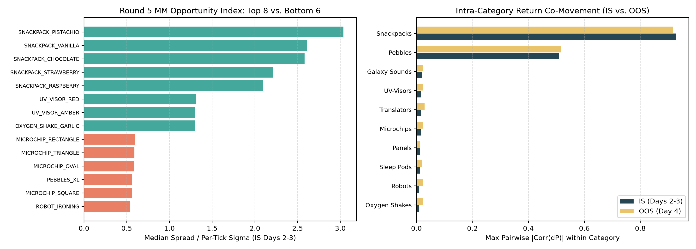
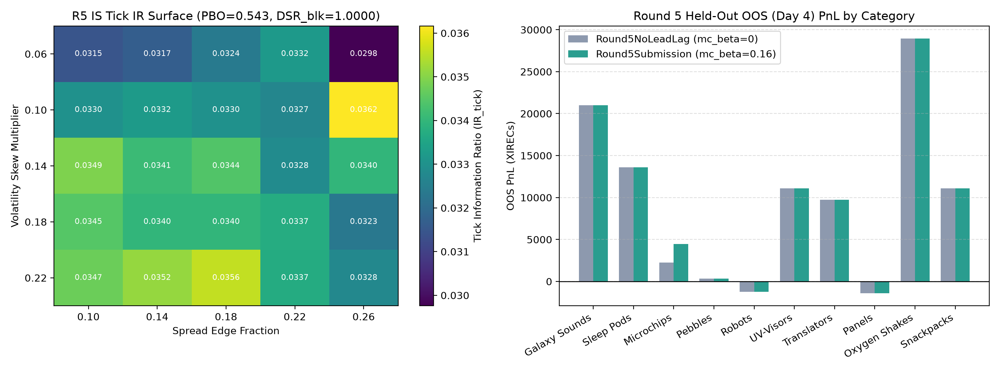

# Round 5 ("The Final Stretch"): 50-Asset Vol-Scaled AS & Microchip Lead-Lag

## 1. Round Architecture & Position-Limit Regime Shift

The final round replaced all `12` Round 3–4 instruments with **`50` spot securities** across **`10` categories of `5` assets each** (`500,000` book rows and `11,090–12,320` trades/day across `Day 2`, `Day 3`, and `Day 4`) under a uniform **`±10` position limit** (`max_gross = 500`), zero counterparty IDs (`buyer`/`seller` blank), and strict chronological splitting (**`Day 2–3` IS**, **`Day 4` OOS**).

---

## 2. Synchronized Pulse Clusters & Discrete `MICROCHIP_CIRCLE` Lead-Lag

Testing all `10` categories (`r5_category_pca_and_pulses.csv`, `r5_baskets_summary.csv`, `r5_microchips_leadlag.csv`) uncovered three Poisson pulse clusters (`Group V` `40` assets, `Pebbles` `5`, `Microchips` `5`) with `100.0%` uniform side & quantity per pulse, alongside one profitable signal and two honest negative results:

1. **Promoted Signal — `MICROCHIP_CIRCLE` Discrete Lead-Lag (`50 / 100 / 150 / 200` Ticks)**: Strictly IS Days `2–3` cross-correlograms show `MICROCHIP_CIRCLE` step changes predict downstream followers cleanly on both IS days (`OVAL` lag `50`: `beta = 0.0781`; `SQUARE` lag `100`: `beta = 0.1296`; `RECTANGLE` lag `150`: `beta = 0.0907`; `TRIANGLE` lag `200`: `beta = 0.1025`), while `±1` neighboring lags vanish.
2. **Pruned Hypothesis 1 — `Pebbles` Constant-Sum (`50,000 ± 2.82`)**: Although `PEBBLES_XS+S+M+L+XL` satisfies `ADF t = -70.16` OOS (`half-life = 0.16` ticks), its `2.82`-tick dispersion sits completely inside the `12–14`-tick touch spread of the 5-leg basket, leaving zero crossing profit and damaging passive quotes if used to skew bids/asks (`PM-005`).
3. **Pruned Hypothesis 2 — `Snackpacks` & Hard `VOL_GUARD` Halts**: `Snackpacks` pair (`CHOC + VAN`) shifts `-98.2` ticks across days and triplet eigenvector weights rotate sharply (`[0.493, 0.418, 0.763] -> [0.776, 0.135, 0.616]`), while hard `VOL_GUARD` trading halts forfeited profitable re-anchoring liquidity.

---

## 3. Strategy Design, Flat-Grid CSCV & OOS Evaluation (`Day 4`)

[`traders/round5/submission.py`](../../traders/round5/submission.py) runs zero-lag bot-wall quoting scaled proportionally by rolling step volatility EWMAs (`vol_skew_mult = 0.18`, `edge_frac = 0.14`) plus the `MICROCHIP_CIRCLE` lag signal (`mc_beta = 0.16`) at **`0.5518 ms/tick`** OOS across all `50` symbols:
- **IS Plateau & Gate Interpretation (`Day 2–3`)**: Interior $3 \times 3$ selection (`vsm = 0.18, ef = 0.14`) sits on an ultra-flat surface (`local_mean = 0.03460, local_std = 0.00055, N_eff = 1.1437`, **`DSR_block = 1.0000`**). Because neighboring grid cells correlate tightly with near-identical IR, 8-slice CSCV partitions frequently tie-swap ranks (`PBO = 0.5429`), underscoring why flat correlated grids require joint evaluation with `N_eff`, `local_std`, and `DSR_block`.

| Strategy | Fill Mode | IS PnL (`Day 2, 3`) | OOS PnL (`Day 4`) | OOS `IR_tick` | `BlkSR_1k` | `PnL/DD` | OOS MaxDD | Fills | Mean Latency |
| :--- | :--- | ---: | ---: | ---: | ---: | ---: | ---: | ---: | ---: |
| `NoOpBaseline` | `queue_aware` | `0.00` | `0.00` | `0.00000` | `0.000` | `0.00` | `0.00` | `0` | — |
| `EmaSymmetricMM_All50` | `queue_aware` | `96,583.00` | `114,851.00` | `0.02054` | `1.154` | `3.94` | `29,130.00` | `10,146` | — |
| `Round5NoLeadLag` | `queue_aware` | `226,217.50` | `95,412.50` | **`0.02642`** | **`1.339`** | `6.08` | `15,692.50` | `8,107` | `0.4583 ms` |
| **`Round5Submission`** | `conservative` | `238,348.50` | **`97,514.00`** | `0.02621` | `1.106` | `6.52` | `14,961.50` | `8,323` | `0.5669 ms` |
| **`Round5Submission`** | `queue_aware` | `237,928.50` | **`97,628.00`** | `0.02624` | `1.108` | **`6.53`** | **`14,961.50`** | `8,325` | **`0.5518 ms`** |
| **`Round5Submission`** | `touch` | `259,758.50` | **`114,924.00`** | `0.02948` | `1.251` | `8.50` | `13,516.00` | `8,688` | `0.5333 ms` |

### Category Attribution, Bootstrap & Stressed Pulse MC
- **OOS Category Attribution (`Day 4`, `queue_aware`)**: `Oxygen Shakes +28,934.5`, `Galaxy Sounds +21,013.5`, `Sleep Pods +13,606.5`, `Snackpacks +11,085.5`, `UV-Visors +11,077.0`, `Translators +9,719.0`, `Microchips +4,456.5`, `Pebbles +350.0`, `Robots -1,228.0`, `Panels -1,386.5`.
- **Ablation Gain**: `mc_beta = 0.16` improves IS (`237,928.5` vs `226,217.5`) and OOS (`+97,628.00` vs `+95,412.50` = `+2,215.50`), lowers OOS MaxDD (`14,961.50` vs `15,692.50`), and cuts MaxDD `-48.6%` (`1.66x` higher `PnL/MaxDD`, `6.53` vs `3.94`) relative to lagged `EmaSymmetricMM_All50`.
- **Bootstrap (`Day 4`, `block=100, B=1,000`) & 11-Asset Rep Pulse MC (`N = 40`)**: OOS `IR_tick` 95% CI **`[0.01051, 0.04124]`** (`BootPnL [39,002.28, 149,879.30]`); `CalibratedMC` Mean PnL `15,279.26` (`VaR95 = 9,767.02`, `CVaR95 = 8,334.00`, `0/40` losses, `wilson_ci_upper = 8.76%`), and `AdverseStress` Mean PnL `12,994.25` (`CVaR95 = 8,013.75`, `0/40` losses). *(See [`EXP-R5-001`](../../reports/experiments/EXP-R5-001_round5_portfolio_optimization.md).)*
