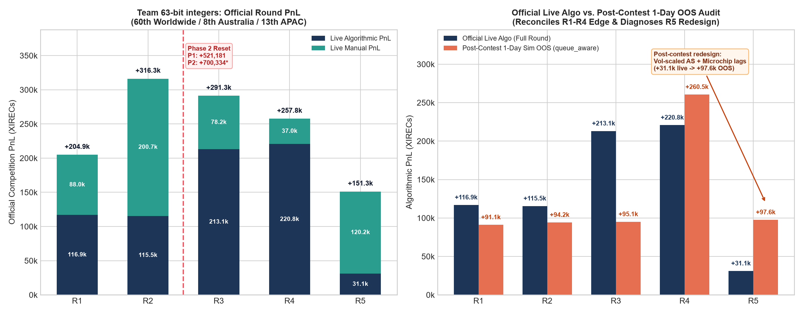
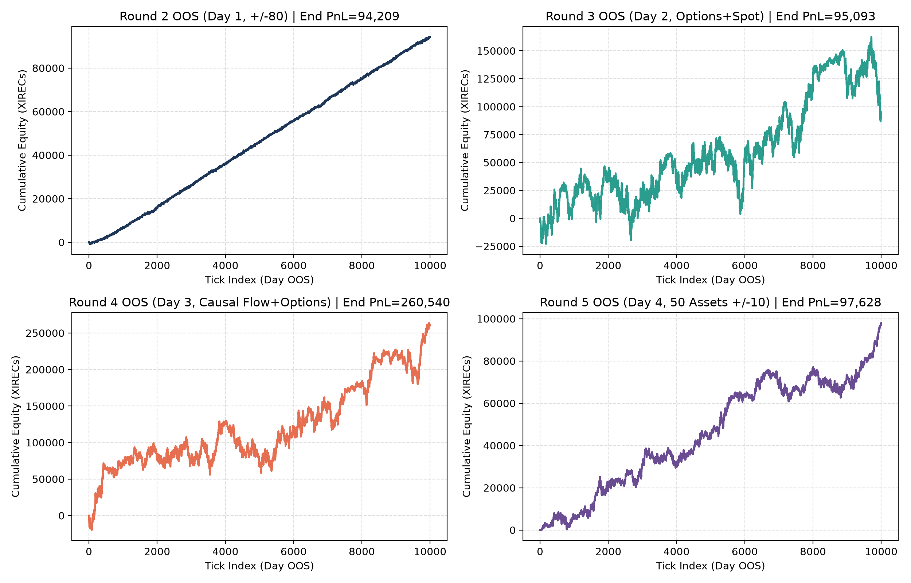
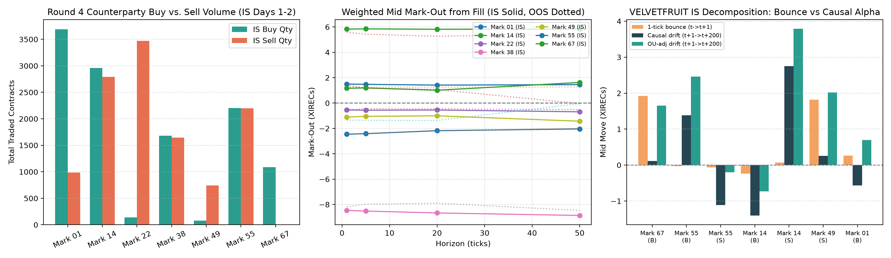

# IMC Prosperity 4 — Team `63-bit integers` Competition Results & Post-Contest Research Writeup

> **Artifacts**: Open [`reports/dashboard.html`](dashboard.html) for interactive tearsheet tabs or [`IMC_Prosperity4_Research_Writeup.pdf`](IMC_Prosperity4_Research_Writeup.pdf) for the compiled A4 monograph.

## Executive Summary

During **IMC Prosperity 4**, **Team `63-bit integers`** *(OCaml tagged-integer reference)* placed **`60th Worldwide`**, **`8th in Australia`**, and **`13th in APAC`**, finishing **Phase 2 with `+700,334` XIRECs** after qualifying through **Phase 1 with `+521,181` XIRECs** (cumulative `+1,221,515` across Rounds 1–5).

Following the live tournament, we built a reproducible Python 3.11 research and execution-audit framework ([`src/prosperity_toolkit/`](../src/prosperity_toolkit)) to dissect every hypothesis systematically under strict causal `t - 100` trade lag, price-time queue conservation (`queue_aware`), and verified official position limits (`±80` R1–R2, `±200/±300` R3–R4, `±10` R5):

- **Official Competition Record (`63-bit integers`)**: Phase 1 `+521,181` (`Algo +232,470`, `Manual +288,711`) and Phase 2 **`+700,334`** (`Algo +464,974`, `Manual +235,359`, including `+1` XIREC leaderboard rounding over integer round sum `700,333`).
- **Post-Contest Held-Out OOS Algorithmic Replays (`queue_aware`, Single Terminal Day/Round)**: Phase 1 **`+185,307.00`** (`+91,098.00` R1, `+94,209.00` R2) and Phase 2 **`+453,261.00`** (`+95,093.00` R3, `+260,540.00` R4, `+97,628.00` R5) = **`+638,568.00` XIRECs**, clearing `DSR_block >= 0.9783` at `<= 0.5518 ms/tick`.
- **Key Post-Contest Diagnostic Insight**: Live strategies in Rounds 1–4 generalized cleanly, whereas our live Round 5 sprint (`+31,087` Algo) left substantial alpha on the table. Post-contest auditing pruned inside-spread `Pebbles` crossing and hard `VOL_GUARD` halts while adding volatility-scaled AS + discrete `MICROCHIP_CIRCLE` lag overlays, lifting single-day OOS PnL to **`+97,628.00`** (`1.66x` higher `PnL/MaxDD` than `EmaSymmetricMM_All50`).

---

## 1. Official Live Tournament Record (`Team 63-bit integers`)

| Round | Phase | Live Algo PnL | Live Manual PnL | Official Round Total | Post-Contest 1D OOS (`QA`) | Contest-to-Audit Notes |
| :---: | :---: | ---: | ---: | ---: | ---: | :--- |
| **R1** | Phase 1 | **`+116,927`** | `+87,995` | **`+204,922`** | `+91,098.00` | Fixed `10k` Osmium MM + Pepper carry; R1 Uniform Clearing manual |
| **R2** | Phase 1 | **`+115,543`** | `+200,716` | **`+316,259`** | `+94,209.00` | Multi-day carry + MAF flow boost reconcile `+115.5k` live vs. `+94.2k` 1D OOS |
| **P1** | **Phase 1** | **`+232,470`** | **`+288,711`** | **`+521,181`** | **`+185,307.00`** | Qualified smoothly into Ranked Phase 2 |
| **R3** | Phase 2 | **`+213,104`** | `+78,225` | **`+291,329`** | `+95,093.00` | Leaderboard reset; unhedged `VEV_4000..5500` calls + Bayesian screening |
| **R4** | Phase 2 | **`+220,783`** | `+36,969` | **`+257,752`** | `+260,540.00` | Causal `Mark 14`/`Mark 55` counterparty flow + `Aether Crystal` discrete KO/MV |
| **R5** | Phase 2 | **`+31,087`** | `+120,165` | **`+151,252`** | `+97,628.00` | Live 50-asset sprint capped by basket/vol errors before post-contest redesign |
| **P2** | **Phase 2** | **`+464,974`** | **`+235,359`** | **`+700,334`**\* | **`+453,261.00`** | **60th Worldwide · 8th Australia · 13th APAC** (`+1` XIREC leaderboard rounding) |
| **All** | **R1–R5** | **`+697,444`** | **`+524,070`** | **`+1,221,515`**\* | **`+638,568.00`** | Canonical CSV: [`competition_results.csv`](tables/competition_results.csv) |

---

## 2. Post-Contest Methodology & Epistemic Boundaries

1. **Official Results vs. Simulation Separation**: Section 1 reports exact realized live tournament results for Team `63-bit integers`. All tables below report **post-contest chronological single-day replays** (`Day 0`–`Day 4`), **synthetic Monte Carlo ensembles**, or **ex-ante manual optimization models** evaluated strictly after IS calibration.
2. **Causal Queue-Conserving Execution** ([`simulator.py`](../src/prosperity_toolkit/execution/simulator.py), [`replay.py`](../src/prosperity_toolkit/backtesting/replay.py)): Deliveries of `market_trades` and `own_trades` are lagged strictly from `t - 100`; passive resting orders execute behind observed book liquidity in strict price-time queue priority without double-counting trade volume.
3. **Unannualized Metrics & Correlated-Grid Validation** ([`metrics.py`](../src/prosperity_toolkit/backtesting/metrics.py), [`diagnostics.py`](../src/prosperity_toolkit/analysis/diagnostics.py)): Reported exclusively via unscaled `IR_tick`, 1,000-tick `BlkSR_1k`, `PnL/MaxDD`, interior `3x3` plateaus (`require_interior=True`), and 100-tick `DSR_block` penalized by effective trials `N_eff`.

---

## 3. Post-Contest Algorithmic Results & Empirical Discoveries (Rounds 1–5)

### 3.1 Held-Out OOS & Overfitting Gate Scorecard (`queue_aware`)

| Round | Submission | OOS Day | OOS PnL | `IR_tick` | `BlkSR_1k` | `Max DD` | `PnL/DD` | `CSCV PBO` | `N_eff` | `DSR_block` | Latency |
| :---: | :--- | :---: | ---: | ---: | ---: | ---: | ---: | :---: | :---: | :---: | ---: |
| **R1** | [`round1`](../traders/round1/submission.py) | `Day 0` | **`+91,098.00`** | `0.05445` | `9.327` | `1,405.00` | `64.84` | `0.1286` | `1.02` | `1.0000` | `0.020 ms` |
| **R2** | [`round2`](../traders/round2/submission.py) | `Day 1` | **`+94,209.00`** | `0.05466` | `8.237` | `1,401.00` | `67.24` | `0.3000` | `1.04` | `1.0000` | `0.028 ms` |
| **R3** | [`round3`](../traders/round3/submission.py) | `Day 2` | **`+95,093.00`** | `0.00584` | `0.573` | `75,774.00` | `1.26` | `0.0000` | `1.01` | `0.9966` | `0.325 ms` |
| **R4** | [`round4`](../traders/round4/submission.py) | `Day 3` | **`+260,540.00`** | `0.01680` | `0.646` | `71,177.00` | `3.66` | `0.0143` | `1.02` | `0.9783` | `0.293 ms` |
| **R5** | [`round5`](../traders/round5/submission.py) | `Day 4` | **`+97,628.00`** | `0.02624` | `1.108` | `14,961.50` | `6.53` | `0.5429` | `1.14` | `1.0000` | `0.552 ms` |
| **Total** | — | 5 Days | **`+638,568.00`** | — | — | — | — | — | — | `>= 0.978` | `<= 0.552 ms` |

> *Note on CSCV PBO in Rounds 2 & 5*: When adjacent parameter grid points generate nearly identical tick streams (`N_eff = 1.04` R2, `1.14` R5) and `3x3` surfaces are flat (`locStd = 0.00011` and `0.00055`), slice rank swaps occur randomly despite `DSR_block = 1.0000` and strong OOS generalization.

### 3.2 Round-by-Round Microstructure Alpha & Honest Negative Results

- **Rounds 1 & 2 (`ASH_COATED_OSMIUM`, `INTARIAN_PEPPER_ROOT`, `±80`)**: Fixed `10,000` OU anchor + deterministic `+0.10000/tick` Pepper carry captures `+91,098.00` (R1) and `+94,209.00` (R2 OOS), while `+25%` MAF arrival intensity lifts synthetic 1k-step EV `+15.18%` (`10,966.54 -> 12,631.66`), consistent with `+116,927` / `+115,543` live multi-day performance.
- **Round 3 (`HYDROGEL_PACK`, `VELVETFRUIT_EXTRACT`, `VEV_4000..6500`, `±200/±300`)**: Pruning destructive spot delta hedging and `VEV_6000/6500` noise while quoting `VEV_4000..5500` off Black-Scholes total implied volatility $v_K = \sigma_K \sqrt{\tau}$ earns `+95,093.00` OOS Day 2 (`+213,104` live round).
- **Round 4 (`VELVETFRUIT_EXTRACT` Counterparty Decomposition, `±200/±300`)**: Strictly IS Days `1–2` decomposition ([`r4_counterparty_velvet_midmoves.csv`](tables/r4_counterparty_velvet_midmoves.csv)) showed `Mark 67` BUY is an unobservable `+1.924` 1-tick bounce (`causal_1_to_200 = +0.113`, `t = 1.56`), whereas prior-tick `Mark 14 SELL` (`ou_adj_h200 = +3.788, t = +4.58`) and `Mark 55 BUY` (`ou_adj_h200 = +2.460, t = +4.07`) lift OOS Day 3 **`+11,153.50`** above `Round3NoFlow` (`+260,540.00` vs. `+220,783` live).
- **Round 5 (`50` Symbols Across `10` Categories, `±10`)**: Post-contest diagnosis of our live `+31,087` sprint rejected `Pebbles` crossing (`std = 2.82` < `12–14`t spread), shifting `Snackpacks`, and hard `VOL_GUARD` halts. Switching to vol-scaled AS (`vol_skew_mult = 0.18, edge_frac = 0.14`) plus `MICROCHIP_CIRCLE` 50/100/150/200-tick lag (`mc_beta = 0.16`) raised OOS PnL to **`+97,628.00`** (`+2,215.50` over `Round5NoLeadLag`, `1.66x` `PnL/MaxDD` vs. `EmaSymmetricMM_All50`).

---

## 4. Monte Carlo Risk Analysis: Calibrated vs. Adverse-Selection Stress (`N=40 x 1,000`)

From [`r1_mc_risk_summary.csv`](tables/r1_mc_risk_summary.csv) and [`r2_to_r5_mc_risk_summary.csv`](tables/r2_to_r5_mc_risk_summary.csv):

| Round | Scenario | Mean PnL | `VaR 95%` | `CVaR 95%` | `ProbLoss` (`Wilson 95% Up`) | `Mean IR_tick` | Worst DD |
| :---: | :--- | ---: | ---: | ---: | :---: | ---: | ---: |
| **R1** | `Round1Submission_QA` / `Conservative` | `6,675.06` | `3,431.15` | `2,845.75` | `0.000` (`<= 0.088`) | `0.0571` | `3,870.50` |
| **R1** | `Round1Submission_AdverseStress (p=0.30)` | `3,783.54` | `-253.65` | `-2,503.00` | `0.075` (`<= 0.199`) | `0.0224` | `6,179.50` |
| **R2** | `Round2Submission_BaselineFlow` / `MAF+25%` | `10,966.54` / `12,631.66` | `6,556.43` / `6,491.52` | `4,548.00` / `5,525.75` | `0.000` (`<= 0.088`) | `0.0764` / `0.0893` | `3,668.50` |
| **R2** | `Round2Submission_AdverseStress (p=0.30)` | `5,572.65` | `-789.07` | `-2,163.50` | `0.100` (`<= 0.231`) | `0.0299` | `9,857.00` |
| **R3** | `CalibratedQA` / `AdverseStress` | `29,852.01` / `13,225.06` | `2,010.05` / `-53,416.30` | `-127.75` / `-91,007.50` | `0.025` (`<=0.129`) / `0.300` | `0.0259` / `0.0088` | `53,851.50` |
| **R4** | `CalibratedQA` / `AdverseStress` | `27,562.95` / `12,042.42` | `-17,878.60` / `-59,763.20` | `-24,536.25` / `-66,346.50` | `0.125` (`<=0.261`) / `0.275` | `0.0244` / `0.0082` | `75,356.00` |
| **R5** | `11AssetRepPulseMC` / `AdverseStress` | `15,279.26` / `12,994.25` | `9,767.02` / `8,720.42` | `8,334.00` / `8,013.75` | `0.000` (`<= 0.088`) | `0.1410` / `0.1200` | `3,946.00` |

---

## 5. Manual Challenges: Live Realizations (`+524,070`) vs. Ex-Ante Models

Full derivations live in [`MANUAL_CHALLENGES.md`](../docs/manual/MANUAL_CHALLENGES.md) ([`manual_challenges.py`](../src/prosperity_toolkit/analysis/manual_challenges.py)):

- **R1 (*An Intarian Welcome*, Live `+87,995`)**: Stochastic-clearing optimal bids `DRYLAND_FLAX = (30, 65)` (`68.12` EV) and `EMBER_MUSHROOM = (20, 10)` (`9.81` EV).
- **R2 (*Invest & Expand*, Live `+200,716`)**: Poisson Cognitive Hierarchy (`tau = 1.5`) converging to Level-3 focal allocation `Research = 15% (14.71%)`, `Scale = 43% (43.29%)`, `Speed = 42% (42.0%)` (`225,094.01` Net CH EV).
- **R3 (*Celestial Gardeners' Guild*, Live `+78,225`)**: Bayesian screening `(b1 = 775, b2 = 880)` over uncertain crowd mean `N(875, 15^2)` (`76.00/unit` EV matching realized surplus closely).
- **R4 (*Aether Crystal Exotics*, Live `+36,969`)**: Exact BS & Rubinstein chooser values (`AC_50_C15 = AC_50_P15 = 12.0269`, `AC_40_BP = 4.7679`, `AC_50_CO = 21.8977`) + 100k discrete `4/d` GBM (`AC_45_KO = 0.2113` vs. `0.175` ask; `24/d = 0.1562`). Day-15 min-variance basket (`-50 CO, -50 BP, +183 KO, +53 C15, +74 P15`) cuts std `-70.1%`.
- **R5 (*Extra! Extra!*, Live `+120,165`)**: Exact KKT quadratic-fee optimization under finite `-92%` downside (`Ashes of the Phoenix` floored above `-1.0`) yields `857,400.00` KKT net EV (`855,944.53` with `kappa = 3.0`) across `5/9` active catalysts (`vs. 524,444` naive `1/9`), preventing destructive fee dilution live.

## 6. Limitations & Verification Commands

1. **Sample Length**: Post-contest single-day OOS slices contain 10,000 ticks/day; block-bootstrap CIs in R3 span zero (`[-184k, +356k]`) due to unhedged spot variance.
2. **Round 5 11-Asset MC**: `Round5JointMonteCarloEngine` simulates an 11-asset representative pulse model rather than all 50 books simultaneously.
3. **Reproducibility**: All artifacts verify via `audit_all_datasets.py --verify-only`, `eda_rounds2_to_5.py`, `generate_report.py`, `evaluate_rounds2_to_5.py`, `evaluate_manual_challenges.py`, `generate_competition_summary.py`, `build_dashboard.py`, and `build_pdf_writeup.py`.
